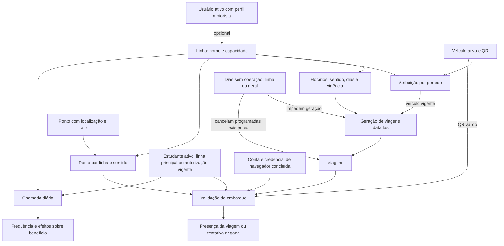

# UNIBUS — Proposta de fluxo guiado de configuração do transporte

**Data:** 06/11/2026. **Situação:** proposta de referência. O fluxo de seis etapas foi aprovado para um MVP com os endpoints atuais, mantendo a alternativa B como evolução futura. A entrega e seus limites estão em [Gestão Guiada — MVP](GESTAO_GUIADA_TRANSPORTE_MVP.md). As decisões de negócio ainda abertas não foram presumidas como aprovadas.

## 1. Objetivo, escopo e método

Permitir que um servidor prepare e acompanhe o atendimento de uma linha a partir de uma única tarefa: **Configurar transporte**. O sistema deve conduzir as escolhas, reaproveitar cadastros e explicar pendências sem exigir que o usuário conheça associações, chaves internas ou a ordem dos módulos.

Esta proposta resulta da leitura dos dois documentos de referência e do código local dos repositórios frontend e backend. É análise estática: não foram consultados banco, `.env`, credenciais ou dados pessoais, nem executados testes, migrations, seeders ou operações HTTP. Os resultados históricos de testes dos documentos não foram reproduzidos. A proposta não certifica operação em produção.

Referências de contexto:

- [Documentação técnica e funcional](UNIBUS_DOCUMENTACAO_COMPLETA.md), especialmente seções 5–9 e inventários 12–16.
- [Auditoria e plano de evolução](UNIBUS_AUDITORIA_E_PLANO_DE_EVOLUCAO.md), especialmente P01, P02, P05, P10 e P11.

Convenções usadas neste documento:

| Marcação | Significado |
| --- | --- |
| **Atual** | Comportamento encontrado no código local; não implica homologação |
| **Proposta de UX** | Organização e linguagem recomendadas, sujeitas a discussão |
| **Evolução de API** | Capacidade necessária que não existe no contrato atual |
| **Decisão SEDUC** | Regra ou escolha operacional que não pode ser decidida pela interface |

“Operação configurada” será uma visão que reúne entidades existentes, e não sinônimo de uma nova linha, viagem ou frequência. Não há hoje uma entidade de configuração com rascunho, aprovação e publicação. Os estados propostos adiante não devem ser enviados aos endpoints existentes.

## 2. Diagnóstico da operação atual

### 2.1 O problema para quem opera

O cadastro da linha fica em `/linhas`; sua programação e estrutura ficam em `/transportes`, atualmente dividida em Estrutura, Operação, Embarque, Conferência e Administração. A pessoa precisa transformar mentalmente uma tarefa concreta — “preparar a linha para a próxima semana” — em diversos cadastros separados.

O agrupamento atual já melhora a localização dos módulos, mas não conduz o processo. A troca de seção remonta `TransporteResourcePanel`, e a seleção de grupo/seção está em estado React local. Não existe uma ficha que diga, em conjunto, quais horários, veículos e pontos tornam aquela linha utilizável em determinado período.

As seleções por nome, campos globais, tratamento de 422/409 e permissões já são uma base aproveitável. O problema central é a coordenação da tarefa, não a ausência de todo o cadastro necessário.

### 2.2 O que o código exige distinguir

| Conceito atual | Consequência para a proposta |
| --- | --- |
| Linha tem capacidade e um `motorista_id` opcional | Motorista pertence à linha; não existe escala por viagem ou por sentido |
| Veículo tem identificação, placa opcional, ativo e QR | Não possui capacidade de passageiros nem vínculo direto com motorista |
| Atribuição define veículo por linha e intervalo de datas | Não é uma reserva de veículo por horário; pode haver atribuições sobrepostas |
| Horário é recorrente; viagem é uma ocorrência datada | Não pedir cadastro manual de cada viagem; gerar a partir da programação |
| `horarios_viagem` é a fonte da programação | `departure_time`/`return_time` da linha são compatibilidade, não outro calendário independente |
| Ponto pertence à linha e ao sentido por `linha_ponto` | Não há vínculo de estudante com ponto nem passagem específica por horário recorrente |
| Presença de QR e frequência da chamada são entidades distintas | Configurar QR não substitui chamada, justificativas ou regras do benefício |
| Não existe “publicar linha” ou estado ativo da linha neste contrato | Concluir o assistente não pode fingir uma ativação operacional já implementada |

### 2.3 Efeitos imediatos e limites relevantes

1. Criar linha com horários legados cria horários recorrentes ativos com dias padrão. Para uma linha nova no assistente, recomenda-se omitir esses campos e tratar a programação numa etapa própria. Em linha existente, carregar os horários antes de propor qualquer inclusão.
2. Criar horário via `ProgramacaoService` tenta gerar viagens de **hoje**; editar horário descarta futuras regeneráveis e também tenta gerar hoje. Os serviços não regeneram automaticamente todo o período futuro antes selecionado pelo gestor.
3. Criar, editar ou remover atribuição sincroniza o veículo de viagens programadas cuja janela ainda não terminou e que não tiveram veículo substituído manualmente. Inativar veículo também dispara sincronização.
4. Atribuir veículo e gerar viagens podem gravar dados e depois devolver conflitos. Isso não equivale a rejeitar a operação inteira. Na criação de atribuição, os conflitos retornados abrangem hoje até hoje + 31 dias; na geração, abrangem o período pedido, inclusive outras linhas.
5. Sem atribuição válida, a geração ainda pode criar viagem com `veiculo_id = null`. Portanto, “viagem gerada” não significa “embarque por QR preparado”.
6. Adicionar dia sem operação cancela viagens programadas alcançadas. Remover o registro não reativa as canceladas. Não existe feriado automaticamente importado de um calendário externo no fluxo analisado.
7. Ponto compartilhado tem coordenadas, raio e situação globais. Editá-lo pode alterar o embarque de outras linhas imediatamente; não existe vigência desse vínculo na modelagem atual.
8. Não há transação única entre as várias chamadas do assistente, nem simulação sem escrita, rascunho de configuração ou chave geral de idempotência. Alguns serviços gravam antes de executar outros passos e capturam exceções: uma falha HTTP não prova que nada foi persistido.

Esses fatos detalham duas formulações gerais dos documentos anteriores: “validar conflitos” nem sempre significa bloquear a gravação, e “refazer futuras” não significa preencher novamente todo o horizonte. O assistente precisa comunicar essas diferenças.

## 3. Mapa das dependências reais

### 3.1 Relações funcionais



O desenho representa dependências funcionais, não chaves estrangeiras completas. Não há ligação automática proposta entre presença e frequência. Motorista, estudantes e pontos não são pré-condições de banco para gerar viagens; têm funções operacionais e de autorização diferentes.

### 3.2 Sequência de gravação com os contratos atuais

| Ordem | Operação | Pré-condição e observação |
| --- | --- | --- |
| 1 | Selecionar linha ou criar com nome e capacidade | Motorista é opcional; omitir horários legados ao criar pelo novo fluxo |
| 2 | Selecionar veículo existente ou cadastrá-lo | Cadastro novo entrega QR somente nessa resposta; preservar oportunidade de baixar/imprimir |
| 3 | Selecionar motorista ativo e vincular à linha, quando aplicável | Seleção usa endpoint específico; criar usuário exige autorização adicional |
| 4 | Consultar e reaproveitar atribuições; criar apenas a necessária | Linha e veículo já existem; conferir início/fim e precedência |
| 5 | Selecionar/criar pontos e vinculá-los por sentido | Pode ocorrer antes dos horários; recomenda-se fazê-lo antes de gerar/usar viagens |
| 6 | Conferir dias sem operação globais e da linha | Novos registros têm consequência imediata; nunca salvar ausência de linha por engano |
| 7 | Reaproveitar ou criar/ajustar horários recorrentes | Salvar pode gerar hoje e afetar viagens futuras; revalidar a estrutura anterior |
| 8 | Gerar viagens no intervalo escolhido | Diferença entre datas de até 62 dias; respeita dias, vigência e suspensões |
| 9 | Consultar viagens, resolver conflitos e conferir cobertura | Tratar viagens sem veículo, cancelamentos e ajustes protegidos; percorrer toda a paginação |
| 10 | Exibir resultado e pendências de atendimento | Elegibilidade, conta e dispositivo de cada estudante não são resolvidos pelo cadastro da linha |

Essa é uma ordem recomendada para reduzir efeitos incompletos, e não uma transação já disponível. A ordem visual pode ser mais natural: horários são informados antes dos pontos, mas permanecem no rascunho até a aplicação. Com API atual, cada gravação real deve ser identificada como tal.

### 3.3 O que significa estar preparada

Propor duas verificações separadas:

- **Programação conferida para o período:** horários correspondem ao atendimento pretendido; datas previstas têm viagens ou suspensão/cancelamento explicado; viagens programadas têm veículo ativo e não há conflitos conhecidos. A ausência de motorista é pendência a classificar pela SEDUC, pois o backend aceita `null`.
- **Estrutura do QR conferida:** além da programação, cada sentido usado tem ponto ativo e janelas compatíveis, e há QR gerado para o veículo. Isso não comprova adesivo afixado, GPS em campo nem elegibilidade/credencial de todos os estudantes.

Não chamar essas verificações de garantia de embarque ou homologação. Definir se ida e volta são obrigatórias é decisão da SEDUC; a API suporta horários separados e não obriga o par.

## 4. Alternativas e recomendação de navegação

| Alternativa | Benefício | Limite |
| --- | --- | --- |
| A. Assistente que salva cada passo nos CRUDs atuais | Menor mudança de API; elimina troca manual de abas | Não assegura rascunho isolado, conclusão atômica ou recuperação robusta após falha |
| B. Fluxo por linha com rascunho persistido e aplicação coordenada | Mantém contexto, permite retomar e concentra validação antes de alterar operação | Exige evolução de backend e tratamento dos efeitos atuais de programação |
| C. Uma ficha longa por linha, com todas as seções abertas | Boa para manutenção por especialistas | Conserva carga cognitiva alta para primeira configuração; não resolve sozinha consistência |

**Recomendação para discussão: B como destino, combinada com a ficha C para manutenção.** A pode ser uma entrega intermediária explicitamente limitada; não deve ser anunciada como solução de rascunho seguro. Nenhuma alternativa foi aprovada pela SEDUC nesta análise.

### 4.1 Entrada por tarefa

Em `/transportes`, propor:

| Entrada principal | Conteúdo e ação |
| --- | --- |
| **Visão geral** | Linhas, período consultado, próximas viagens, pendências e botão **Configurar transporte** |
| **Operação do dia** | Viagens, troca pontual de veículo, atraso, cancelamento e dias sem operação |
| **Embarques e atendimento** | Presenças, ocorrências, revisões, autorizações adicionais e credenciais de navegador |
| **Cadastros e manutenção** | Veículos, pontos, horários, atribuições e vínculos detalhados, conforme permissão |
| **Administração** | Instituições, cargos e auditoria; sem ocupar o percurso de preparação de linha |

Manter `/linhas`, `/frequencias` e demais rotas existentes acessíveis. `/linhas` deve oferecer **Configurar transporte** e **Ver operação** para a mesma linha, sem criar uma segunda fonte de dados. Frequência continua sendo uma tarefa própria.

Os nomes acima descrevem uma hierarquia proposta, não exigem cinco novas abas. Priorizar visão geral e ações; detalhes podem ser navegação secundária. Definir URL para linha, etapa e retorno permite histórico do navegador e links diretos; os formatos finais dependem do desenho de rotas e autorização.

### 4.2 Ficha da linha

Ao abrir uma operação: resumo de atendimento, motorista responsável, veículo efetivo por data, horários, pontos por sentido, calendário e pendências. Ações: **Continuar configuração**, **Ajustar programação**, **Trocar veículo desta viagem**, **Ver estudantes** e **Abrir manutenção**.

Para operação existente, mostrar diferenças antes/depois e o alcance: “Só esta viagem”, “Atendimento durante um período” ou “Programação recorrente”. Evitar usar um único botão “Editar” para três consequências diferentes.

## 5. Etapas do fluxo guiado

O fluxo recomendado tem seis etapas. O cabeçalho mantém linha, período, progresso e estado de salvamento. **Voltar** conserva valores; **Salvar e sair** salva o rascunho no desenho completo; **Continuar** valida a etapa, sem significar ativação da operação. Na alternativa A, informar claramente quais dados já foram gravados.

### Etapa 1 — Qual atendimento vamos preparar?

**Pergunta:** “Você quer preparar uma linha existente ou cadastrar uma nova?”

| Campos | Ações e comportamento |
| --- | --- |
| Linha existente: seleção por nome, descrição e capacidade | Carregar programação, atribuições, pontos e viagens; indicar o que já está pronto |
| Nova linha: nome obrigatório, capacidade obrigatória; descrição opcional | Antes de criar, mostrar linhas semelhantes; reutilização é a opção principal |
| Período que será conferido: início e fim | É contexto do assistente e horizonte de verificação, não novo campo da linha |
| Instituições atendidas, quando necessário | Etapa complementar; relação atual é `instituicao.linhas_ids`, não campo da linha nem condição da geração |

Nome: 3–255 caracteres; capacidade: inteiro mínimo 1; descrição, se enviada: 3–255. Não preencher saída/retorno da linha nesta etapa. O intervalo de geração deve respeitar a diferença máxima de 62 dias; períodos maiores requerem lotes explícitos e conferência por lote, não uma promessa de gravação indivisível.

Selecionar linha existente não deve copiá-la. Propor reaproveitamento de programação em outra linha somente como evolução posterior, com seleção explícita do que copiar e nova revisão.

### Etapa 2 — Quem conduz e qual veículo atende?

| Campos | Ações e comportamento |
| --- | --- |
| Veículo: identificação, placa e situação | Selecionar ativo; **Cadastrar veículo** em formulário contextual, se autorizado |
| Atendimento do veículo: início, fim opcional e motivo opcional | Mostrar atribuições já existentes e veículo efetivo no período; fim vazio significa sem prazo |
| Motorista responsável | Selecionar pelo nome entre usuários ativos com perfil motorista; deixar pendente é tecnicamente permitido |
| QR do veículo novo | Oferecer baixar/imprimir na resposta de criação; QR existente não pode ser recuperado por GET |

Separar três intenções: alocação habitual, cobertura de um dia (`inicio = fim`) e substituição de uma única viagem. A última é ajuste de viagem, não nova atribuição geral.

Uma linha pode ter várias atribuições no período. O backend escolhe, entre veículos ativos, a de início mais recente; em empate, a de maior ID. Não bloquear toda sobreposição como inválida: ela suporta coberturas excepcionais. Explicar a precedência e alertar atribuições iguais ou sem efeito.

Alterar atribuição só permite fim e motivo. Troca de identidade exige nova atribuição; encerramento da anterior depende de ser substituição permanente ou cobertura temporária. Datas finais são inclusivas.

Motorista não depende do veículo. Trocar veículo não exige trocar motorista ou QR de outro veículo. Trocar motorista da linha altera quem pode acessar sua chamada pelo escopo atual; não há histórico de escala por viagem para simular.

**Cadastro contextual de motorista:** possível apenas a quem tem `users.write`, com formulário de usuário existente e perfil fixo motorista. Campos obrigatórios atuais: nome, e-mail único, senha com mínimo 8 e papel válido já existente; CPF, matrícula, nascimento e ativo seguem o contrato quando informados. Senha não entra no rascunho. Gestor não recebe essa permissão no seeder; nesse caso, oferecer orientação para administração e permitir salvar a pendência. Não criar conta com senha inventada nem promover usuário automaticamente.

### Etapa 3 — Em quais dias e horários o transporte funciona?

| Campos | Ações e comportamento |
| --- | --- |
| Sentido: Ida ou Volta | Linguagem auxiliar: deslocamento de ida e retorno; confirmar termos com a SEDUC |
| Dias da semana | Mostrar nomes; converter internamente para 0 domingo até 6 sábado, sem repetições |
| Horário de saída | HH:MM; aceitar mais de uma regra por sentido, preservando as existentes |
| Vigência inicial/final opcionais; ativo | Explicar ausência de prazo; período de conferência não substitui vigência |
| Antecedência e tolerância após saída | Campos avançados opcionais, inteiros 0–180 minutos; vazio herda configuração do servidor |

Exibir primeiro as regras existentes, com **Usar como está**, **Ajustar** e **Adicionar outro horário**. Dias: pelo menos um. Conferir vigência final não anterior à inicial. Mostrar horários locais no fuso da operação, sem conversão silenciosa pelo navegador.

Não apresentar dois formulários independentes para horários legados e recorrentes. Ao ler, usar `horarios-viagem`; ao gravar, usar o ID da regra existente. Se houver mais de um horário no mesmo sentido, o campo legado da linha não representa todos eles.

O Resource de horário retorna `janela_efetiva`; ela pode explicar os valores herdados de regras existentes. Para regra nova ainda não salva, não assumir os defaults do arquivo de configuração como valores implantados. Sua apresentação antecipada exige metadados ou simulação na API.

### Etapa 4 — Onde os estudantes embarcam?

| Campos | Ações e comportamento |
| --- | --- |
| Pontos existentes por nome e localização | **Usar ponto existente** primeiro; permitir seleção de vários pontos por sentido |
| Novo ponto: nome, latitude, longitude, raio em metros e ativo | Formulário contextual; nome 3–255, latitude -90 a 90, longitude -180 a 180, raio inteiro mínimo 10 e teto validado pelo servidor |
| Sentido de uso; ordem opcional | Ordem, quando informada: 1–999; oferecer mover para cima/baixo também por teclado |
| Passagem prevista opcional | HH:MM; se ausente, vale a janela da viagem |
| Tolerâncias do ponto opcionais | Inteiros 0–180; não ampliar automaticamente para contornar GPS ruim |

Texto de ajuda: “Escolha os locais onde será permitido registrar o embarque nesta linha.” Não pedir ao operador que “crie uma geocerca”. Coordenadas e raio continuam necessários; a linguagem simples não elimina a necessidade de localização validada por responsável qualificado.

Mapa e captura da posição podem ser estudados como auxílio futuro; não são capacidades de geocodificação da API atual. Não inventar coordenadas por endereço ou nome. Sem ponto validado, salvar pendência; não declarar o QR preparado.

Vínculo é único por linha + ponto + sentido. Um ponto pode servir várias linhas e ambos os sentidos. Mudar linha, ponto ou sentido do vínculo exige remover/recriar; ordem, passagem e tolerâncias podem ser atualizadas.

**Limitação importante:** a passagem pertence à linha/sentido, não a cada horário recorrente. Duas saídas no mesmo sentido compartilham esse horário do ponto. Não oferecer passagens distintas por saída sem evolução da modelagem. A janela de viagem e a janela de ponto precisam permitir o mesmo instante; um ponto com passagem fora da janela da viagem não habilita embarque por si só.

Alterar posição, raio ou ativo de ponto compartilhado deve mostrar as linhas afetadas e pedir confirmação contextual. Ajustar só a ordem/passagem do vínculo preserva os dados globais do ponto.

### Etapa 5 — Conferir o calendário e as viagens

| Campos e visualizações | Ações e comportamento |
| --- | --- |
| Intervalo de conferência e calendário por dia/sentido | Mostrar datas esperadas pela programação, viagens existentes e dias sem operação |
| Dias sem operação globais e da linha | Reutilizar registros; **Adicionar suspensão** com data, escopo explícito e motivo de 3–255 caracteres |
| Geração a partir da programação | Antes de executar, explicar que cria viagens; não chamar o endpoint atual para uma mera prévia |
| Viagens programadas/canceladas, veículo e janela | Filtrar pendências, abrir detalhe e corrigir dentro do contexto |
| Ajuste pontual | Veículo ativo opcional, início/fim da janela, status Programada/Cancelada e motivo obrigatório de 5–255 |

Geração repetida para o mesmo horário/data não duplica a ocorrência. Isso não elimina horários recorrentes duplicados: dois horários diferentes podem gerar duas viagens equivalentes.

Após alterar regra, gerar novamente o intervalo necessário e reler viagens; não presumir que todas foram refeitas. Viagens com presença, ajuste manual ou cuja janela já começou podem permanecer diferentes da programação nova. Listá-las separadamente como exceções preservadas.

**Ausência legítima:** fim de semana fora da regra, fora da vigência, suspensão e cancelamento explicado não são automaticamente falhas de configuração. Diferenciar “não previsto”, “suspenso”, “cancelado”, “previsto e ainda não gerado” e “programado sem veículo”.

### Etapa 6 — Revisar e concluir

Resumo por linha e período: recursos reutilizados, cadastros novos, mudanças em recursos compartilhados, motorista, calendário, pontos, conflitos e exceções. Cada item oferece **Corrigir**, retornando à etapa certa e preservando as outras informações.

Exibir três grupos: **Impedimentos técnicos**, **Pendências operacionais** e **Avisos**. A SEDUC deve decidir quais pendências operacionais impedem a conclusão. Não transformar ausência de motorista ou estudante em erro de API inexistente.

No desenho completo, **Aplicar configuração** usa a aplicação coordenada futura; depois exibe resultado confirmado, período conferido e data da conferência. Na alternativa A, usar **Concluir conferência** e informar que os cadastros foram gravados durante o percurso. Não oferecer “Publicar” com um efeito inexistente.

Separar conclusão estrutural de providências externas: impressão/afixação do QR, validação de ponto em campo, conta e navegador dos estudantes. Uma caixa marcada pelo operador é uma declaração, não prova produzida pelo backend. Persistir essas declarações exige suporte novo.

## 6. Reutilização e cadastros sem perder o contexto

| Entidade | Reutilização | Cadastro durante o fluxo |
| --- | --- | --- |
| Linha | Selecionar por nome e carregar estrutura real | Sim, nome/capacidade/descrição; conferir semelhantes |
| Veículo | Buscar identificação/placa e verificar ativo | Sim, com `veiculos.write`; tratar QR de uso único |
| Motorista | `users/motoristas` fornece somente ID/nome de motoristas ativos | Condicional a `users.write`; não criar um cargo novo |
| Horário | Selecionar regras da linha e editar pelo ID | Sim; impedir repetição acidental, preservando múltiplas saídas legítimas |
| Ponto | Reusar local existente e consultar linhas atendidas | Sim, com `geocercas.write`; alertar semelhantes e impactos globais |
| Atribuição e vínculo de ponto | Reusar relações já existentes | Criar apenas o que falta, com referências internas corretas |
| Dia sem operação | Reusar suspensão global ou da linha | Sim; escopo preenchido explicitamente e impacto confirmado |
| Viagem | Consultar existente por período e linha | Não há POST genérico de viagem; gerar pela programação e ajustar ocorrência |
| Instituição | Consultar lista e vínculos atuais | Complementar, com `instituicoes.write`; preservar todos os demais `linhas_ids` ao incluir esta linha |
| Estudante | Consultar cadastro e elegibilidade; mostrar ativos da linha quando autorizado | Manter inscrição/análise/cadastro no processo existente; não incluir formulário completo no caminho obrigatório |
| Autorização adicional de linha | Consultar por estudante/linha/data | Ação complementar com início/fim e motivo; não troca linha principal |
| Credencial de navegador | Consultar e encaminhar atendimento autorizado | Não se cadastra aparelho em nome do estudante; ele deve concluir prova no próprio navegador |

Padrão contextual: selecionar → “Não encontrou? Cadastrar” → modal global com formulário apropriado → salvar → inserir a entidade retornada na seleção → restaurar foco e valores da etapa. Cancelar o modal não limpa o assistente. Evitar modais empilhados.

Na alternativa A, avisar que salvar o cadastro contextual já o torna compartilhado, mesmo se o restante for abandonado. No desenho B, propor dados novos no rascunho e criação na aplicação, com exceção explícita de cadastros independentes que o usuário escolha salvar imediatamente. Não apagar esses recursos ao descartar o rascunho.

## 7. Validações, conflitos e situações excepcionais

### 7.1 Regras encontradas e comportamento recomendado

| Situação | Atual | Proposta de UX / evolução necessária |
| --- | --- | --- |
| Veículo repetido | Identificação e placa têm unicidade; placa é opcional | Oferecer recurso existente após 422; normalização visual não promete unicidade além da API |
| Linha/ponto com nome parecido | Não há regra geral de deduplicação por semelhança | Mostrar candidatos por nome/local e pedir escolha; não fundir automaticamente |
| Horário recorrente repetido | Não há unicidade semântica da regra | Alertar mesma linha/sentido/hora com dias e vigências sobrepostos; bloqueio consistente requer regra de API aprovada |
| Mesmo ponto na mesma linha/sentido | Índice único; serviço retorna 409 | Recarregar e selecionar vínculo já existente; não repetir POST |
| Atribuições iguais ou sobrepostas | Sem exclusão geral de sobreposição; vale precedência descrita | Mostrar veículo efetivo por data e cobertura excepcional; deduplicação precisa de reforço no servidor |
| Veículo inativo na atribuição | Request exige existência, mas não ativo; resolvedor efetivo considera apenas ativos | Oferecer ativos, sinalizar referências antigas; endurecer contrato é evolução a discutir |
| Mesmo veículo em janelas de viagens diferentes | Geração/atribuição podem salvar e devolver conflitos; ajuste de viagem recusa colisão com 409 | Exibir ambas as linhas, datas e janelas; corrigir veículo ou janela; validação prévia exige API |
| Viagens de outras linhas | Geração retorna conflitos de todo o período consultado | Separar conflito que afeta a linha de alerta externo; acesso ao detalhe respeita permissões |
| Disponibilidade física de frota | Conflito atual compara janelas de presença | Não alegar escala viária validada: não há duração de trajeto, garagem, tempo de deslocamento ou manutenção |
| Mesmo motorista em linhas concomitantes | Não há escala/conflito de motorista por viagem | Mostrar responsável; reserva e conflito real exigem modelagem e regra de negócio |
| Capacidade | `max_capacity` é da linha; `LinhaComVaga` valida vínculos administrativos de estudantes; ocupação considera ativos | Mostrar ocupação e vagas como referência; não calcular lotação por viagem ou por veículo |
| Reduzir capacidade abaixo da ocupação | Request da linha só exige inteiro mínimo 1 | Alertar e remeter à SEDUC; não afirmar bloqueio atual ou realocar estudantes automaticamente |
| Autorizações adicionais | Somam linha para estudante ativo; não reservam assento e não têm controle de duplicidade no serviço analisado | Consultar vigentes antes de criar; alertar sobreposições e impacto de ocupação, sem prometer reserva |
| Sem geocerca aplicável | Não aprova presença automática | Informar sentido sem ponto ativo; orientar correção ou atendimento de exceção existente |
| Janela de ponto incompatível | Registro depende de janela da viagem e do ponto | Mostrar interseção; se vazia, apontar pendência para QR sem inventar ajuste automático |
| Limites que se tocam | Aceitação da viagem é inclusiva; detecção de sobreposição usa comparações estritas | Revisar a coerência na API: janelas adjacentes podem ficar ambíguas no instante comum; não prometer ausência absoluta de ambiguidade |
| Madrugada | Resolvedor considera janela remanescente do dia anterior; ponto usa passagem na data da viagem | Conferir datas completas; passagem após meia-noite não tem campo de deslocamento de dia. Exige validação específica e possível evolução |
| Suspensão removida | Cancelamentos anteriores permanecem | Oferecer lista para reativação manual autorizada, com motivo; não reativar em silêncio |
| Reativar em data ainda suspensa | Ajuste de status não oferece uma regra explícita de conciliação com suspensão no serviço lido | Alertar contradição e encaminhar decisão; bloqueio consistente precisa ser especificado |
| QR perdido | GET não retorna token; rotação invalida anterior imediatamente | Nunca rotacionar automaticamente ao retomar; ação deliberada com motivo e nova impressão |
| Excluir para desfazer | Linha, veículo e ponto podem ter histórico protegido por 409 | Sem compensação por DELETE em cascata; corrigir ou encerrar o que for apropriado |

Janelas e conflitos precisam ser conferidos com outras linhas e datas vizinhas quando atravessam meia-noite. Não restringir a análise apenas às viagens da linha aberta. A extensão da consulta e a consistência das bordas devem ser parte da evolução de validação, e não uma regra paralela mantida só no navegador.

### 7.2 Mensagens e recuperação

| Evento | Resposta da interface |
| --- | --- |
| 422 | Erro junto ao campo e resumo navegável; conservar valores; levar foco ao primeiro problema |
| 409 | Explicar conflito e oferecer abrir/corrigir recurso relacionado; manter edição |
| 401/419 | Explicar sessão e usar recuperação já existente; rascunho confirmado não depende do estado da aba |
| 403 | Informar permissão faltante e manter consulta permitida; não usar endpoint público ou ID manual para contornar autorização |
| 404 | Recurso pode ter sido removido; retirar seleção inválida após confirmação e solicitar substituto |
| 429 | Informar limite e aguardar nova tentativa, sem tempestade de requisições |
| Timeout, desconexão ou 5xx após envio | Estado “resultado ainda não confirmado”; consultar o servidor antes de repetir escrita |
| Mudança concorrente | Mostrar alteração detectada, diferenças e nova validação; controle robusto por versão depende da API |

Não mostrar “salvo” antes da confirmação. Retentativa de geração é idempotente por horário/data; retentativas de POST de linha, ponto, horário, atribuição e autorização não têm essa garantia geral.

## 8. Salvar progresso, retomar e aplicar com segurança

### 8.1 Desenho recomendado: rascunho no servidor

**Evolução de API.** O rascunho precisa guardar responsável, permissões de acesso, linha existente ou dados de nova linha, período, valores por etapa, referências existentes, novos itens propostos, versão e datas de atualização. Separar referências de recursos já existentes das identificações temporárias de itens ainda não criados.

Guardar somente dados necessários ao planejamento; excluir senhas, tokens QR, chaves de navegador e documentos de estudantes. Rascunho não concede acesso a dados que o usuário não pode consultar. Definir retenção e descarte com a SEDUC.

Estados conceituais do rascunho: **Em preenchimento**, **Com pendências**, **Pronto para revisar**, **Aplicado** e **Descartado**. “Aplicando” e “Resultado a confirmar” são estados de processamento. Não são novos valores para `Viagem.status`. Aplicado não significa homologado nem imune a alterações posteriores.

Ao retomar, consultar referências e programação atuais, verificar itens removidos/inativos e alterações desde a versão salva. Recalcular pendências; não substituir silenciosamente valores do rascunho. Mudança de linha deve exigir revisão dos itens dependentes e nunca transportar vínculos da linha anterior inadvertidamente.

Mostrar “Salvo às HH:MM”, “Salvando” ou “Não foi possível salvar”. Salvamento automático pode ser proposto, mas deve ter confirmação do servidor e alternativa manual. Em dispositivo compartilhado, dados locais precisam ser associados à sessão e limpos na saída; armazenamento local não é a fonte oficial.

### 8.2 Aplicação coordenada

Requisitos a especificar antes do desenvolvimento:

1. Simular/validar o conjunto sem escrita, incluindo recursos existentes, propostos, conflitos entre linhas e impactos em viagens protegidas.
2. Validar novamente permissões e versão no momento de aplicar; prévia não reserva veículo nem impede edição por terceiros.
3. Usar operação idempotente de aplicação e controle de concorrência; clique duplo ou perda de resposta devolve resultado recuperável sem novos cadastros.
4. Gravar o conjunto em transação dentro de um escopo definido e limitado. Ajustar a composição dos serviços atuais: chamadas que capturam erros e retornam `JsonResponse` não bastam para propagar falha/rollback confiável numa transação externa.
5. Coordenar geradores e sincronizadores para impedir efeitos intermediários: ninguém deve observar uma configuração incompleta como operacional, inclusive geração disparada pela leitura de QR.
6. Publicar o resultado somente após commit; registrar identificadores criados/reutilizados, mudanças, exceções preservadas e responsável na auditoria. Efeitos externos devem ocorrer após confirmação da transação.
7. Tratar emissão do QR de veículo novo como entrega única; se a resposta se perder, não prometer recuperar o token por consulta. Decidir entrega operacional separada ou rotação deliberada posterior, sem guardar token no rascunho.

Aplicação de vários lotes de geração ou de recursos administrativos independentes precisa explicitar fronteiras transacionais. Não declarar “tudo ou nada” para operações que escapem dessas fronteiras. Definir isso no contrato futuro.

Para linha já operando, rascunho de ajuste não congela a operação vigente. Viagens com presença e ajustes manuais devem ter impacto mostrado antes de qualquer aplicação; não remover histórico para satisfazer o assistente.

### 8.3 Alternativa temporária com a API atual

Possível: manter a edição em memória enquanto a aba permanece aberta, informar gravações reais, guardar IDs devolvidos e reconstruir partes da configuração lendo a linha e seus vínculos. Isso não recupera valores nunca enviados, etapa exata ou QR de resposta perdida.

Uma cópia local, se adotada em fase intermediária, deve ser chamada **progresso neste navegador**, com limite de validade e escopo por usuário. Não equivale a “retomar de qualquer computador”.

Em falha parcial, listar cada operação confirmada, a operação com resultado incerto e as pendentes; reler antes de repetir. Oferecer continuar correção, sem apagar dados compartilhados ou afirmar rollback. Essa alternativa reduz confusão, mas não atende integralmente ao requisito de evitar configuração operacional parcial. O desenho completo depende da evolução de API.

## 9. Visão geral das operações

### 9.1 Lista centrada em linha e período

Entrada recomendada: “Como está o transporte de hoje?” com período alterável e ações **Configurar transporte**, **Retomar configurações** e **Ver pendências**.

Cada linha apresenta nome, motorista responsável, resumo de horários, veículo efetivo/variações por data, pontos ativos por sentido, viagens previstas/geradas/canceladas e primeira pendência acionável. Exibir data e alcance da última conferência. Não condensar uma frota variável no período em um único veículo enganoso.

| Sinal proposto | Critério e origem |
| --- | --- |
| **Rascunho** | Há configuração não aplicada; exige persistência nova |
| **Com pendências** | Falta de veículo, ponto aplicável, cobertura de datas ou outra pendência identificada; sempre mostrar qual |
| **Conflito identificado** | Colisão conhecida de janelas/veículo; indicar viagens afetadas e período verificado |
| **Programação conferida** | Critérios estruturais atendidos no intervalo consultado; não é status atual da linha |
| **Sem operação no período** | Programação, vigência e suspensões explicam ausência de viagens; não inferir só de lista vazia |
| **Não foi possível conferir** | Falha de consulta, conjunto incompleto ou falta de permissão; não tratar como pronto ou vazio |

Os sinais podem coexistir: linha pode ter programação conferida e rascunho de alteração, ou dias cancelados dentro de período operacional. Separar **situação da configuração**, **situação das viagens** e **pendências de atendimento**.

Não mostrar “em circulação”, “concluída” ou localização ao vivo: a viagem atual só tem Programada/Cancelada. Presença registrada não comprova início ou término de viagem.

### 9.2 Agregação e atualização

Hoje é possível compor uma visão limitada lendo linhas, atribuições, horários, pontos/vínculos, suspensões e viagens paginadas. Total de viagens não pode ser o tamanho da primeira página. Consultar todas as páginas necessárias, respeitar falhas e informar alcance da conferência; não fazer POST de geração ao abrir a visão geral.

Para escala e consistência, recomenda-se resumo agregado no backend com motivos de pendência por linha/período, origem dos cálculos, conflitos e horário da apuração. O indicador de presenças existente não substitui esse resumo de prontidão.

Filtros propostos: nome da linha, período, motorista, veículo, “com pendências”, “com conflitos” e “com rascunho”. Os três últimos dependem de cálculo/agregação novos; não são filtros atualmente aceitos por todos os endpoints.

Após mutação, invalidar consultas pelo mecanismo existente e recalcular indicadores afetados. Uma configuração aplicada pode voltar a ter pendências se veículo/ponto for inativado, vigência terminar ou recurso compartilhado mudar. Não conservar selo de prontidão desatualizado.

Atendimento de estudantes aparece como bloco separado, quando autorizado. Ausência de dispositivo, conta ou elegibilidade não bloqueia automaticamente a preparação da linha. Somar autorizados adicionais à ocupação principal exige decisão de negócio; o contador atual não representa esse total.

## 10. Endpoints atuais e lacunas

Os caminhos abaixo incluem `/api`; as constantes do frontend omitem o prefixo porque a base já o contém. PUT/PATCH de recursos seguem as rotas existentes; não é proposta de novos contratos.

### 10.1 Contratos suficientes para operações isoladas

| Uso | Endpoints atuais | Permissões e limites |
| --- | --- | --- |
| Linhas | `GET/POST /api/linha`; `GET/PUT/PATCH /api/linha/{id}` | `linhas.view` / `linhas.write`; update exige `max_capacity`; horários legados têm efeitos descritos |
| Motoristas disponíveis | `GET /api/users/motoristas` | `linhas.write`; devolve ID/nome de ativos com perfil motorista, sem exigir `users.view` |
| Criar motorista | `POST /api/users` com `role=motorista` | `users.write`; não há endpoint específico de escala ou convite nesse fluxo |
| Veículos | `GET/POST /api/veiculos`; `GET/PUT/PATCH /api/veiculos/{id}` | `veiculos.view` / `veiculos.write`; listagem atual retorna coleção completa |
| Novo QR | `POST /api/veiculos/{id}/qr` | `veiculos.write`; motivo; invalida anterior; não é recuperação/reimpressão do token antigo |
| Atribuições | `GET/POST /api/veiculos/atribuicoes`; `PUT/PATCH/DELETE /api/veiculos/atribuicoes/{id}` | Leitura `veiculos.view`, mutações `veiculos.write`; GET aceita linha, veículo e data; update só fim/motivo |
| Horários | `GET/POST /api/horarios-viagem`; `GET/PUT/PATCH/DELETE /api/horarios-viagem/{id}` | `viagens.view` / `viagens.write`; listagem por linha/ativo, coleção completa |
| Viagens | `GET /api/viagens`; `GET/PUT/PATCH /api/viagens/{id}`; `POST /api/viagens/gerar` | `viagens.view` / `viagens.write`; GET paginado por data, intervalo, linha, veículo, status e sentido; geração grava, ajuste exige motivo |
| Suspensões | `GET/POST /api/dias-sem-operacao`; `DELETE /api/dias-sem-operacao/{id}` | `viagens.view` / `viagens.write`; GET filtra de/até, não linha; selecionar locais + globais no resultado |
| Pontos | `GET/POST /api/pontos-embarque`; `GET/PUT/PATCH/DELETE /api/pontos-embarque/{id}` | `geocercas.view` / `geocercas.write`; listagem atual é coleção completa, com vínculos |
| Pontos da linha | `GET/POST /api/pontos-embarque/linhas`; `PUT/PATCH/DELETE /api/pontos-embarque/linhas/{id}` | `geocercas.view` / `geocercas.write`; GET aceita linha/sentido |
| Estudantes da linha | `GET /api/linha/{id}/estudantes` | `linhas.view` e `estudantes.view`; ativos e paginados; não lista automaticamente todos os autorizados adicionais |
| Busca de estudante | `GET /api/estudantes?search=...` | `estudantes.view`; busca por nome no servidor, paginação; não usar como busca de veículo/ponto |
| Autorizações adicionais | `GET/POST /api/autorizacoes-linha`; `DELETE /api/autorizacoes-linha/{id}` | `estudantes.view` / `estudantes.write`; filtros estudante, linha e data; sem endpoint de edição |
| Instituições | `GET/POST /api/instituicao`; `GET/PUT/PATCH /api/instituicao/{id}` | Lista pública paginada de 15 sem metadados completos no envelope; escrita/detalhe com `instituicoes.write` |
| Atendimento e evidências | `GET /api/dispositivos`, `/api/dispositivos/solicitacoes`, `/api/presencas`, `/api/presencas/tentativas`, `/api/presencas/indicadores` | Permissões específicas; complementam operação, não salvam configuração |
| Auditoria | `GET /api/auditoria` | `auditoria.view`; não equivale a histórico unificado do assistente |

As rotas DELETE administrativas permanecem manutenção sujeita às proteções de domínio; não são mecanismo de desfazer o fluxo.

**Precisão sobre busca:** o componente de referência suporta pesquisa local/paginação quando há metadados. No backend local, veículos e pontos são retornados integralmente, enquanto viagens são paginadas. Portanto, não afirmar que veículos e pontos atuais são necessariamente limitados à primeira página; tampouco anunciar `search` global nesses endpoints. Padronizar busca no servidor é evolução para volume futuro, não parâmetro já suportado.

Permissão de escrita não implica leitura. Um usuário pode conseguir salvar uma referência e não ter acesso à listagem necessária para conferir o conjunto. A UI precisa detectar a combinação e permitir apenas tarefas realizáveis; um coordenador futuro também deve checar permissões de cada suboperação, sem bypass por um novo endpoint único.

### 10.2 Evoluções necessárias para a experiência completa

| Prioridade | Capacidade proposta, ainda sem rota definida | Por que é necessária |
| --- | --- | --- |
| Essencial | Criar/listar/ler/atualizar/descartar rascunhos com versão e controle de acesso | Retomada entre sessões/computadores e identificação real de pendências salvas |
| Essencial | Validar/simular configuração sem escrita | Mostrar conflitos, cobertura e impactos antes de gerar viagens ou sincronizar recursos |
| Essencial | Aplicar conjunto com idempotência, transação e resultado recuperável | Evitar duplicações e aplicação operacional parcial; coordenar efeitos atuais dos serviços |
| Essencial | Concorrência consistente entre validação, aplicação e geração por QR | Impedir que prévia aprovada se torne falsa antes do commit ou que leitura veja estado intermediário |
| Essencial | Regras de integridade sobre duplicidade/associações conforme decisões aprovadas | Validação só de navegador não protege contra outros clientes ou requisições concorrentes |
| Alta | Resumo de operações e pendências por linha/período | Evitar muitas consultas e conclusões incorretas com dados parciais |
| Alta | Metadados efetivos de operação: fuso, janelas herdadas e teto de raio | Não fixar no frontend valores que podem mudar por configuração implantada |
| Alta | Prévia de impacto em recursos compartilhados, suspensões e viagens protegidas | Tornar consequências revisáveis antes da gravação |
| Alta | Revisar consistência de janelas adjacentes e consultas que cruzam datas | Alinhar detecção de conflito com resolução inclusiva do QR |
| Evolução | Busca global e paginação padronizada de referências; envelopes consistentes | Escala de cadastros e seletores acessíveis com resultados completos |
| Condicional | Escala de motoristas, capacidade de veículo e indisponibilidades físicas | Somente se SEDUC quiser planejamento de recursos além do modelo atual |
| Condicional | Passagem por horário/viagem e deslocamento de dia para madrugada | Necessário se houver várias saídas no mesmo sentido ou passagens em dia seguinte |

Também revisar `instituicao.linhas_ids`: as Requests atuais não validam existência de cada linha. Na inclusão contextual, preservar vínculos existentes; validação referencial e atualização concorrente seguras precisam de reforço. Nomes semelhantes não são prova de duplicidade: definir critérios antes de adicionar restrições únicas que possam impedir atendimentos legítimos.

Não se propõem aqui nomes finais de tabelas/rotas, payloads novos ou migrações. Esses contratos serão desenhados depois da aprovação da direção de produto e dos limites transacionais.

## 11. Wireframes textuais

Os exemplos são ilustrativos, sem dados reais; números e rótulos não representam resposta de API. Estados de rascunho e conferência dependem das evoluções descritas.

### 11.1 Visão geral

```text
TRANSPORTE                                  [Configurar transporte]
Conferir período: [início] [fim] [Conferir]
Pesquisar linha [________________]  [Só pendências]

Linha Exemplo A
Programação conferida no período | Conferida às HH:MM
Motorista: selecionado | Veículo: varia em duas datas
Ida e volta configuradas | Pontos ativos nos sentidos usados
[Ver operação] [Ajustar programação]

Linha Exemplo B
Pendência: viagem de volta sem veículo em uma data
[Corrigir veículo] [Ver calendário]

Configurações em andamento
Nova linha — etapa Pontos — salvo às HH:MM
[Retomar] [Descartar rascunho]

[Operação do dia] [Embarques e atendimento] [Cadastros e manutenção]
```

### 11.2 Etapa com cadastro contextual

```text
CONFIGURAR TRANSPORTE — Linha Exemplo
Atendimento > Veículo e motorista > Horários > Pontos > Calendário > Revisão
Período: início até fim                         Rascunho salvo às HH:MM

QUAL VEÍCULO ATENDERÁ ESTA LINHA?
Selecionar veículo [Pesquisar identificação ou placa______________]
Veículo selecionado: Van Exemplo — placa cadastrada — ativo
[Cadastrar veículo]

Atende de [data] até [data opcional]
Motivo [________________________________________________________]
Você está propondo uma cobertura temporária. A alocação habitual continua.

Motorista responsável [Selecionar nome___________________________]
Ajuda: trocar o responsável também altera o acesso à chamada desta linha.

[Voltar]                         [Salvar e sair] [Continuar]
```

### 11.3 Revisão e correção

```text
REVISAR CONFIGURAÇÃO
Linha e capacidade             Conferidos                   [Corrigir]
Veículo e motorista            Uma cobertura temporária      [Corrigir]
Horários                       Regras existentes reutilizadas[Corrigir]
Pontos                         Falta ponto ativo na volta    [Corrigir]
Calendário                     Conflito de veículo           [Corrigir]

Conflito: veículo previsto para duas viagens com janelas sobrepostas
Linha Exemplo A | data | janela de presença
Linha Exemplo C | data | janela de presença
[Trocar veículo da ocorrência] [Rever janela]

Consequências: listar alterações, recursos compartilhados e exceções preservadas.
Atendimento: credenciais dos estudantes são conferidas separadamente.
[Voltar] [Salvar rascunho] [Aplicar configuração: aguarda correções]
```

## 12. Clareza, acessibilidade e manutenção

Usar perguntas de tarefa e frases curtas. Traduzir “atribuição” para “qual veículo atende”, “janela” para “período permitido para registrar embarque” e “vínculo” para “pontos usados pela linha”. Termos técnicos podem aparecer em ajuda para a equipe de suporte, não como pré-requisito para operar.

Mostrar escolhas existentes antes de formulários novos, distinguir obrigatório de opcional e explicar “sem prazo” em vez de deixar a pessoa interpretar campo vazio. Datas DD/MM/AAAA e horas HH:MM; IDs ficam internos. Homônimos exigem contexto funcional permitido, sem expor CPF completo por padrão.

Etapas acessíveis por teclado, título e progresso anunciados, estado além da cor, foco restaurado ao fechar cadastro contextual e resumo de erros com destino. Em celular, etapa atual e próxima ação são prioritárias; revisão em blocos, sem tabela horizontal obrigatória. Modal não deve esconder conteúdo já preenchido nem prender a pessoa sem forma de cancelar.

Reaproveitar componentes globais reais de botões, inputs, Select, DateInput, modal, feedback, skeleton, paginação e os serviços existentes. Um autocomplete pode evoluir o padrão compartilhado, sem recriar uma biblioteca paralela. Manter páginas finas, lógica visual na feature `src/components/ui/transportes`, contratos em `src/types` e chamadas nos módulos de API. O repositório real usa `(dashboard)`; não migrar para as pastas apenas ilustrativas do AGENTS.md.

Preservar as telas administrativas para inspeção, correções excepcionais e histórico. Torná-las secundárias no percurso de primeira configuração, com links contextuais que devolvam à linha/etapa e filtros preservados. Recursos avançados só aparecem com permissão; simplificação de navegação não amplia poderes do perfil operador.

Manutenção também deve invalidar a conferência de configurações afetadas. Não manter duas interfaces com regras divergentes: validações finais e efeitos pertencem ao backend, tanto para assistente quanto para CRUD administrativo.

## 13. Plano de implementação por fases — sujeito à aprovação

| Fase | Entregas propostas | Critério para avançar |
| --- | --- | --- |
| 0. Validar operação e decisões | Revisar esta proposta com servidores, mapear cenário real de uma linha, definir pendências bloqueantes, horários múltiplos/madrugada e permissões | SEDUC aprova escopo e registra decisões; casos concretos de atendimento documentados |
| 1. Navegação e visão por linha | Visão geral limitada com leituras atuais, ficha da linha e links contextuais; preservar manutenção | Nada é gerado em consultas; sem conclusões a partir de páginas incompletas; permissões e erros visíveis |
| 2. Contratos de rascunho e consistência | Rascunho versionado, simulação, aplicação coordenada, idempotência, concorrência, metadados e auditoria | Falha não deixa aplicação parcial dentro do escopo acordado; retentativa não duplica; QR e dados sensíveis fora do rascunho |
| 3. Assistente completo | Seis etapas, seleção/reuso, cadastro contextual, retomada, revisão de impacto e correção | Preparar operação sem navegar manualmente pelos módulos; retomar em outra sessão; corrigir mantendo contexto |
| 4. Acompanhamento e rotina | Agregação de pendências, alterações pontuais, indicação de conferência desatualizada e encaminhamento de atendimento | Mudança externa reaparece na visão geral; ausência de operação é explicável; exceções/histórico preservados |
| 5. Piloto e ajustes | Homologação com usuários reais, pontos e QR em campo, acessibilidade e cenários de falha | Aceite da SEDUC com evidências; limites conhecidos e orientações operacionais documentados |

Se for escolhida a alternativa A como transição, delimitá-la entre as fases 1 e 2: sem promessa de isolamento de rascunho, atomicidade ou retomada entre computadores. Não entregar esse recorte como se cumprisse todos os requisitos do desenho B.

### Cenários mínimos de homologação futura

- Linha nova e linha existente; reaproveitamento sem duplicar; duas saídas legítimas no mesmo sentido; ida sem volta quando permitido.
- Veículo ativo/inativo, atribuição habitual e cobertura de um dia, troca de uma viagem e janela conflitante com outra linha.
- Horário alterado com viagens futuras regeneráveis e viagens protegidas; geração repetida; período sem dias operacionais e limite de 62 dias de diferença.
- Ponto compartilhado, vínculo repetido, janela de ponto incompatível, várias saídas por sentido e passagem em madrugada.
- Suspensão global/da linha, remoção sem reativação automática e contradição ao reativar viagem ainda suspensa.
- Sessão expirada, falta de permissão, edição simultânea, clique duplo, timeout após commit e falha em cada etapa de aplicação.
- QR novo, perda da resposta de emissão, retomada sem token e rotação deliberada; nenhum token recuperável no rascunho.
- Operação sem estudantes ainda, estudante inativo, autorização adicional, conta ausente e dispositivo aprovado mas não concluído; sem confundir prontidão da linha com elegibilidade individual.
- Teclado, leitor de tela, zoom e telas pequenas; conclusão da tarefa por servidor sem conhecimento das entidades internas.

Testes de aplicação futuros precisam de ambiente isolado e dados descartáveis. As falhas de suíte reportadas na documentação devem ser investigadas antes da homologação; não são consideradas corrigidas por esta proposta.

## 14. Questões de negócio para decisão da SEDUC

| Prioridade | Questão | Impacto no desenho |
| --- | --- | --- |
| Antes de desenvolver | O que torna uma operação apta: motorista, ida e volta, pontos validados, QR afixado, estudantes vinculados? Quais ausências permitem salvar e quais impedem concluir? | Critérios de prontidão e diferença entre impedimento, pendência e aviso |
| Antes de desenvolver | Quem prepara, quem corrige e quem pode aplicar? Há aprovação por segunda pessoa ou basta o gestor? | Acesso a rascunhos, auditoria e eventual aprovação; não existe aprovação de configuração hoje |
| Antes de desenvolver | Rascunhos são pessoais ou compartilhados pela equipe? Quem pode retomar/descartar e por quanto tempo são guardados? | Propriedade, concorrência, retenção e colaboração |
| Antes de desenvolver | O recorte inicial inclui cadastro novo de motorista/instituição ou apenas seleção e encaminhamento? | Limite de permissões e extensão dos formulários contextuais |
| Antes do piloto | A frequência oficial permanece a chamada? Como tratar divergência com QR e regras de perda do benefício já implementadas? | Nenhuma sincronização automática até definição formal; manter processos separados |
| Antes do piloto | Há várias saídas por sentido, volta após meia-noite, veículos diferentes por sentido ou dois veículos simultâneos na mesma linha? | Modelo atual escolhe um veículo efetivo por linha/data; passagens são por linha/sentido; pode exigir evolução |
| Antes do piloto | Motorista pode cobrir várias linhas? É necessário substituto por data/viagem e histórico de condução? | Possível escala nova; hoje alteração é do responsável da linha e afeta acesso à chamada |
| Antes do piloto | Capacidade é limite da linha, do veículo ou por viagem? Como contar autorizações adicionais e reduzir capacidade já ocupada? | Não há reserva por viagem nem capacidade do veículo; evitar falsa garantia de assentos |
| Antes do piloto | Quem valida coordenadas, raio e tolerâncias? Como operar sem GPS/internet ou com ponto ainda não homologado? | Calibração em campo e encaminhamento para exceções autorizadas |
| Antes do piloto | Cobertura temporária deve sobrepor alocação habitual? Qual procedimento ao fim da cobertura e para trocas permanentes? | Explicação e confirmações de precedência sem eliminar comportamento existente |
| Antes do piloto | Quem cadastra suspensão geral, quem remove e quem reativa viagens? Pode haver exceção para uma viagem em dia suspenso? | Escopo, prevenção de cancelamento indevido e regra de conciliação hoje incompleta |
| Antes do piloto | Qual horizonte costuma ser preparado: semana, mês ou período letivo? Quem renova a conferência quando vigências vencem? | Geração em lotes, resumo de pendências e rotina de acompanhamento |
| Antes de automatizar deduplicação | Nomes iguais de linha/ponto são legítimos? Como distinguir pontos próximos e horários semelhantes? | Restrições de unicidade não podem ser inventadas a partir de semelhança |
| Governança | Qual evidência comprova QR afixado e ponto homologado? Quem atesta e por quanto tempo vale? | Checklist persistente novo, separado do estado técnico do cadastro |
| Governança | Quem pode ver localização, dados de atendimento e auditoria, e qual a política de retenção? | Permissões e minimização de dados; rascunho não deve carregar histórico pessoal desnecessário |
| Governança | A nomenclatura oficial permanece UNIBUS? | Consistência entre interface, backend e treinamento, sem renomeação nesta tarefa |

Essas respostas ficam abertas para discussão; não são pré-condições para ler ou revisar a proposta, mas delimitam o que poderá ser implementado e liberado posteriormente.

## 15. Rastreabilidade das conclusões

Os caminhos de backend abaixo são relativos ao repositório vizinho `transporte-seduc-backend`.

| Conclusão | Evidência principal |
| --- | --- |
| Navegação por seções e estado local | Frontend: `src/components/ui/transportes/TransportesWorkspace.tsx`, `transporteNavigation.ts`, `TransporteResourcePanel.tsx`; `src/services/navigation/sidebar-items.ts` |
| Campos e seleções existentes | Frontend: `transporteConfig.ts`, `TransporteReferenceField.tsx`, `TransporteEstudanteField.tsx`; `src/components/ui/linhas/LinhasWorkspace.tsx` |
| Contratos consumidos e cache | Frontend: `src/services/api/transporte-endpoints.ts`, `modules/transporte.ts`, `modules/linha.ts`, `query-cache.ts`; `src/types/transporte.ts` |
| Rotas, verbos e permissões | Backend: `routes/api.php`, `database/seeders/RolePermissionSeeder.php` |
| Linha, motorista e capacidade | Backend: `app/Http/Requests/Linha/{StoreLinhaRequest,UpdateLinhaRequest}.php`, `app/Rules/{UsuarioMotorista,LinhaComVaga}.php`, `app/Services/Linha/LinhaService.php`, `app/Services/User/UserService.php`, `app/Services/Frequencia/EscopoFrequencia.php` |
| Horários legados e programação real | Backend: `app/Services/Viagem/HorariosDaLinha.php`, `ProgramacaoService.php`, `app/Models/HorarioViagem.php`, `app/Http/Requests/Viagem/HorarioViagemRequest.php` |
| Geração, unicidade, conflitos e ajustes | Backend: `app/Services/Viagem/{GeradorViagens,ViagemService,ResolvedorViagem}.php`, `app/Models/Viagem.php`, `app/Http/Requests/Viagem/{GerarViagensRequest,AjustarViagemRequest}.php`; migrations de horários/viagens |
| Precedência de veículo e QR único na resposta | Backend: `app/Models/AtribuicaoVeiculo.php`, `app/Services/Viagem/VeiculoService.php`, `app/Http/Requests/Viagem/{VeiculoRequest,AtribuicaoVeiculoRequest}.php`, `app/Http/Resources/Viagem/VeiculoResource.php`; migrations de veículos/atribuições |
| Pontos, janelas e vínculos compartilhados | Backend: `app/Services/Viagem/PontoEmbarqueService.php`, `app/Services/Presenca/Geocerca/PontosFixos.php`, `app/Models/LinhaPonto.php`, `app/Http/Requests/Viagem/{PontoEmbarqueRequest,LinhaPontoRequest}.php`; migration de pontos |
| Elegibilidade e autorização adicional | Backend: `app/Services/Viagem/{AutorizacaoEstudante,AutorizacaoLinhaService}.php`, `app/Http/Requests/Viagem/AutorizacaoLinhaRequest.php` |
| Limites de configuração não certificados como implantação | Backend: `config/presenca.php`, `app/Http/Resources/Viagem/HorarioViagemResource.php`, `app/Support/HorarioLocal.php` |
| Instituições e limites referenciais | Backend: `app/Services/Instituicao/InstituicaoService.php`, `app/Http/Requests/Instituicao/{StoreInstituicaoRequest,UpdateInstituicaoRequest}.php`, `app/Models/Instituicao.php` |
| Cenários já expressos em testes, sem execução nesta análise | Backend: `tests/Feature/Presenca/{GestaoTransporteTest,ResolvedorViagemTest}.php`; relatos e limitações na documentação completa |

**Entrega original da proposta:** somente este documento, sem implementação naquela etapa. O MVP autorizado posteriormente está registrado no relatório vinculado no início; não confundir suas gravações independentes com a aplicação coordenada futura proposta aqui.
