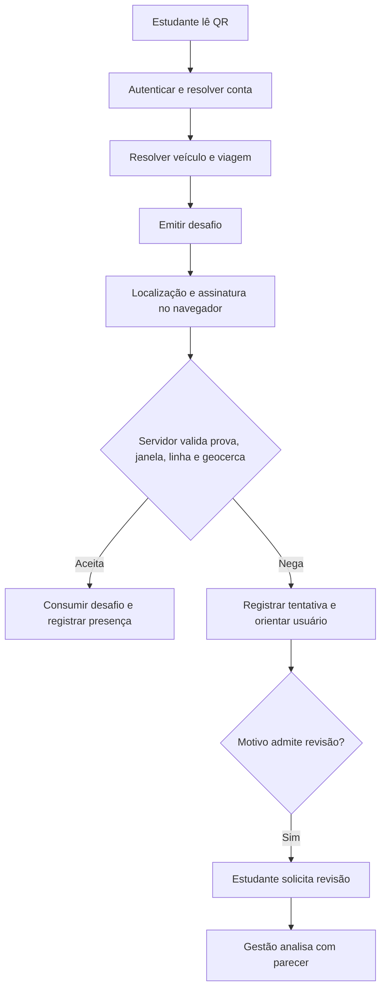
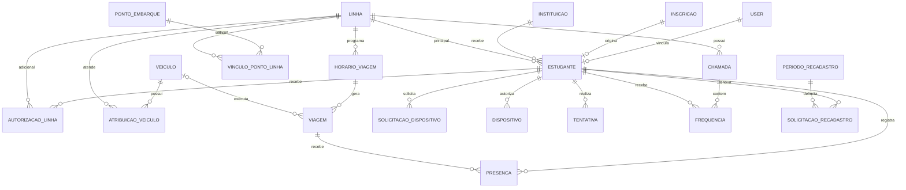

# UNIBUS — documentação técnica e funcional

Referência: código local de frontend e backend em 06/11/2026. Este documento distingue implementação observada de operação validada. Existência de código ou teste unitário não comprova funcionamento em produção. Nenhum `.env`, dado de estudante, credencial ou conteúdo do banco foi utilizado na documentação.

**Incidente de validação:** as primeiras execuções PHPUnit não tiveram isolamento confirmado devido ao cache Laravel ativo, que apontava para ambiente/banco fora dos critérios de teste. Como usam RefreshDatabase, o banco associado pode ter sido recriado. O usuário confirmou que a base era descartável; não há recuperação pendente. Não foi tentada restauração. A proteção adicionada e os testes posteriores isolados não desfazem possíveis efeitos anteriores. Detalhes nas seções 2.3 e 10.

## 1. Visão geral e escopo

O UNIBUS apoia o transporte universitário da Secretaria Municipal de Educação de Caraguatatuba. Centraliza inscrição, análise documental, estudantes, linhas, recadastramento, chamada diária e o embarque registrado pelo próprio estudante. Atende equipe administrativa, gestores, operadores, motoristas e estudantes.

Busca reduzir cadastros desconectados, conferência manual sem histórico, dificuldade para controlar vagas e ausência de evidências de embarque. O escopo implementado inclui aplicações pública, administrativa e portal autenticado do estudante; não inclui rastreamento contínuo da frota, cálculo de rotas ou um aplicativo móvel nativo.

Fontes principais: `src/app`, `src/components/ui`, `src/services/api`, `src/types`; no backend, `routes/api.php`, `app/Http/Requests`, `app/Http/Resources`, `app/Services`, `app/Models`, `database/migrations` e `database/seeders/RolePermissionSeeder.php`. Os inventários ao final identificam os arquivos de cada contrato. Auditorias anteriores em `docs/auditoria-*.md` são registros históricos; afirmações sobre acesso por CPF, por exemplo, devem ser confrontadas com a verificação por código atualmente implementada.

## 2. Arquitetura

### 2.1 Stack e organização

Frontend: Next.js 16.1.6 com App Router, React 19.2.3, TypeScript, Tailwind CSS 4, Axios 1.14, Zustand 5, Lucide React e qrcode 1.5.4. Biome 2.2 executa lint e formatação. Testes existentes usam `node:test`, TypeScript transpile e, para marcação, React DOM Server. A fonte é Montserrat, configurada em `src/app/layout.tsx` com `next/font/google`.

Backend: PHP ^8.4, Laravel ^13, Sanctum ^4.3, Laravel Excel ^4, DomPDF ^3.1, Pulse e Scribe. PHPUnit ^12.5 e Pint estão disponíveis. As versões indicadas são as declarações dos manifests, não uma auditoria de dependências instaladas.

```text
frontend/src/
  app/                    rotas públicas, (auth), (dashboard), portal-estudante
  components/             buttons, form/inputs, table, modal, pagination, guard
    ui/                   workspaces organizados por funcionalidade
  contexts/               restauração de sessão e store de autenticação
  hooks/                  autorização, cache, loading mínimo e câmera QR
  services/api/           clientes, interceptors, endpoints, cache, módulos
  services/navigation/    sidebar, destino da conta e retorno do QR
  types/                  contratos tipados por domínio
  utils/                  CPF, CEP, telefone, classes, foco e autorização
backend/
  routes/                 rotas e middlewares
  app/Http/Controllers/   entrada HTTP e delegação
  app/Http/Requests/      autorização e validação de payloads
  app/Http/Resources/     serialização de respostas
  app/Services/           regras, transações, acesso e integrações
  app/Models/             entidades e relacionamentos Eloquent
  database/               migrations, factories e seeders
  tests/                  testes unitários e de funcionalidades
```

As páginas delegam a workspaces. A aplicação real usa `(dashboard)` e pastas como `ui/transportes`, e não a estrutura ilustrativa `(sistema)/(gestao)` do AGENTS.md. A revisão manteve a estrutura real. Não foi criada arquitetura paralela.

### 2.2 Estado, consultas e persistência

`useAuthStore` guarda usuário e status `unknown`, `guest` ou `authenticated` em memória. `AuthProvider` restaura `/me`, redireciona visitantes e conduz contas estudante ao portal. Formulários, filtros, paginação e modais usam estado React local. `createCachedQuery`, `useCachedQuery` e `sharePendingRequest` compartilham consultas e evitam requisições duplicadas; invalidação após mutações e revisão de sessão impedem reutilização indevida entre contas. Não há promessa de persistência de filtros entre todas as rotas.

A credencial do navegador usa Web Crypto/IndexedDB em `src/services/student-device.ts`; a chave privada não é exportada. O QR pendente é guardado temporariamente em sessionStorage para retornar ao embarque depois do login. Token e arte do QR de veículo recém-gerado ficam no estado do modal, fora do cache das listas.

### 2.3 Autenticação, autorização e API

`api` é Axios com credenciais e XSRF; `publicApi` atende fluxos públicos com tokens próprios. `csrfClient` obtém o cookie Sanctum. O interceptor tenta renovar CSRF uma vez em 419, limpa a autenticação em 401 e invalida consultas após escrita. O frontend usa `useAuthz`, `PermissionBoundary`, `hasRouteAccess` e itens de menu com permissões; o backend permanece a autoridade final.

Rotas administrativas usam `auth:sanctum`, conta ativa e permissões por operação. `CheckPermission` tem bypass para `admin`; o frontend decide pelas permissões devolvidas em `/me`. Contas estudante são resolvidas por `estudantes.user_id`, não por CPF da URL. Inscrição e recadastro públicos usam tokens próprios após os fluxos de acesso; isso não equivale a uma sessão administrativa.

Banco: modelos e migrations são acessíveis. `config/database.php` permite múltiplas conexões; o default de código é SQLite e a configuração pode sobrescrevê-lo. O phpunit.xml declara MySQL `transporte_test`. **Incidente na validação:** as primeiras execuções definiram variáveis de SQLite, mas foi identificado cache de configuração ativo que pode sobrescrevê-las. A configuração cacheada não indicava ambiente testing nem banco de teste/memória. Como a suíte usa RefreshDatabase, não é possível garantir a preservação do banco associado ao cache; o usuário confirmou que essa base era descartável, encerrando a pendência de recuperação. Não foi tentada restauração. A execução isolada posterior ignora o cache por APP_CONFIG_CACHE separado, com pré-checagem efetiva de testing/SQLite/:memory:.

### 2.4 Padrão visual e de componentes

Os tokens de `src/app/globals.css` definem marca azul (`brand-600` #084e80, `brand-700` #063b61), superfícies, conteúdo, bordas e ações de edição, aprovação e exclusão. Campos administrativos usam variante `white` com altura-base de 40px; a variante `dark` permanece disponível explicitamente para contextos próprios. Botões principais podem conter texto; ações de registros usam `TableActionButton`, Lucide, título informativo e nome acessível.

`DataTable` concentra cabeçalho, erro, tentativa novamente, vazio, skeleton, paginação e overflow horizontal. Cada feature define colunas e renderização; o componente usa grid de artigos, não uma tabela HTML semântica. Em transporte, a coluna de ações reserva 9rem; tabelas largas têm largura mínima no desktop e scroll no contêiner. Abaixo de `md`, cada registro apresenta rótulos junto dos valores. Não se ocultam colunas de dados para caber.

`DateInput` exibe DD/MM/AAAA e emite ISO AAAA-MM-DD. Preserva min/max, limites de ano e datas desabilitadas. Calendário de 288px, limitado pelo viewport, usa sete colunas, meses/anos, Hoje e Limpar. O popover existente na camada superior evita corte por overflow; posição acompanha o campo e tenta abrir acima quando falta espaço abaixo. A verificação visual desse comportamento permanece pendente.

## 3. Perfis e permissões

A matriz abaixo reflete o seeder, não os vínculos existentes em produção. Cargos adicionais podem existir no banco sem permissões automaticamente correspondentes. `roles` não oferece editor de permissões no frontend. Permissão de escrita não implica leitura.

| Perfil | Acesso confirmado no seeder |
| --- | --- |
| admin | Todas as permissões declaradas; bypass no middleware de permissão; regras de domínio continuam aplicáveis |
| gestor | Gestão de estudantes, inscrição, instituições, linhas, documentos, períodos, recadastro, frequência de todas as linhas, justificativas, veículos, viagens, geocercas, dispositivos, presenças e auditoria; não recebe gestão de usuários/cargos nem `presencas.registrar` |
| operador | Consulta operacional, frequência de todas as linhas e edição de estudante; sem análise de dispositivo/presença, exclusões ou escrita de programação |
| motorista | Dashboard e leitura/escrita de frequência, limitada às próprias linhas quando falta `frequencias.todas` |
| estudante | `presencas.registrar`; portal e operações apenas do estudante associado à conta |

A matriz exata por permissão e perfil está no inventário ao final. As operações reais também dependem de elegibilidade, status e pertencimento. Não inferir poderes de um cargo somente por seu nome.

## 4. Inventário funcional das páginas

O inventário de rotas ao final enumera todos os `page.tsx`, inclusive aliases, e os componentes importados. Nesta seção estão objetivos, dados, ações, regras e limites dos módulos.

| Módulo e rotas | Componentes e dados | Operações, filtros e dependências |
| --- | --- | --- |
| Entrada `/login` | LoginWorkspace; CPF/e-mail e senha | Iniciar sessão, recuperar senha; erros e loading; depende de conta ativa; destino conforme tipo de conta |
| Senha `/recuperar-senha`, `/redefinir-senha`, `/reset-password` | PasswordRecoveryWorkspace; e-mail, token, senha e confirmação | Solicitar e redefinir; alias aceita link de e-mail; token válido e senha confirmada; não autentica automaticamente |
| Acesso `/area-aluno` | AreaEstudanteWorkspace; CPF e código enviado | Determina inscrição, lista de espera ou recadastro; identidade deve ser verificada antes de recuperar dados existentes |
| Inscrição `/registro` | RegisterWorkspace; dados pessoais, endereço, familiares, acadêmicos, dias e documentos | Validação por etapas, consulta de CEP/instituições/cursos/linhas, upload e atualização conforme status; token da inscrição |
| Recadastro público `/recadastro` | AreaEstudanteWorkspace, compartilhado com `/area-aluno` | Iniciar acesso por CPF/código e encaminhar ao fluxo apropriado; período e token válidos para renovação |
| Dashboard `/` | DashboardWorkspace; resumo de estudantes, ocupação, solicitações e pendências | Atualizar e atalhos; API exige `dashboard.view`, embora o helper de rota permita qualquer autenticado; seção indisponível pode retornar 403 |
| Estudantes `/estudantes` | StudentsWorkspace, StudentsEditModal, filtros/exportação; identificação, contato, curso, instituição, status, linha e documentos | Consultar, editar, excluir com confirmação, exportar PDF/XLSX, gerir conta; filtros locais no conjunto carregado e paginação da API precisam ser considerados; permissões `estudantes.*`, conta também `users.view` |
| Linhas `/linhas` | LinhasWorkspace, LinhaCard, LinhaDetailsModal; nome, descrição, ida/volta, capacidade, motorista, ocupação | Grid/lista, cadastro, edição, exclusão, detalhes e estudantes paginados; motorista selecionado por nome; depende de `linhas.*` |
| Inscrições administrativas `/solicitacoes` | SolicitacoesWorkspace; inscrição, instituição, documentos e pendências | Busca/filtros, detalhes, aprovar/rejeitar/devolver para revisão e excluir; regras por status; `inscricoes.view`, `inscricoes.analise`, `inscricoes.delete` e permissões documentais |
| Recadastramento `/recadastramento` | RecadastroAdminWorkspace, PeriodosSection, SolicitacoesSection; períodos, solicitações, campos pendentes e documentos | Consultar/analisar solicitações, gerir períodos, abrir/fechar e tratar ausentes; acesso por `periodos.view` ou `solicitacoes.view`; operações têm permissões separadas |
| Chamada `/frequencias` | FrequenciasWorkspace, FrequenciaLinhaCard, ChamadaSheet; linha/data e marcações | Abrir/carregar chamada, salvar alterações, fechar/reabrir; somente linhas autorizadas; marcações decididas por justificativa são bloqueadas |
| Histórico `/frequencias/chamadas` | ChamadasHistoryWorkspace, FilterCard, Table | Filtrar chamadas, abrir folha e consultar situação; leitura `frequencias.view`; escopo por linha e `frequencias.todas` |
| Justificativas `/frequencias/justificativas` | JustificativasWorkspace, FilterCard, Table, AnalysisModal | Consultar, filtrar e analisar com parecer; `justificativas.view`/`justificativas.analise`; decisão afeta a marcação de frequência |
| Relatórios `/frequencias/relatorio` | RelatorioFrequenciaWorkspace, FilterCard, Summary, Table, RelatorioEstudanteModal | Período/linha e resumo por estudante; consulta detalhada; `frequencias.view` e escopo autorizado |
| Usuários `/usuarios` | UsersWorkspace, UsersTable, UserFormModal | Nome, CPF, nascimento, contato, papel, senha e situação; criar, editar, ativar/inativar, excluir; `users.*`; proteção contra ações sobre a própria conta |
| Perfil `/perfil` | Página local que exibe apenas o título Perfil | Placeholder confirmado; não tem formulário, consulta de perfil ou ações de atualização |
| Transporte `/transportes` | TransportesWorkspace, ResourcePanel, Fields, Details, Indicadores, QrCode | Cinco áreas, 16 seções preservadas; campos, ações e permissões detalhados no inventário configurável |
| Portal `/portal-estudante` | PortalDashboardWorkspace | Próximas viagens, dispositivo e presenças; somente dados da conta associada |
| Transporte do estudante `/portal-estudante/transporte` | PortalTransporteWorkspace | Próximas viagens e situação de embarque; sem escolha/alteração autônoma de linha ou ponto |
| Dispositivo `/portal-estudante/dispositivo` | PortalDispositivoWorkspace | Solicitar/cancelar vínculo, acompanhar análise, concluir desafio com chave local; substituição afeta credencial anterior |
| Embarque `/portal-estudante/presenca`, `/presenca/scan` | PortalPresencaWorkspace | Ler QR/câmera ou endereço do código, resolver viagem, obter localização e assinar desafio; API decide presença |
| Histórico próprio `/portal-estudante/frequencia` | PortalFrequenciaWorkspace | Presenças e tentativas próprias paginadas, pedido de revisão permitido; não é a chamada diária administrativa |
| Conta `/portal-estudante/conta` | PortalContaWorkspace | Dados disponíveis da sessão e orientação de acesso; não pressupõe endpoint para editar todo o cadastro |

As validações de payload do servidor estão no inventário de Requests. As estruturas de resposta estão no inventário de Resources e tipos do frontend. Os campos da inscrição e edição abrangem nome, CPF/RG, nascimento, telefone/e-mail, filiação, CEP/endereço, instituição, curso, semestre, conclusão, turno, cidade de destino, dias, transporte anterior, bolsa e observações; sua disponibilidade varia por etapa/status.

## 5. Transporte: navegação, campos e operações

A proposta foi registrada antes da alteração em `docs/superpowers/plans/2026-11-06-auditoria-unibus.md`.

| Área nova | Seções anteriores preservadas |
| --- | --- |
| Estrutura | Veículos; Veículo × linha; Pontos de embarque; Ponto × linha |
| Operação | Horários; Viagens; Dias sem operação |
| Embarque | Autorizações de linha; Dispositivos; Presenças registradas |
| Conferência | Solicitações de dispositivo; Tentativas e revisões; Auditoria |
| Administração | Cargos; Instituições; Indicadores |

Áreas sem seções autorizadas ficam ausentes. Selecionar área mostra apenas suas seções. Selecionar seção monta seu painel com chave da sessão; o comportamento anterior de reiniciar o estado local ao trocar seção foi mantido. Dentro do mesmo painel, mutação invalida consultas e preserva filtros/página. Não há novas rotas nem mudanças no seeder/guards.

Relacionamentos são selecionados por rótulo. Estudantes usam pesquisa no servidor, atraso de 300ms e paginação de 15; escola quando disponível, curso e situação ajudam a distinguir nomes. IDs continuam no payload. Veículos, pontos e viagens permitem pesquisar nas opções da página e avançar quando a API fornece metadados; essa pesquisa é explicitamente local à página, não uma busca global no servidor. Linhas e responsáveis usam as coleções existentes. Linhas da instituição usam seleção por checkbox. Sem permissão de consultar uma referência, o campo informa essa restrição e permanece desabilitado; não é feita chamada para contornar a autorização.

Instituições conservam a consulta auxiliar por identificador para compatibilidade; a listagem por nome é o caminho principal. Cargos permitem listar e criar, mas não editar/excluir pela listagem sem ID. A UI comunica a disponibilidade em linguagem funcional; a limitação técnica está no diagnóstico.

O filtro de responsável da auditoria usa a lista de usuários somente com `users.view`. Sem essa permissão, oferece os responsáveis presentes nos registros de auditoria carregados, sem consultar o cadastro restrito; a navegação pelas páginas permite encontrar outros responsáveis. Essa limitação é indicada junto ao campo.

Filtros não são aplicados em cada digitação: Filtrar envia valores não vazios e volta à página 1; Limpar restaura filtros e página. Indicadores também têm Limpar filtros. As validações 422 aparecem no formulário; conflitos 409 preservam o modal e o conteúdo. Falhas de leitura não viram listas vazias fictícias. Confirmações permanecem para exclusão, QR, pareceres, revogação e revisão.

## 6. Fluxos de ponta a ponta

### 6.1 Inscrição, análise e estudante

Iniciador: candidato no acesso público; posteriormente responsável com permissão de análise. Pré-condições: campos válidos, documentos exigidos e, ao retomar dados existentes, código de acesso/token correspondente. O candidato informa dados em etapas; o frontend valida etapas, cria/retoma inscrição, vincula dados institucionais e envia documentos. O serviço administrativo lista a inscrição, carrega os documentos e envia decisão/observações/campos pendentes. Aprovação gera o cadastro de estudante; devolução habilita correção conforme estado. Criar estudante não garante provisionar conta autenticada.

Estados e validações concretos são os das Requests e Models no inventário. Erros de CPF/e-mail, arquivo, estado não editável, código/token inválido ou permissão mantêm a operação sem sucesso fictício. Instituição e linhas existentes são dependências; criação/edição de vínculo de conta tem validações próprias. A exclusão de estudante com presença ou frequência já marcada é recusada com 409; inativação preserva histórico. Alteração de e-mail sincroniza a conta associada e invalida códigos antigos conforme `Estudante::booted`.

### 6.2 Recadastramento

Iniciador: gestão abre um período; estudante acessa por CPF/código. Pré-condições: estudante elegível, período aberto e token válido. Consulta cria/retoma solicitação; estudante confere dados, envia documentos e aceita as declarações de finalização. `ReecadastroPublicoService` valida token, prazo e documentos e envia para análise; responsável aprova, rejeita ou devolve pendências conforme operações existentes. A finalização revoga o token de envio. Gestão pode consultar ausentes e executar a ação específica de inativação, sujeita às confirmações e regras existentes. Período fechado/expirado, documento recusado e dados pendentes impedem conclusão. Não há recadastro autenticado completo no portal.

### 6.3 Linhas, veículos e atribuição

Iniciador: gestão autorizada. Uma linha descreve atendimento, horários legados, capacidade e motorista. CRUD de linhas usa `linhaService`; motoristas ativos vêm do endpoint próprio. Veículo tem identificação, placa, ativo e QR. Cadastro gera QR uma única vez; gestão deve baixar/imprimir. Atribuição relaciona veículo e linha por início/fim e motivo. Selecionar nomes produz IDs internos; editar atribuição muda fim/motivo, não troca sua identidade. O serviço valida conflitos e sincroniza viagens aplicáveis. Conflitos exigem ajuste operacional, não são escondidos pelo frontend. Exclusões com histórico podem ser recusadas.

### 6.4 Horários, viagens e suspensão de operação

Iniciador: gestão com `viagens.write`. Pré-condições: linha e programação válida. Horário define sentido, dias 0–6, saída, vigência, janelas opcionais e ativo. Geração por período cria viagens datadas de modo idempotente pelo par horário/data. Respeita dias sem operação e atribuição vigente. Limite da geração é 62 dias de diferença entre de/até. Ajuste de viagem exige motivo, preserva histórico e envia apenas alterações; horas locais não são convertidas inadvertidamente para UTC.

Alterar programação descarta/recria apenas viagens futuras que possam ser regeneradas, sem presença e sem ajuste manual, conforme os serviços. Dia sem operação alcança uma linha ou todas: cancela viagens existentes do dia. Remover a suspensão não reativa automaticamente as viagens canceladas. Uma viagem cancelada deve ser reativada antes de presença manual. Janelas conflitantes para o mesmo veículo impedem resolução inequívoca do QR.

### 6.5 Pontos, geocercas e autorizações de linha

Gestão cadastra nome, latitude, longitude, raio e ativo do ponto; depois vincula à linha e sentido com ordem, passagem prevista e janelas. Pré-condições: coordenadas válidas, raio permitido e referências existentes. A presença automática usa pontos ativos para linha/sentido; sem ponto aplicável pode exigir revisão. Passagem prevista ajusta a validação de janela conforme política de geocerca. Geolocalização do estudante é evidência de uma tentativa de embarque, não rastreamento contínuo.

Autorização de linha soma temporariamente uma linha ao estudante, com início/fim/motivo. Não substitui a linha principal. Fim vazio não determina prazo final. Remover autorização pode impedir embarques futuros nessa linha. A API aplica elegibilidade, vigência e permissões `estudantes.*`.

### 6.6 Dispositivo e solicitação de vínculo

Iniciador: estudante autenticado com vínculo `user_id`; gestão aprova. Navegador prepara chave privada não exportável, solicita vínculo/troca e acompanha análise. Gestão confere identidade e registra parecer. Aprovação ainda não significa vínculo concluído: estudante solicita desafio, assina localmente e conclui no prazo. O servidor verifica assinatura/solicitação e ativa a credencial conforme o fluxo. A troca e a revogação afetam o navegador anterior; revogar um dispositivo ativo bloqueia novas presenças por ele. Status de solicitação incluem Pendente, Aprovada, Rejeitada, Concluida, Cancelada e Expirada; a credencial distingue Ativo e Revogado.

Erros: conta sem estudante, estudante não elegível, solicitação não aprovada, desafio expirado, assinatura inválida e armazenamento local indisponível. Não se simula sucesso quando a chave não pode ser persistida. Ver `DispositivoService`, `AnaliseDispositivoService` e `student-device.ts`.

### 6.7 Embarque por QR e presença

Iniciador: estudante elegível em navegador autorizado. Pré-condições: QR válido, viagem programada e única para a van/janela, linha autorizada, assinatura válida e localização aceita. A UI lê o QR, resolve a viagem, pede desafio, obtém localização e assina o conteúdo esperado. `RegistroPresencaService` revalida condições e consome o desafio, registrando presença de método Dispositivo. Restrição de unicidade impede duplicidade por estudante/viagem. Negativa registra tentativa com código e mensagem.



Códigos de identidade/dispositivo/linha retornam 403; QR inválido 404; desafio usado ou presença duplicada 409; demais recusas descritas por `CodigoPresenca` usam 422. Throttle pode retornar 429. O cliente não transforma presença negada em presença registrada.

### 6.8 Revisão, exceção manual e auditoria

Estudante pode pedir revisão apenas de tentativa própria que admita revisão. `CodigoPresenca::admiteRevisao` inclui problemas de janela, localização e necessidade de revisão manual, não falhas de identidade/dispositivo. Servidor impede revisão incompatível, presença já existente e pedidos duplicados por viagem conforme regras do serviço.

Gestão com `presencas.analise` analisa revisão pendente com decisão e parecer. Aprovar cria presença Manual quando permitido; rejeitar encerra com parecer. Gestão pode registrar exceção manual diretamente escolhendo estudante/viagem e justificativa de 10–1000 caracteres. Viagem cancelada e duplicidade são recusadas. Auditoria registra responsável, ação, alvo, alterações e motivo; a consulta é somente leitura e filtrável. Essas decisões permanecem humanas, não foram executadas em dados reais durante a auditoria.

### 6.9 Chamada diária, justificativa e relatórios

Motorista/equipe com acesso inicia chamada de sua linha e data. A folha mantém rascunho de marcações e observações; salvar envia somente mudanças válidas. Fechar/reabrir são operações distintas. Justificativas decididas bloqueiam edição da marcação correspondente. Gestão consulta histórico e relatório por período/linha e pode analisar justificativas com a permissão específica. Serviços de frequência tratam suas regras e efeitos no benefício; não se deve equiparar automaticamente uma `Presenca` de QR a uma `Frequencia` de chamada: são entidades e endpoints separados, sem sincronização presumida.

### 6.10 Indicadores e administração

Equipe com `presencas.view` consulta indicadores por período/linha; sem filtro o serviço considera os últimos 30 dias. A tela soma presenças, manuais, negativas e revisões e mostra distribuições retornadas. Não calcula presença fictícia nem permite editar indicador.

Administração de usuários usa CRUD, ativação/inativação e papéis aceitos pelo backend. Cargos são consultáveis/criáveis nesta tela, sem gestão de permissões. Instituições possuem nome e vínculos de linha; selecionar nenhuma linha remove vínculos quando o payload é salvo. Criação de cargo não implica atribuição automática de permissões.

## 7. Integração com a API

Os caminhos do inventário HTTP são os retornados pelo roteador Laravel, com prefixo `/api`. Constantes do frontend omitem esse prefixo porque a base URL o fornece. O cookie CSRF usa `/sanctum/csrf-cookie` na origem do backend. A rota Next `/api/cep/[cep]` é um proxy separado para consulta de CEP, não um endpoint Laravel.

Parâmetros de caminho aparecem entre chaves. Parâmetros de consulta e corpos devem respeitar as Requests/Controllers listadas nos anexos. Respostas são heterogêneas: coleções Resources podem ter `data/meta/links`; legados podem retornar mensagem sem `data`; operações retornam entidade/mensagem; exportação e documentos retornam arquivos. `estudanteService`, `linhaService` e `transporteService` normalizam somente os envelopes conhecidos. Não extrapolar um envelope para todas as rotas.

Erros transversais: 401 sem sessão, 403 falta de permissão/conta inativa, 404 recurso ausente, 419 CSRF, 422 validação com `errors`, 429 throttle e 5xx falha interna. Operações com histórico/duplicidade/conflito podem usar 409; códigos de presença estão descritos no fluxo. HTTP 200 sozinho não garante transição desejada: verificar corpo e status retornados.

Extensão desta revisão: `GET /api/estudantes?search=nome&page=1&per_page=15`. `search` é opcional, string de até 100 caracteres, removidos espaços laterais; filtra nome antes da paginação e preserva o envelope paginado quando busca não tem resultados. O endpoint e a permissão `estudantes.view` permanecem os mesmos. Requer atualizar frontend e backend juntos para a pesquisa global funcionar. O endpoint ainda serializa o Resource administrativo completo para usuários autorizados; apenas dados de identificação funcional são mostrados no seletor.

## 8. Glossário e relacionamentos

| Conceito | Significado implementado |
| --- | --- |
| Estudante | Cadastro do beneficiário, associado opcionalmente a conta, inscrição, instituição e linha principal |
| Inscrição | Pedido inicial com dados e documentos, submetido a análise antes de formar cadastro aprovado |
| Recadastro | Solicitação de renovação/conferência em período; não é uma nova conta |
| Linha | Organização do atendimento, com capacidade, horários legados e motorista; não é uma viagem específica |
| Horário | Regra recorrente por linha, sentido, dias da semana e vigência |
| Viagem | Ocorrência datada do horário, com veículo, janela e situação próprias |
| Veículo × linha | Atribuição de um veículo a uma linha durante uma vigência |
| Ponto × linha | Vínculo do ponto à linha/sentido, com ordem e passagem/janelas opcionais |
| Dia sem operação | Suspensão por data, geral ou por linha; cadastro cancela viagens alcançadas |
| Autorização de linha | Direito adicional e vigente de estudante usar outra linha |
| Dispositivo vinculado | Credencial de uma instalação de navegador cuja chave foi aprovada/comprovada; não apenas o modelo físico do telefone |
| Desafio | Conteúdo temporário assinado para provar posse da chave local; prazo e uso controlados pelo servidor |
| Presença | Comprovante associado a estudante/viagem, registrado automaticamente ou como exceção Manual |
| Tentativa | Rastro de resolução/desafio/confirmação de presença, com resultado e eventual motivo de recusa |
| Revisão | Pedido para gestão avaliar tentativa elegível; aprovação pode produzir presença Manual |
| Frequência | Marcação de estudante em chamada diária; distinta de comprovante de QR |
| Auditoria | Histórico de ações administrativas com responsável e contexto; consulta sem edição nesta UI |



O diagrama representa as relações funcionais principais, não um DDL completo. Relações opcionais, constraints e política de exclusão devem ser conferidas nas migrations; não deduzir cascata pelo desenho. O inventário de modelos complementa os relacionamentos e campos persistíveis.

## 9. Diagnóstico: fatos e pendências

### Confirmado no código

- Há implementações completas de UI/serviço para inscrição, recadastro, linhas, estudantes, frequência, dispositivos e embarque, mas operação em produção não foi demonstrada por esta revisão.
- `DateInput` tinha default `dark`, divergindo do `Input` administrativo; isso explicava a cápsula azul do filtro. Default corrigido para `white`; calendários explicitamente escuros continuam possíveis.
- O transporte usava ações textuais compactadas em colunas de mesma largura e navegação plana. Ações e agrupamentos foram corrigidos sem eliminar seções.
- A busca por estudante não existia no endpoint paginado; foi adicionada sem novo endpoint ou permissão.
- Resource de cargos retorna título sem identificador: edição/exclusão pela lista não são oferecidas. Backend ter rotas CRUD não significa que esse fluxo de frontend esteja completo.
- Instituições usam paginação legada sem total; a UI avança por páginas de 15 e pode precisar abrir uma última página vazia quando a anterior tiver exatamente 15 itens.
- Busca de opções de veículo/ponto/viagem é por página; pesquisa global nesses endpoints continua oportunidade de evolução.
- Dashboard permite entrada de rota a autenticados pelo helper, mas o endpoint exige `dashboard.view`. Conta estudante é redirecionada pelo provider; perfis personalizados podem receber 403.
- Papel estudante existe no RBAC, porém Requests administrativas de usuário restringem papéis graváveis a admin/gestor/operador/motorista. A interface preserva papel estudante existente e não oferece atribuição que seria recusada.
- Portal autenticado não tem todos os contratos de edição de cadastro, benefício, documentos e recadastro. Essas operações continuam nos fluxos públicos/administrativos correspondentes.
- `/perfil` é uma página incompleta: exibe somente um título.
- UI de detalhes de transporte apresenta IDs de referência como metadados quando retornados; seleção administrativa principal passou a usar nomes, mas não se promete remover todo identificador da aplicação.
- Troca de seção no transporte reinicia filtros locais; preservação completa entre seções e deep links não foi implementada.
- DataTable usa grids, com semântica de seção/artigo. Evolução para semântica tabular completa deve respeitar a apresentação mobile.

### Requer validação humana ou ambiente apropriado

- Revisão visual em 1920, 1440, 1280, 1024, 768, 430 e 375px, incluindo teclado, zoom, popovers, foco e modal. O controle do navegador foi bloqueado por impossibilidade de verificar a URL atual.
- Testes de campo de câmera/GPS, precisão e geocercas, impressões reais de QR e troca entre navegadores/aparelhos.
- Entrega real de e-mail, links de recuperação, duração/configuração de códigos e filas no ambiente implantado.
- Conjunto de papéis/permissões efetivamente atribuído no banco e operação de dados legados. A matriz documentada vem do seeder.
- Desempenho da busca de nome em grande volume e índices/collation na conexão de produção. Testes em SQLite não comprovam comportamento de MySQL em todas as expressões.
- Nomes homônimos com mesmos dados acadêmicos podem precisar de um identificador funcional adicional aprovado pela gestão; o seletor não exibe CPF/e-mail.

## 10. Registro de correções e validação

### Arquivos desta revisão

- `src/components/form/inputs/DateInput.tsx`: default branco e calendário de 288px; preservadas alterações locais anteriores de posicionamento/popover.
- `src/components/ui/transportes/TransportesWorkspace.tsx` e `transporteNavigation.ts`: dois níveis de navegação, com todas as seções e mesmas permissões.
- `TransporteResourcePanel.tsx`: ações pelo TableActionButton, coluna reservada, scroll controlado no desktop, filtros com botões que podem se reorganizar no mobile.
- `TransporteFields.tsx`, `TransporteReferenceField.tsx`, `TransporteEstudanteField.tsx`: relacionamentos por rótulos, pesquisa/paginação e estado de erro sem exigir entrada numérica como alternativa.
- `TransporteIndicadores.tsx`: limpeza de filtros e cabeçalho flexível.
- `transporteConfig.ts`: mensagens de cargos/instituições em linguagem funcional.
- `src/services/api/modules/estudante.ts` e `page-queries.ts`: parâmetro opcional de pesquisa e consulta cacheada por pesquisa/página.
- Backend: `app/Http/Controllers/Api/Estudante/EstudanteController.php`, `app/Services/Estudante/EstudanteService.php` e `tests/Feature/Estudante/BuscaEstudantesTest.php`.
- Segurança da validação: `backend/tests/TestCase.php` bloqueia cache ativo e conexões inadequadas antes de RefreshDatabase; `backend/tests/README.md` documenta execução isolada.
- Testes frontend: `tests/unibus-ui.test.cjs` e `tests/student-search-service.test.cjs`; documentação e plano de auditoria.

Antes da revisão já existiam mudanças locais em Button, Input, SearchInput, Select, Textarea, Modal, Pagination, DataTable, AppHeader/AppShell/AppSidebar e quatro componentes de recadastro, além de `tests/layout-accessibility.test.cjs`. Não atribuir todas as diferenças contra HEAD a esta auditoria. Elas foram preservadas, sem reset ou commit automático.

### Comportamentos preservados

Rotas e permissões, contratos de mutação, IDs internos, status, validações, confirmações, regras de janelas/horários, idempotência de geração, efeitos de suspensão e revogação, invalidação de cache e mensagens de conflito foram preservados no código da aplicação. Não foram criadas migrations ou alteradas regras de aprovação. A preservação dos dados durante as primeiras execuções de teste não está garantida: ver incidente acima.

### Evidências de validação

| Verificação | Resultado observado |
| --- | --- |
| `node --test tests/*.test.cjs` | 115 testes passaram, nenhuma falha |
| `npx.cmd tsc --noEmit --incremental false` | Passou |
| `npm.cmd run build` | Passou; compilação, TypeScript e geração de páginas concluídos |
| Biome nos 13 arquivos de código/teste desta revisão | Passou |
| `npm.cmd run lint` global | 194 erros em arquivos fora dos 13 verificados; a maioria dos diagnósticos exibidos envolve formatação; não foi feita reformatação global fora do escopo |
| Pint e `php -l` nos arquivos de backend alterados | Passaram |
| `BuscaEstudantesTest.php`, execução final com guarda e SQLite em memória | 4 testes, 10 asserções passaram em 2,659s; caminho APP_CONFIG_CACHE separado e isolamento previamente verificado |
| Suíte completa PHPUnit isolada, `memory_limit=512M` | Concluiu 399 testes e 1.624 asserções; 2 erros e 3 falhas, exit code 2; detalhes abaixo. A suíte completa não está verde |
| Tentativas completas anteriores | Encerraram no teste de download de recadastro; na execução isolada a causa observada foi esgotamento do limite PHP de 128MB em FinfoMimeTypeDetector. O mesmo teste isolado passou. As primeiras execuções também tiveram o problema de cache descrito no incidente |
| Guarda de segurança em TestCase | Execução com cache ativo recusada antes de RefreshDatabase, com exit code 2 e mensagem de bloqueio; execução posterior isolada permitida |
| `git diff --check` nos dois repositórios | Passou |
| Revisão independente de código | Dois problemas encontrados e corrigidos: opção vazia nos relacionamentos opcionais e reinício da pesquisa interna ao limpar indicadores |
| Inspeção visual em navegador | Bloqueada pela ferramenta de controle, que não conseguiu confirmar a URL da janela Chrome; não certificada |

Não foram realizadas ações pela interface em dados reais. Isso não assegura ausência de efeito das primeiras execuções PHPUnit: RefreshDatabase pode ter recriado o banco configurado no cache. O usuário confirmou que a base era descartável; não foi necessária recuperação. Foi adicionada proteção em `backend/tests/TestCase.php` para recusar ambiente não testing, cache ativo e conexão que não seja SQLite em memória ou banco com sufixo `_test`, antes das migrations de teste. O cache existente não foi apagado nem editado. Os anexos seguintes complementam o inventário sem presumir dados de produção.

Falhas da execução completa isolada (não corrigidas nesta revisão de interface):

- `RelatorioFrequenciaTest::test_resume_cada_estudante_com_quem_mais_falta_primeiro` e `test_filtra_quem_esta_com_faltas_seguidas`: violação de unicidade de `chamadas.linha_id, chamadas.data` no SQLite.
- `LinhaEstudantesTest::test_retorna_faltas_e_ultima_presenca_somente_de_chamadas_fechadas`: esperava data, recebeu data com hora `00:00:00`.
- `GestaoTransporteTest::test_alterar_horario_refaz_as_viagens_futuras`: esperava hora com segundos, recebeu `17:30`.
- `RegistroPresencaTest::test_painel_de_tentativas_e_indicadores`: esperava agregado de presença por linha, recebeu lista vazia.

Esses resultados exigem investigação de compatibilidade SQLite/MySQL e dos dados de teste; não foram atribuídos automaticamente a regressão desta revisão. O resultado isolado não certifica a integridade do banco usado nas execuções iniciais. O usuário confirmou que a base era descartável. A pendência de recuperação foi encerrada sem restauração; as demais limitações de validação continuam registradas.

## 11. Inventario verificavel de paginas
| Rota | Arquivo | Dependencias diretas |
| --- | --- | --- |
| /login | `src/app/(auth)/login/page.tsx` | `@/components/ui/auth/LoginWorkspace` |
| /recuperar-senha | `src/app/(auth)/recuperar-senha/page.tsx` | `@/components/ui/auth/PasswordRecoveryWorkspace` |
| /redefinir-senha | `src/app/(auth)/redefinir-senha/page.tsx` | `@/components/ui/auth/PasswordRecoveryWorkspace` |
| /reset-password | `src/app/(auth)/reset-password/page.tsx` | `../redefinir-senha/page` |
| /estudantes | `src/app/(dashboard)/estudantes/page.tsx` | `@/components/ui/estudantes/StudentsWorkspace` |
| /frequencias/chamadas | `src/app/(dashboard)/frequencias/chamadas/page.tsx` | `@/components/ui/frequencias/ChamadasHistoryWorkspace` |
| /frequencias/justificativas | `src/app/(dashboard)/frequencias/justificativas/page.tsx` | `@/components/ui/frequencias/JustificativasWorkspace` |
| /frequencias | `src/app/(dashboard)/frequencias/page.tsx` | `@/components/ui/frequencias/FrequenciasWorkspace` |
| /frequencias/relatorio | `src/app/(dashboard)/frequencias/relatorio/page.tsx` | `@/components/ui/frequencias/RelatorioFrequenciaWorkspace` |
| /linhas | `src/app/(dashboard)/linhas/page.tsx` | `@/components/ui/linhas/LinhasWorkspace` |
| / | `src/app/(dashboard)/page.tsx` | `@/components/ui/dashboard/DashboardWorkspace` |
| /perfil | `src/app/(dashboard)/perfil/page.tsx` | JSX local; consultar arquivo |
| /recadastramento | `src/app/(dashboard)/recadastramento/page.tsx` | `@/components/ui/recadastro/RecadastroAdminWorkspace` |
| /solicitacoes | `src/app/(dashboard)/solicitacoes/page.tsx` | `@/components/ui/solicitacoes/SolicitacoesWorkspace` |
| /transportes | `src/app/(dashboard)/transportes/page.tsx` | `@/components/ui/transportes/TransportesWorkspace` |
| /usuarios | `src/app/(dashboard)/usuarios/page.tsx` | `@/components/ui/users/UsersWorkspace` |
| /area-aluno | `src/app/area-aluno/page.tsx` | `@/components/ui/area-estudante/AreaEstudanteWorkspace` |
| /portal-estudante/conta | `src/app/portal-estudante/conta/page.tsx` | `@/components/ui/portal-estudante/PortalContaWorkspace` |
| /portal-estudante/dispositivo | `src/app/portal-estudante/dispositivo/page.tsx` | `@/components/ui/portal-estudante/PortalDispositivoWorkspace` |
| /portal-estudante/frequencia | `src/app/portal-estudante/frequencia/page.tsx` | `@/components/ui/portal-estudante/PortalFrequenciaWorkspace` |
| /portal-estudante | `src/app/portal-estudante/page.tsx` | `@/components/ui/portal-estudante/PortalDashboardWorkspace` |
| /portal-estudante/presenca | `src/app/portal-estudante/presenca/page.tsx` | `@/components/ui/portal-estudante/PortalPresencaWorkspace` |
| /portal-estudante/transporte | `src/app/portal-estudante/transporte/page.tsx` | `@/components/ui/portal-estudante/PortalTransporteWorkspace` |
| /presenca/scan | `src/app/presenca/scan/page.tsx` | `@/components/ui/portal-estudante/PortalEstudanteLayout`; `@/components/ui/portal-estudante/PortalPresencaWorkspace` |
| /recadastro | `src/app/recadastro/page.tsx` | `@/components/ui/area-estudante/AreaEstudanteWorkspace` |
| /registro | `src/app/registro/page.tsx` | `@/components/ui/registro/RegisterWorkspace` |

## 12. Inventario configuravel das secoes de transporte
Fonte: `src/components/ui/transportes/transporteConfig.ts`. Todas as secoes abaixo ficam em `/transportes`; o painel reutiliza ResourcePanel/Fields/Details. Indicadores usa componente proprio. Regras adicionais do servidor constam nas Requests.

### Veículos (`veiculos`)
Leitura: veiculos.view. Escrita: veiculos.write. Remocao: veiculos.delete. Criar: True. Editar: True.
Colunas: Identificação (`identificacao`), Placa (`placa`), Ativo (`ativo`), Linhas atendidas hoje (`atribuicoes`).
O QR aparece somente ao cadastrar ou gerar um novo código. Gerar outro invalida o anterior imediatamente; reimprima o adesivo.
| Uso | Chave interna | Rotulo configurado | Tipo | Regras/opcoes | Orientacao |
| --- | --- | --- | --- | --- | --- |
| Formulario | identificacao | Identificação | texto/select | {"required": true, "minLength": 2, "maxLength": 60} |  |
| Formulario | placa | Placa | texto/select | {"maxLength": 10} |  |
| Formulario | ativo | Ativo | boolean | {} |  |

### Veículo × linha (`atribuicoes`)
Leitura: veiculos.view. Escrita: veiculos.write. Remocao: veiculos.write. Criar: True. Editar: True.
Colunas: Veículo (`veiculo.identificacao`), Linha (`linha.name`), Início (`inicio`), Fim (`fim`).
Fim em branco mantém a atribuição sem prazo. Para trocar veículo, linha ou início, encerre esta atribuição e crie outra. Conflitos de horário precisam ser resolvidos nas viagens.
| Uso | Chave interna | Rotulo configurado | Tipo | Regras/opcoes | Orientacao |
| --- | --- | --- | --- | --- | --- |
| Formulario | veiculo_id | ID do veículo | number | {"min": 1, "step": 1, "required": true, "createOnly": true} |  |
| Formulario | linha_id | ID da linha | number | {"min": 1, "step": 1, "required": true, "createOnly": true} |  |
| Formulario | inicio | Início | date | {"required": true, "createOnly": true} |  |
| Formulario | fim | Fim | date | {"required": false} |  |
| Formulario | motivo | Motivo | textarea | {"maxLength": 255} |  |
| Filtro | linha_id | ID da linha | number | {"min": 1, "step": 1, "required": false} |  |
| Filtro | veiculo_id | ID do veículo | number | {"min": 1, "step": 1, "required": false} |  |
| Filtro | data | Data de vigência | date | {"required": false} |  |

### Horários (`horarios`)
Leitura: viagens.view. Escrita: viagens.write. Remocao: viagens.write. Criar: True. Editar: True.
Colunas: Linha (`linha.name`), Sentido (`sentido`), Dias (`dias_semana`), Saída (`horario_saida`).
Alterações refazem viagens futuras sem presença e sem ajuste manual. Os horários usam o fuso da operação.
| Uso | Chave interna | Rotulo configurado | Tipo | Regras/opcoes | Orientacao |
| --- | --- | --- | --- | --- | --- |
| Formulario | linha_id | ID da linha | number | {"min": 1, "step": 1, "required": true} |  |
| Formulario | sentido | Sentido | texto/select | {"options": ["Ida", "Volta"], "required": true} |  |
| Formulario | dias_semana | Dias da semana | days | {"required": true} |  |
| Formulario | horario_saida | Saída | time | {"required": true} |  |
| Formulario | janela_antes_min | Janela antes (minutos) | number | {"min": 0, "max": 180} | Em branco: padrão do servidor. |
| Formulario | janela_depois_min | Janela depois (minutos) | number | {"min": 0, "max": 180} | Em branco: padrão do servidor. |
| Formulario | vigencia_inicio | Vigência inicial | date | {"required": false} |  |
| Formulario | vigencia_fim | Vigência final | date | {"required": false} |  |
| Formulario | ativo | Ativo | boolean | {} |  |
| Filtro | linha_id | ID da linha | number | {"min": 1, "step": 1, "required": false} |  |
| Filtro | ativo | Ativo | texto/select | {"options": ["1", "0"]} |  |

### Viagens (`viagens`)
Leitura: viagens.view. Escrita: viagens.write. Remocao: indisponivel. Criar: False. Editar: True.
Colunas: Data (`data`), Linha (`linha.name`), Sentido (`sentido`), Saída (`horario_saida`), Veículo (`veiculo.identificacao`), Situação (`status`).
Ajustar exige motivo e preserva o histórico. A geração é idempotente e aceita até 62 dias de diferença entre início e fim.
| Uso | Chave interna | Rotulo configurado | Tipo | Regras/opcoes | Orientacao |
| --- | --- | --- | --- | --- | --- |
| Formulario | motivo | Motivo | textarea | {"required": true, "minLength": 5, "maxLength": 255} |  |
| Formulario | veiculo_id | ID do veículo (vazio: sem veículo) | number | {"min": 1, "step": 1, "required": false} |  |
| Formulario | janela_inicio | Início da janela (hora local) | datetime-local | {"required": true} |  |
| Formulario | janela_fim | Fim da janela (hora local) | datetime-local | {"required": true} |  |
| Formulario | status | Situação | texto/select | {"options": ["Programada", "Cancelada"], "required": true} |  |
| Filtro | de | De | date | {"required": false} |  |
| Filtro | ate | Até | date | {"required": false} |  |
| Filtro | linha_id | ID da linha | number | {"min": 1, "step": 1, "required": false} |  |
| Filtro | veiculo_id | ID do veículo | number | {"min": 1, "step": 1, "required": false} |  |
| Filtro | sentido | Sentido | texto/select | {"options": ["Ida", "Volta"], "required": false} |  |
| Filtro | status | Situação | texto/select | {"options": ["Programada", "Cancelada"]} |  |

### Dias sem operação (`dias`)
Leitura: viagens.view. Escrita: viagens.write. Remocao: viagens.write. Criar: True. Editar: False.
Colunas: Data (`data`), Linha (vazio: todas) (`linha.name`), Motivo (`motivo`).
Cadastrar cancela as viagens existentes do dia. Remover o dia sem operação exige reativar manualmente as viagens canceladas.
| Uso | Chave interna | Rotulo configurado | Tipo | Regras/opcoes | Orientacao |
| --- | --- | --- | --- | --- | --- |
| Formulario | data | Data | date | {"required": true} |  |
| Formulario | linha_id | ID da linha | number | {"min": 1, "step": 1, "required": false} | Em branco: todas as linhas. |
| Formulario | motivo | Motivo | textarea | {"required": true, "minLength": 3, "maxLength": 255} |  |
| Filtro | de | De | date | {"required": false} |  |
| Filtro | ate | Até | date | {"required": false} |  |

### Pontos de embarque (`pontos`)
Leitura: geocercas.view. Escrita: geocercas.write. Remocao: geocercas.write. Criar: True. Editar: True.
Colunas: Nome (`nome`), Latitude (`latitude`), Longitude (`longitude`), Raio (m) (`raio_metros`), Ativo (`ativo`).
| Uso | Chave interna | Rotulo configurado | Tipo | Regras/opcoes | Orientacao |
| --- | --- | --- | --- | --- | --- |
| Formulario | nome | Nome | texto/select | {"required": true, "minLength": 3, "maxLength": 255} |  |
| Formulario | latitude | Latitude | number | {"required": true, "min": -90, "max": 90, "step": 1e-07} |  |
| Formulario | longitude | Longitude | number | {"required": true, "min": -180, "max": 180, "step": 1e-07} |  |
| Formulario | raio_metros | Raio (metros) | number | {"required": true, "min": 10} | Calibre em campo; o limite máximo é validado pelo servidor. |
| Formulario | ativo | Ativo | boolean | {} |  |

### Ponto × linha (`vinculos`)
Leitura: geocercas.view. Escrita: geocercas.write. Remocao: geocercas.write. Criar: True. Editar: True.
Colunas: Linha (`linha.name`), Ponto (`ponto.nome`), Sentido (`sentido`), Ordem (`ordem`), Passagem (`horario_previsto`).
Sem ponto ativo para a linha e sentido, a presença automática não é aprovada. Sem passagem prevista, vale a janela da viagem.
| Uso | Chave interna | Rotulo configurado | Tipo | Regras/opcoes | Orientacao |
| --- | --- | --- | --- | --- | --- |
| Formulario | linha_id | ID da linha | number | {"min": 1, "step": 1, "required": true, "createOnly": true} |  |
| Formulario | ponto_id | ID do ponto | number | {"min": 1, "step": 1, "required": true, "createOnly": true} |  |
| Formulario | sentido | Sentido | texto/select | {"options": ["Ida", "Volta"], "required": true, "createOnly": true} |  |
| Formulario | ordem | Ordem | number | {"min": 1, "max": 999} |  |
| Formulario | horario_previsto | Passagem prevista | time | {} |  |
| Formulario | janela_antes_min | Janela antes (minutos) | number | {"min": 0, "max": 180} | Em branco: padrão do servidor. |
| Formulario | janela_depois_min | Janela depois (minutos) | number | {"min": 0, "max": 180} | Em branco: padrão do servidor. |
| Filtro | linha_id | ID da linha | number | {"min": 1, "step": 1, "required": false} |  |
| Filtro | sentido | Sentido | texto/select | {"options": ["Ida", "Volta"], "required": false} |  |

### Autorizações de linha (`autorizacoes`)
Leitura: estudantes.view. Escrita: estudantes.write. Remocao: estudantes.write. Criar: True. Editar: False.
Colunas: Estudante (`estudante.name`), Linha adicional (`linha.name`), Início (`inicio`), Fim (`fim`).
A autorização soma uma linha ao cadastro do estudante durante a vigência. Fim em branco: sem prazo.
| Uso | Chave interna | Rotulo configurado | Tipo | Regras/opcoes | Orientacao |
| --- | --- | --- | --- | --- | --- |
| Formulario | estudante_id | ID do estudante | number | {"min": 1, "step": 1, "required": true} |  |
| Formulario | linha_id | ID da linha adicional | number | {"min": 1, "step": 1, "required": true} |  |
| Formulario | inicio | Início | date | {"required": true} |  |
| Formulario | fim | Fim | date | {"required": false} |  |
| Formulario | motivo | Motivo | textarea | {"required": true, "minLength": 5, "maxLength": 255} |  |
| Filtro | estudante_id | ID do estudante | number | {"min": 1, "step": 1, "required": false} |  |
| Filtro | linha_id | ID da linha | number | {"min": 1, "step": 1, "required": false} |  |
| Filtro | data | Vigente em | date | {"required": false} |  |

### Solicitações de dispositivo (`solicitacoes`)
Leitura: dispositivos.view. Escrita: dispositivos.analise. Remocao: indisponivel. Criar: False. Editar: False.
Colunas: Estudante (`estudante.name`), Tipo (`tipo`), Situação (`status`), Solicitada em (`created_at`).
Confira a identidade e registre o parecer. Depois da aprovação, o estudante deve concluir a vinculação no navegador dentro do prazo exibido.
| Uso | Chave interna | Rotulo configurado | Tipo | Regras/opcoes | Orientacao |
| --- | --- | --- | --- | --- | --- |
| Filtro | estudante_id | ID do estudante | number | {"min": 1, "step": 1, "required": false} |  |
| Filtro | status | Situação | texto/select | {"options": ["Pendente", "Aprovada", "Rejeitada", "Concluida", "Cancelada", "Expirada"]} |  |
| Filtro | tipo | Tipo | texto/select | {"options": ["Vinculacao", "Troca"]} |  |

### Dispositivos (`dispositivos`)
Leitura: dispositivos.view. Escrita: dispositivos.analise. Remocao: indisponivel. Criar: False. Editar: False.
Colunas: Estudante (`estudante.name`), Navegador (`rotulo`), Situação (`status`), Último uso (`ultimo_uso_em`).
Revogar bloqueia imediatamente novas presenças deste navegador.
| Uso | Chave interna | Rotulo configurado | Tipo | Regras/opcoes | Orientacao |
| --- | --- | --- | --- | --- | --- |
| Filtro | estudante_id | ID do estudante | number | {"min": 1, "step": 1, "required": false} |  |
| Filtro | status | Situação | texto/select | {"options": ["Ativo", "Revogado"]} |  |

### Presenças registradas (`presencas`)
Leitura: presencas.view. Escrita: presencas.analise. Remocao: indisponivel. Criar: False. Editar: False.
Colunas: Estudante (`estudante.name`), Linha (`viagem.linha.name`), Data da viagem (`viagem.data`), Método (`metodo`), Registrada em (`registrada_em`).
| Uso | Chave interna | Rotulo configurado | Tipo | Regras/opcoes | Orientacao |
| --- | --- | --- | --- | --- | --- |
| Filtro | de | De | date | {"required": false} |  |
| Filtro | ate | Até | date | {"required": false} |  |
| Filtro | estudante_id | ID do estudante | number | {"min": 1, "step": 1, "required": false} |  |
| Filtro | linha_id | ID da linha | number | {"min": 1, "step": 1, "required": false} |  |
| Filtro | viagem_id | ID da viagem | number | {"min": 1, "step": 1, "required": false} |  |
| Filtro | metodo | Método | texto/select | {"options": ["Dispositivo", "Manual"]} |  |

### Tentativas e revisões (`tentativas`)
Leitura: presencas.view. Escrita: presencas.analise. Remocao: indisponivel. Criar: False. Editar: False.
Colunas: Estudante (`estudante.name`), Resultado (`resultado`), Motivo (`mensagem`), Revisão (`revisao.status`), Recebida em (`recebida_em`).
| Uso | Chave interna | Rotulo configurado | Tipo | Regras/opcoes | Orientacao |
| --- | --- | --- | --- | --- | --- |
| Filtro | de | De | date | {"required": false} |  |
| Filtro | ate | Até | date | {"required": false} |  |
| Filtro | estudante_id | ID do estudante | number | {"min": 1, "step": 1, "required": false} |  |
| Filtro | linha_id | ID da linha | number | {"min": 1, "step": 1, "required": false} |  |
| Filtro | resultado | Resultado | texto/select | {"options": ["Negada", "Registrada"]} |  |
| Filtro | revisao_status | Revisão | texto/select | {"options": ["Pendente", "Aprovada", "Rejeitada"]} |  |
| Filtro | codigo | Código do motivo | texto/select | {} |  |

### Auditoria (`auditoria`)
Leitura: auditoria.view. Escrita: indisponivel. Remocao: indisponivel. Criar: False. Editar: False.
Colunas: Data (`created_at`), Responsável (`user.name`), Ação (`acao`), Registro (`auditavel_type`), Identificador (`auditavel_id`).
| Uso | Chave interna | Rotulo configurado | Tipo | Regras/opcoes | Orientacao |
| --- | --- | --- | --- | --- | --- |
| Filtro | de | De | date | {"required": false} |  |
| Filtro | ate | Até | date | {"required": false} |  |
| Filtro | acao | Prefixo da ação | texto/select | {"maxLength": 60} | Ex.: dispositivo. ou viagem. |
| Filtro | user_id | ID do responsável | number | {"min": 1, "step": 1, "required": false} |  |

### Cargos (`roles`)
Leitura: roles.view. Escrita: roles.write. Remocao: indisponivel. Criar: True. Editar: False.
Colunas: Cargo (`title`).
Consulte os cargos cadastrados ou cadastre um novo cargo. A edição de cargos e a configuração de permissões não estão disponíveis nesta tela.
| Uso | Chave interna | Rotulo configurado | Tipo | Regras/opcoes | Orientacao |
| --- | --- | --- | --- | --- | --- |
| Formulario | title | Nome do cargo | texto/select | {"required": true, "minLength": 1, "maxLength": 100} |  |

### Instituições (`instituicoes`)
Leitura: instituicoes.write, instituicoes.delete. Escrita: instituicoes.write. Remocao: instituicoes.delete. Criar: True. Editar: True.
Colunas: Instituição (`name`), Linhas vinculadas (`linhas_ids`).
Consulte as instituições em páginas de até 15 registros. Use as ações de cada instituição para visualizar ou editar seus dados.
| Uso | Chave interna | Rotulo configurado | Tipo | Regras/opcoes | Orientacao |
| --- | --- | --- | --- | --- | --- |
| Formulario | name | Nome | texto/select | {"required": true, "minLength": 3, "maxLength": 255} |  |
| Formulario | linhas_ids | IDs das linhas | ids | {} | Separe os IDs por vírgula. Em branco remove os vínculos. |

### Operacoes adicionais

`gerarViagensFields`
| Chave | Rotulo | Tipo | Regras |
| --- | --- | --- | --- |
| de | De | date | {"required": true} |
| ate | Até | date | {"required": true} |
| linha_id | ID da linha | number | {"min": 1, "step": 1, "required": false} |

`presencaManualFields`
| Chave | Rotulo | Tipo | Regras |
| --- | --- | --- | --- |
| estudante_id | ID do estudante | number | {"min": 1, "step": 1, "required": true} |
| viagem_id | ID da viagem | number | {"min": 1, "step": 1, "required": true} |
| justificativa | Justificativa da exceção | textarea | {"required": true, "minLength": 10, "maxLength": 1000} |

`parecerFields`
| Chave | Rotulo | Tipo | Regras |
| --- | --- | --- | --- |
| parecer | Parecer | textarea | {"required": true, "minLength": 5, "maxLength": 1000} |

`motivoFields`
| Chave | Rotulo | Tipo | Regras |
| --- | --- | --- | --- |
| motivo | Motivo | textarea | {"required": true, "minLength": 5, "maxLength": 255} |

`revisaoFields`
| Chave | Rotulo | Tipo | Regras |
| --- | --- | --- | --- |
| decisao | Decisão | texto/select | {"options": ["Aprovada", "Rejeitada"], "required": true} |
| parecer | Parecer | textarea | {"required": true, "minLength": 5, "maxLength": 1000} |

Os rotulos numericos legados acima sao os metadados da configuracao; os seletores de relacionamento transformam a apresentacao em nomes. Nao representam inputs numericos obrigatorios na UI atual.

## 13. Matriz exata de permissoes por perfil (seeder)
| Permissao | admin | gestor | operador | motorista | estudante |
| --- | --- | --- | --- | --- | --- |
| dashboard.view | Sim | Sim | Sim | Sim | - |
| users.view | Sim | - | - | - | - |
| users.write | Sim | - | - | - | - |
| users.delete | Sim | - | - | - | - |
| roles.view | Sim | - | - | - | - |
| roles.write | Sim | - | - | - | - |
| roles.delete | Sim | - | - | - | - |
| estudantes.view | Sim | Sim | Sim | - | - |
| estudantes.write | Sim | Sim | Sim | - | - |
| estudantes.delete | Sim | Sim | - | - | - |
| inscricoes.view | Sim | Sim | Sim | - | - |
| inscricoes.delete | Sim | Sim | - | - | - |
| inscricoes.analise | Sim | Sim | - | - | - |
| instituicoes.write | Sim | Sim | - | - | - |
| instituicoes.delete | Sim | Sim | - | - | - |
| linhas.view | Sim | Sim | Sim | - | - |
| linhas.write | Sim | Sim | - | - | - |
| linhas.delete | Sim | Sim | - | - | - |
| documentos.view | Sim | Sim | Sim | - | - |
| documentos.delete | Sim | Sim | - | - | - |
| periodos.view | Sim | Sim | Sim | - | - |
| periodos.write | Sim | Sim | - | - | - |
| periodos.delete | Sim | Sim | - | - | - |
| solicitacoes.view | Sim | Sim | Sim | - | - |
| solicitacoes.analise | Sim | Sim | - | - | - |
| solicitacoes.delete | Sim | Sim | - | - | - |
| frequencias.view | Sim | Sim | Sim | Sim | - |
| frequencias.write | Sim | Sim | - | Sim | - |
| frequencias.delete | Sim | Sim | - | - | - |
| frequencias.todas | Sim | Sim | Sim | - | - |
| justificativas.view | Sim | Sim | Sim | - | - |
| justificativas.analise | Sim | Sim | - | - | - |
| veiculos.view | Sim | Sim | Sim | - | - |
| veiculos.write | Sim | Sim | - | - | - |
| veiculos.delete | Sim | Sim | - | - | - |
| viagens.view | Sim | Sim | Sim | - | - |
| viagens.write | Sim | Sim | - | - | - |
| geocercas.view | Sim | Sim | Sim | - | - |
| geocercas.write | Sim | Sim | - | - | - |
| dispositivos.view | Sim | Sim | Sim | - | - |
| dispositivos.analise | Sim | Sim | - | - | - |
| presencas.view | Sim | Sim | Sim | - | - |
| presencas.analise | Sim | Sim | - | - | - |
| presencas.registrar | Sim | - | - | - | Sim |
| auditoria.view | Sim | Sim | - | - | - |

## 14. Contratos HTTP do backend
Extraidos de `php artisan route:list --path=api --json`. `GET` tambem admite HEAD quando retornado pelo roteador. A finalidade e identificada pela operacao real Controller::metodo, sem inventar semantica de endpoints nao consumidos. As validacoes e esquemas estao nos anexos 15 e 16. Para detalhes de retornos transacionais e conflitos, consultar o metodo/service referenciado.
| Metodo | Endpoint | Finalidade/implementacao | Modulo consumidor | Autorizacao/middlewares | Caminho / Request | Formato da resposta | Erros |
| --- | --- | --- | --- | --- | --- | --- | --- |
| POST |  /api/area-estudante/acesso | AcessoEstudanteController::solicitar | area-estudante | ThrottleRequests:acesso-cpf |  / ConsultaCpfRequest | JSON fluxo; AcessoEstudanteController::solicitar | 401/403/404/422; conflitos e throttle conforme operacao |
| POST |  /api/area-estudante/acesso/verificar | AcessoEstudanteController::verificar | area-estudante | ThrottleRequests:acesso-cpf |  / VerificarCodigoRequest | Retorno de AcessoEstudanteController::verificar; consultar fonte | 401/403/404/422; conflitos e throttle conforme operacao |
| GET |  /api/auditoria | AuditoriaController::index | transportes | Authenticate:sanctum; EnsureContaAtiva; CheckPermission:auditoria.view |  | data: RegistroAuditoriaResource; colecao; esquema no anexo 16 | 401/403/404/422; conflitos e throttle conforme operacao |
| POST |  /api/auth/token | AuthController::tokenLogin | API de token; cliente web usa sessao | ThrottleRequests:5,1 |  | JSON token_type; AuthController::tokenLogin | 401/403/404/422; conflitos e throttle conforme operacao |
| POST |  /api/auth/token/revoke | AuthController::tokenLogout | API de token; cliente web usa sessao | Authenticate:sanctum |  | JSON message; AuthController::tokenLogout | 401/403/404/422; conflitos e throttle conforme operacao |
| GET |  /api/autorizacoes-linha | AutorizacaoLinhaController::index | transportes | Authenticate:sanctum; EnsureContaAtiva; CheckPermission:estudantes.view |  | data: AutorizacaoLinhaResource; colecao; esquema no anexo 16 | 401/403/404/422; conflitos e throttle conforme operacao |
| POST |  /api/autorizacoes-linha | AutorizacaoLinhaController::store | transportes | Authenticate:sanctum; EnsureContaAtiva; CheckPermission:estudantes.write |  / AutorizacaoLinhaRequest | data: AutorizacaoLinhaResource; esquema no anexo 16 | 401/403/404/422; conflitos e throttle conforme operacao |
| DELETE |  /api/autorizacoes-linha/{autorizacao} | AutorizacaoLinhaController::destroy | transportes | Authenticate:sanctum; EnsureContaAtiva; CheckPermission:estudantes.write | autorizacao | JSON message; AutorizacaoLinhaController::destroy | 401/403/404/422; conflitos e throttle conforme operacao |
| GET |  /api/contar-estudantes | EstudanteController::countEstudantes | estudantes | Authenticate:sanctum; EnsureContaAtiva; CheckPermission:estudantes.view |  | JSON data/message; EstudanteController::countEstudantes | 401/403/404/422; conflitos e throttle conforme operacao |
| GET |  /api/curso | CursoController::index | registro/estudantes | Publico; validar regras no Controller |  | data: CursoResource; colecao; esquema no anexo 16 | 401/403/404/422; conflitos e throttle conforme operacao |
| GET |  /api/dashboard | DashboardController::index | dashboard | Authenticate:sanctum; EnsureContaAtiva; CheckPermission:dashboard.view |  | JSON data; DashboardController::index | 401/403/404/422; conflitos e throttle conforme operacao |
| GET |  /api/dias-sem-operacao | ProgramacaoController::diasSemOperacao | transportes | Authenticate:sanctum; EnsureContaAtiva; CheckPermission:viagens.view |  | data: DiaSemOperacaoResource; colecao; esquema no anexo 16 | 401/403/404/422; conflitos e throttle conforme operacao |
| POST |  /api/dias-sem-operacao | ProgramacaoController::criarDiaSemOperacao | transportes | Authenticate:sanctum; EnsureContaAtiva; CheckPermission:viagens.write |  / DiaSemOperacaoRequest | data: DiaSemOperacaoResource; esquema no anexo 16 | 401/403/404/422; conflitos e throttle conforme operacao |
| DELETE |  /api/dias-sem-operacao/{dia} | ProgramacaoController::removerDiaSemOperacao | transportes | Authenticate:sanctum; EnsureContaAtiva; CheckPermission:viagens.write | dia | JSON message; ProgramacaoController::removerDiaSemOperacao | 401/403/404/422; conflitos e throttle conforme operacao |
| GET |  /api/dispositivos | AnaliseDispositivoController::dispositivos | transporte/portal-estudante | Authenticate:sanctum; EnsureContaAtiva; CheckPermission:dispositivos.view |  | data: DispositivoResource; colecao; esquema no anexo 16 | 401/403/404/422; conflitos e throttle conforme operacao |
| GET |  /api/dispositivos/solicitacoes | AnaliseDispositivoController::solicitacoes | transporte/portal-estudante | Authenticate:sanctum; EnsureContaAtiva; CheckPermission:dispositivos.view |  | data: SolicitacaoDispositivoResource; colecao; esquema no anexo 16 | 401/403/404/422; conflitos e throttle conforme operacao |
| GET |  /api/dispositivos/solicitacoes/{solicitacao} | AnaliseDispositivoController::solicitacao | transporte/portal-estudante | Authenticate:sanctum; EnsureContaAtiva; CheckPermission:dispositivos.view | solicitacao | data: SolicitacaoDispositivoResource; esquema no anexo 16 | 401/403/404/422; conflitos e throttle conforme operacao |
| PATCH |  /api/dispositivos/solicitacoes/{solicitacao}/aprovar | AnaliseDispositivoController::aprovar | transporte/portal-estudante | Authenticate:sanctum; EnsureContaAtiva; CheckPermission:dispositivos.analise | solicitacao / AnalisarSolicitacaoDispositivoRequest | Retorno de AnaliseDispositivoController::aprovar; consultar fonte | 401/403/404/422; conflitos e throttle conforme operacao |
| PATCH |  /api/dispositivos/solicitacoes/{solicitacao}/rejeitar | AnaliseDispositivoController::rejeitar | transporte/portal-estudante | Authenticate:sanctum; EnsureContaAtiva; CheckPermission:dispositivos.analise | solicitacao / AnalisarSolicitacaoDispositivoRequest | Retorno de AnaliseDispositivoController::rejeitar; consultar fonte | 401/403/404/422; conflitos e throttle conforme operacao |
| PATCH |  /api/dispositivos/{dispositivo}/revogar | AnaliseDispositivoController::revogar | transporte/portal-estudante | Authenticate:sanctum; EnsureContaAtiva; CheckPermission:dispositivos.analise | dispositivo / MotivoRequest | data: DispositivoResource; esquema no anexo 16 | 401/403/404/422; conflitos e throttle conforme operacao |
| GET |  /api/estudantes | EstudanteController::index | estudantes/transporte | Authenticate:sanctum; EnsureContaAtiva; CheckPermission:estudantes.view |  | data: EstudanteResource; colecao; esquema no anexo 16 | 401/403/404/422; conflitos e throttle conforme operacao |
| POST |  /api/estudantes | EstudanteController::store | estudantes/transporte | Authenticate:sanctum; EnsureContaAtiva; CheckPermission:estudantes.write |  / StoreEstudanteRequest | data: EstudanteResource; esquema no anexo 16 | 401/403/404/422; conflitos e throttle conforme operacao |
| GET |  /api/estudantes/{estudante} | EstudanteController::show | estudantes/transporte | Authenticate:sanctum; EnsureContaAtiva; CheckPermission:estudantes.view | estudante | data: EstudanteResource; esquema no anexo 16 | 401/403/404/422; conflitos e throttle conforme operacao |
| PUT / PATCH |  /api/estudantes/{estudante} | EstudanteController::update | estudantes/transporte | Authenticate:sanctum; EnsureContaAtiva; CheckPermission:estudantes.write | estudante / UpdateEstudanteRequest | data: EstudanteResource; esquema no anexo 16 | 401/403/404/422; conflitos e throttle conforme operacao |
| DELETE |  /api/estudantes/{estudante} | EstudanteController::destroy | estudantes/transporte | Authenticate:sanctum; EnsureContaAtiva; CheckPermission:estudantes.delete | estudante | data: EstudanteResource; esquema no anexo 16 | 401/403/404/422; conflitos e throttle conforme operacao |
| POST |  /api/estudantes/{estudante}/conta | ContaEstudanteController::store | estudantes/transporte | Authenticate:sanctum; EnsureContaAtiva; CheckPermission:estudantes.write | estudante | JSON message/data; ContaEstudanteController::store | 401/403/404/422; conflitos e throttle conforme operacao |
| PATCH |  /api/estudantes/{estudante}/email | CorrecaoEmailController::estudante | estudantes/transporte | Authenticate:sanctum; EnsureContaAtiva; CheckPermission:estudantes.write | estudante / CorrigirEmailRequest | Retorno de CorrecaoEmailController::estudante; consultar fonte | 401/403/404/422; conflitos e throttle conforme operacao |
| GET |  /api/exportar-estudantes/{type} | EstudanteController::exportarEstudantes | estudantes | Authenticate:sanctum; EnsureContaAtiva; CheckPermission:estudantes.view | type | Arquivo para download/visualizacao; Content-Disposition conforme operacao | 401/403/404/422; conflitos e throttle conforme operacao |
| GET |  /api/frequencias/chamadas | ChamadaController::index | frequencias | Authenticate:sanctum; EnsureContaAtiva; CheckPermission:frequencias.view |  / ListarChamadasRequest | data: ChamadaResource; colecao; esquema no anexo 16 | 401/403/404/422; conflitos e throttle conforme operacao |
| POST |  /api/frequencias/chamadas | ChamadaController::store | frequencias | Authenticate:sanctum; EnsureContaAtiva; CheckPermission:frequencias.write |  / AbrirChamadaRequest | data: ChamadaResource; esquema no anexo 16 | 401/403/404/422; conflitos e throttle conforme operacao |
| GET |  /api/frequencias/chamadas/{chamada} | ChamadaController::show | frequencias | Authenticate:sanctum; EnsureContaAtiva; CheckPermission:frequencias.view | chamada | data: ChamadaResource; esquema no anexo 16 | 401/403/404/422; conflitos e throttle conforme operacao |
| PUT / PATCH |  /api/frequencias/chamadas/{chamada} | ChamadaController::update | frequencias | Authenticate:sanctum; EnsureContaAtiva; CheckPermission:frequencias.write | chamada / RegistrarFrequenciaRequest | data: ChamadaResource; esquema no anexo 16 | 401/403/404/422; conflitos e throttle conforme operacao |
| DELETE |  /api/frequencias/chamadas/{chamada} | ChamadaController::destroy | frequencias | Authenticate:sanctum; EnsureContaAtiva; CheckPermission:frequencias.delete | chamada | JSON message; ChamadaController::destroy | 401/403/404/422; conflitos e throttle conforme operacao |
| PATCH |  /api/frequencias/chamadas/{chamada}/fechar | ChamadaController::fechar | frequencias | Authenticate:sanctum; EnsureContaAtiva; CheckPermission:frequencias.write | chamada | data: ChamadaResource; esquema no anexo 16 | 401/403/404/422; conflitos e throttle conforme operacao |
| PATCH |  /api/frequencias/chamadas/{chamada}/reabrir | ChamadaController::reabrir | frequencias | Authenticate:sanctum; EnsureContaAtiva; CheckPermission:frequencias.write | chamada | data: ChamadaResource; esquema no anexo 16 | 401/403/404/422; conflitos e throttle conforme operacao |
| GET |  /api/frequencias/estudantes/{estudante}/relatorio | RelatorioFrequenciaController::estudante | frequencias | Authenticate:sanctum; EnsureContaAtiva; CheckPermission:frequencias.view | estudante / RelatorioFrequenciaRequest | JSON message/data; RelatorioFrequenciaController::estudante | 401/403/404/422; conflitos e throttle conforme operacao |
| POST |  /api/frequencias/justificativas | JustificativaController::store | frequencias | Authenticate:sanctum; EnsureContaAtiva; CheckPermission:frequencias.write |  / CriarJustificativaRequest | data: JustificativaResource; esquema no anexo 16 | 401/403/404/422; conflitos e throttle conforme operacao |
| GET |  /api/frequencias/justificativas | JustificativaController::index | frequencias | Authenticate:sanctum; EnsureContaAtiva; CheckPermission:justificativas.view |  / ListarJustificativasRequest | data: JustificativaResource; colecao; esquema no anexo 16 | 401/403/404/422; conflitos e throttle conforme operacao |
| GET |  /api/frequencias/justificativas/{justificativa} | JustificativaController::show | frequencias | Authenticate:sanctum; EnsureContaAtiva; CheckPermission:justificativas.view | justificativa | data: JustificativaResource; esquema no anexo 16 | 401/403/404/422; conflitos e throttle conforme operacao |
| PUT |  /api/frequencias/justificativas/{justificativa}/analise | JustificativaController::analise | frequencias | Authenticate:sanctum; EnsureContaAtiva; CheckPermission:justificativas.analise | justificativa / AnalisarJustificativaRequest | data: JustificativaResource; esquema no anexo 16 | 401/403/404/422; conflitos e throttle conforme operacao |
| GET |  /api/frequencias/linhas | ChamadaController::linhas | frequencias | Authenticate:sanctum; EnsureContaAtiva; CheckPermission:frequencias.view |  | JSON data; ChamadaController::linhas | 401/403/404/422; conflitos e throttle conforme operacao |
| GET |  /api/frequencias/relatorio | RelatorioFrequenciaController::index | frequencias | Authenticate:sanctum; EnsureContaAtiva; CheckPermission:frequencias.view |  / RelatorioFrequenciaRequest | JSON data; RelatorioFrequenciaController::index | 401/403/404/422; conflitos e throttle conforme operacao |
| GET |  /api/horarios-viagem | ProgramacaoController::horarios | transportes | Authenticate:sanctum; EnsureContaAtiva; CheckPermission:viagens.view |  | data: HorarioViagemResource; colecao; esquema no anexo 16 | 401/403/404/422; conflitos e throttle conforme operacao |
| POST |  /api/horarios-viagem | ProgramacaoController::criarHorario | transportes | Authenticate:sanctum; EnsureContaAtiva; CheckPermission:viagens.write |  / HorarioViagemRequest | data: HorarioViagemResource; esquema no anexo 16 | 401/403/404/422; conflitos e throttle conforme operacao |
| GET |  /api/horarios-viagem/{horario} | ProgramacaoController::horario | transportes | Authenticate:sanctum; EnsureContaAtiva; CheckPermission:viagens.view | horario | data: HorarioViagemResource; esquema no anexo 16 | 401/403/404/422; conflitos e throttle conforme operacao |
| PUT / PATCH |  /api/horarios-viagem/{horario} | ProgramacaoController::atualizarHorario | transportes | Authenticate:sanctum; EnsureContaAtiva; CheckPermission:viagens.write | horario / HorarioViagemRequest | data: HorarioViagemResource; esquema no anexo 16 | 401/403/404/422; conflitos e throttle conforme operacao |
| DELETE |  /api/horarios-viagem/{horario} | ProgramacaoController::removerHorario | transportes | Authenticate:sanctum; EnsureContaAtiva; CheckPermission:viagens.write | horario | JSON message; ProgramacaoController::removerHorario | 401/403/404/422; conflitos e throttle conforme operacao |
| POST |  /api/inscricoes | InscricaoController::store | registro/solicitacoes | ThrottleRequests:10,1 |  / StoreInscricaoRequest | data: InscricaoResource; esquema no anexo 16 | 401/403/404/422; conflitos e throttle conforme operacao |
| GET |  /api/inscricoes | InscricaoController::index | registro/solicitacoes | Authenticate:sanctum; EnsureContaAtiva; CheckPermission:inscricoes.view |  | data: InscricaoResource; colecao; esquema no anexo 16 | 401/403/404/422; conflitos e throttle conforme operacao |
| PUT |  /api/inscricoes/analise/{id} | InscricaoController::analise | registro/solicitacoes | Authenticate:sanctum; EnsureContaAtiva; CheckPermission:inscricoes.analise | id / AnaliseInscricaoRequest | JSON message; InscricaoController::analise | 401/403/404/422; conflitos e throttle conforme operacao |
| POST |  /api/inscricoes/validar-step | InscricaoController::validateStep | registro/solicitacoes | Publico; validar regras no Controller |  | JSON message; InscricaoController::validateStep | 401/403/404/422; conflitos e throttle conforme operacao |
| POST |  /api/inscricoes/{inscricao_id}/instituicoes | InscricaoInstituicaoController::store | registro/solicitacoes | VerifyInscricaoToken | inscricao_id / StoreInscricaoInstituicaoRequest | data: InscricaoInstituicaoResource; esquema no anexo 16 | 401/403/404/422; conflitos e throttle conforme operacao |
| GET |  /api/inscricoes/{inscricao_id}/instituicoes | InscricaoInstituicaoController::index | registro/solicitacoes | Authenticate:sanctum; EnsureContaAtiva; CheckPermission:inscricoes.view | inscricao_id | data: InscricaoInstituicaoResource; colecao; esquema no anexo 16 | 401/403/404/422; conflitos e throttle conforme operacao |
| PUT |  /api/inscricoes/{inscricao_id}/instituicoes/{instituicao} | InscricaoInstituicaoController::update | registro/solicitacoes | VerifyInscricaoToken | inscricao_id, instituicao / UpdateInscricaoInstituicaoRequest | data: InscricaoInstituicaoResource; esquema no anexo 16 | 401/403/404/422; conflitos e throttle conforme operacao |
| PATCH |  /api/inscricoes/{inscricao_id}/instituicoes/{instituicao} | InscricaoInstituicaoController::update | registro/solicitacoes | VerifyInscricaoToken | inscricao_id, instituicao / UpdateInscricaoInstituicaoRequest | data: InscricaoInstituicaoResource; esquema no anexo 16 | 401/403/404/422; conflitos e throttle conforme operacao |
| GET |  /api/inscricoes/{inscricao_id}/instituicoes/{instituicao} | InscricaoInstituicaoController::show | registro/solicitacoes | Authenticate:sanctum; EnsureContaAtiva; CheckPermission:inscricoes.view | inscricao_id, instituicao | data: InscricaoInstituicaoResource; esquema no anexo 16 | 401/403/404/422; conflitos e throttle conforme operacao |
| DELETE |  /api/inscricoes/{inscricao_id}/instituicoes/{instituicao} | InscricaoInstituicaoController::destroy | registro/solicitacoes | Authenticate:sanctum; EnsureContaAtiva; CheckPermission:inscricoes.delete | inscricao_id, instituicao | JSON message; InscricaoInstituicaoController::destroy | 401/403/404/422; conflitos e throttle conforme operacao |
| GET |  /api/inscricoes/{inscricao} | InscricaoController::show | registro/solicitacoes | VerifyInscricaoToken | inscricao | data: InscricaoResource; esquema no anexo 16 | 401/403/404/422; conflitos e throttle conforme operacao |
| PUT |  /api/inscricoes/{inscricao} | InscricaoController::update | registro/solicitacoes | VerifyInscricaoToken | inscricao / UpdateInscricaoRequest | data: InscricaoResource; esquema no anexo 16 | 401/403/404/422; conflitos e throttle conforme operacao |
| PATCH |  /api/inscricoes/{inscricao} | InscricaoController::update | registro/solicitacoes | VerifyInscricaoToken | inscricao / UpdateInscricaoRequest | data: InscricaoResource; esquema no anexo 16 | 401/403/404/422; conflitos e throttle conforme operacao |
| DELETE |  /api/inscricoes/{inscricao} | InscricaoController::destroy | registro/solicitacoes | Authenticate:sanctum; EnsureContaAtiva; CheckPermission:inscricoes.delete | inscricao | JSON message; InscricaoController::destroy | 401/403/404/422; conflitos e throttle conforme operacao |
| GET |  /api/inscricoes/{inscricao}/documentos | InscricaoDocumentoController::index | registro/solicitacoes | VerifyInscricaoToken | inscricao | data: DocumentoResource; colecao; esquema no anexo 16 | 401/403/404/422; conflitos e throttle conforme operacao |
| POST |  /api/inscricoes/{inscricao}/documentos | InscricaoDocumentoController::store | registro/solicitacoes | VerifyInscricaoToken | inscricao / StoreDocumentoRequest | data: DocumentoResource; esquema no anexo 16 | 401/403/404/422; conflitos e throttle conforme operacao |
| DELETE |  /api/inscricoes/{inscricao}/documentos/{documento} | InscricaoDocumentoController::destroy | registro/solicitacoes | VerifyInscricaoToken | inscricao, documento | JSON message; InscricaoDocumentoController::destroy | 401/403/404/422; conflitos e throttle conforme operacao |
| GET |  /api/inscricoes/{inscricao}/documentos/{documento}/download | InscricaoDocumentoController::download | registro/solicitacoes | VerifyInscricaoToken | inscricao, documento | Arquivo para download/visualizacao; Content-Disposition conforme operacao | 401/403/404/422; conflitos e throttle conforme operacao |
| PATCH |  /api/inscricoes/{inscricao}/email | CorrecaoEmailController::inscricao | registro/solicitacoes | Authenticate:sanctum; EnsureContaAtiva; CheckPermission:inscricoes.analise | inscricao / CorrigirEmailRequest | Retorno de CorrecaoEmailController::inscricao; consultar fonte | 401/403/404/422; conflitos e throttle conforme operacao |
| GET |  /api/instituicao | InstituicaoController::index | transportes/registro/estudantes | Publico; validar regras no Controller |  | data: InstituicaoResource; colecao; esquema no anexo 16 | 401/403/404/422; conflitos e throttle conforme operacao |
| POST |  /api/instituicao | InstituicaoController::store | transportes/registro/estudantes | Authenticate:sanctum; EnsureContaAtiva; CheckPermission:instituicoes.write |  / StoreInstituicaoRequest | data: InstituicaoResource; esquema no anexo 16 | 401/403/404/422; conflitos e throttle conforme operacao |
| GET |  /api/instituicao/{instituicao} | InstituicaoController::show | transportes/registro/estudantes | Authenticate:sanctum; EnsureContaAtiva; CheckPermission:instituicoes.write | instituicao | data: InstituicaoResource; esquema no anexo 16 | 401/403/404/422; conflitos e throttle conforme operacao |
| PUT / PATCH |  /api/instituicao/{instituicao} | InstituicaoController::update | transportes/registro/estudantes | Authenticate:sanctum; EnsureContaAtiva; CheckPermission:instituicoes.write | instituicao / UpdateInstituicaoRequest | data: InstituicaoResource; esquema no anexo 16 | 401/403/404/422; conflitos e throttle conforme operacao |
| DELETE |  /api/instituicao/{instituicao} | InstituicaoController::destroy | transportes/registro/estudantes | Authenticate:sanctum; EnsureContaAtiva; CheckPermission:instituicoes.delete | instituicao | data: InstituicaoResource; esquema no anexo 16 | 401/403/404/422; conflitos e throttle conforme operacao |
| GET |  /api/linha | LinhaController::index | linhas | Authenticate:sanctum; EnsureContaAtiva; CheckPermission:linhas.view |  | data: LinhaResource; colecao; esquema no anexo 16 | 401/403/404/422; conflitos e throttle conforme operacao |
| POST |  /api/linha | LinhaController::store | linhas | Authenticate:sanctum; EnsureContaAtiva; CheckPermission:linhas.write |  / StoreLinhaRequest | data: LinhaResource; esquema no anexo 16 | 401/403/404/422; conflitos e throttle conforme operacao |
| GET |  /api/linha/{linha} | LinhaController::show | linhas | Authenticate:sanctum; EnsureContaAtiva; CheckPermission:linhas.view | linha | data: LinhaResource; esquema no anexo 16 | 401/403/404/422; conflitos e throttle conforme operacao |
| PUT / PATCH |  /api/linha/{linha} | LinhaController::update | linhas | Authenticate:sanctum; EnsureContaAtiva; CheckPermission:linhas.write | linha / UpdateLinhaRequest | data: LinhaResource; esquema no anexo 16 | 401/403/404/422; conflitos e throttle conforme operacao |
| DELETE |  /api/linha/{linha} | LinhaController::destroy | linhas | Authenticate:sanctum; EnsureContaAtiva; CheckPermission:linhas.delete | linha | data: LinhaResource; esquema no anexo 16 | 401/403/404/422; conflitos e throttle conforme operacao |
| GET |  /api/linha/{linha}/estudantes | LinhaController::estudantes | linhas | Authenticate:sanctum; EnsureContaAtiva; CheckPermission:linhas.view; CheckPermission:estudantes.view | linha | data: LinhaEstudanteResource; colecao; esquema no anexo 16 | 401/403/404/422; conflitos e throttle conforme operacao |
| POST |  /api/login | AuthController::login | auth | ThrottleRequests:5,1 |  | JSON user; AuthController::login | 401/403/404/422; conflitos e throttle conforme operacao |
| POST |  /api/logout | AuthController::logout | auth | Authenticate:sanctum |  | JSON message; AuthController::logout | 401/403/404/422; conflitos e throttle conforme operacao |
| GET |  /api/me | Closure::closure | portal-estudante | Authenticate:sanctum; EnsureContaAtiva |  | Retorno de Closure::; consultar fonte | 401/403/404/422; conflitos e throttle conforme operacao |
| GET |  /api/me/dispositivo | MeuDispositivoController::show | portal-estudante | Authenticate:sanctum; EnsureContaAtiva; CheckPermission:presencas.registrar; ResolveEstudanteDaConta |  | data: DispositivoResource, SolicitacaoDispositivoResource; esquema no anexo 16 | 401/403/404/422; conflitos e throttle conforme operacao |
| POST |  /api/me/dispositivo/solicitacoes | MeuDispositivoController::solicitar | portal-estudante | Authenticate:sanctum; EnsureContaAtiva; CheckPermission:presencas.registrar; ResolveEstudanteDaConta; ThrottleRequests:dispositivo |  / SolicitarDispositivoRequest | data: SolicitacaoDispositivoResource; esquema no anexo 16 | 401/403/404/422; conflitos e throttle conforme operacao |
| DELETE |  /api/me/dispositivo/solicitacoes/{solicitacao} | MeuDispositivoController::cancelar | portal-estudante | Authenticate:sanctum; EnsureContaAtiva; CheckPermission:presencas.registrar; ResolveEstudanteDaConta; ThrottleRequests:dispositivo | solicitacao | data: SolicitacaoDispositivoResource; esquema no anexo 16 | 401/403/404/422; conflitos e throttle conforme operacao |
| POST |  /api/me/dispositivo/solicitacoes/{solicitacao}/concluir | MeuDispositivoController::concluir | portal-estudante | Authenticate:sanctum; EnsureContaAtiva; CheckPermission:presencas.registrar; ResolveEstudanteDaConta; ThrottleRequests:dispositivo | solicitacao / ConcluirVinculacaoRequest | data: DispositivoResource; esquema no anexo 16 | 401/403/404/422; conflitos e throttle conforme operacao |
| POST |  /api/me/dispositivo/solicitacoes/{solicitacao}/desafio | MeuDispositivoController::desafio | portal-estudante | Authenticate:sanctum; EnsureContaAtiva; CheckPermission:presencas.registrar; ResolveEstudanteDaConta; ThrottleRequests:dispositivo | solicitacao | JSON message/data; MeuDispositivoController::desafio | 401/403/404/422; conflitos e throttle conforme operacao |
| GET |  /api/me/presencas | RegistroPresencaController::presencas | portal-estudante | Authenticate:sanctum; EnsureContaAtiva; CheckPermission:presencas.registrar; ResolveEstudanteDaConta |  | data: PresencaResource; colecao; esquema no anexo 16 | 401/403/404/422; conflitos e throttle conforme operacao |
| GET |  /api/me/presencas/tentativas | RegistroPresencaController::tentativas | portal-estudante | Authenticate:sanctum; EnsureContaAtiva; CheckPermission:presencas.registrar; ResolveEstudanteDaConta |  | data: TentativaPresencaResource; colecao; esquema no anexo 16 | 401/403/404/422; conflitos e throttle conforme operacao |
| POST |  /api/me/presencas/tentativas/{tentativa}/revisao | RegistroPresencaController::pedirRevisao | portal-estudante | Authenticate:sanctum; EnsureContaAtiva; CheckPermission:presencas.registrar; ResolveEstudanteDaConta; ThrottleRequests:presenca | tentativa / PedirRevisaoRequest | data: TentativaPresencaResource; esquema no anexo 16 | 401/403/404/422; conflitos e throttle conforme operacao |
| GET |  /api/me/viagens | RegistroPresencaController::viagens | portal-estudante | Authenticate:sanctum; EnsureContaAtiva; CheckPermission:presencas.registrar; ResolveEstudanteDaConta |  | data: ViagemResource; esquema no anexo 16 | 401/403/404/422; conflitos e throttle conforme operacao |
| POST |  /api/password/email | PasswordResetController::forgot | auth | ThrottleRequests:5,1 |  / ForgotPasswordRequest | JSON message; PasswordResetController::forgot | 401/403/404/422; conflitos e throttle conforme operacao |
| POST |  /api/password/reset | PasswordResetController::reset | auth | ThrottleRequests:5,1 |  / ResetPasswordRequest | JSON message; PasswordResetController::reset | 401/403/404/422; conflitos e throttle conforme operacao |
| GET |  /api/pontos-embarque | PontoEmbarqueController::index | transportes | Authenticate:sanctum; EnsureContaAtiva; CheckPermission:geocercas.view |  | data: PontoEmbarqueResource; colecao; esquema no anexo 16 | 401/403/404/422; conflitos e throttle conforme operacao |
| POST |  /api/pontos-embarque | PontoEmbarqueController::store | transportes | Authenticate:sanctum; EnsureContaAtiva; CheckPermission:geocercas.write |  / PontoEmbarqueRequest | data: PontoEmbarqueResource; esquema no anexo 16 | 401/403/404/422; conflitos e throttle conforme operacao |
| GET |  /api/pontos-embarque/linhas | PontoEmbarqueController::vinculos | transportes | Authenticate:sanctum; EnsureContaAtiva; CheckPermission:geocercas.view |  | data: LinhaPontoResource; colecao; esquema no anexo 16 | 401/403/404/422; conflitos e throttle conforme operacao |
| POST |  /api/pontos-embarque/linhas | PontoEmbarqueController::vincular | transportes | Authenticate:sanctum; EnsureContaAtiva; CheckPermission:geocercas.write |  / LinhaPontoRequest | data: LinhaPontoResource; esquema no anexo 16 | 401/403/404/422; conflitos e throttle conforme operacao |
| PUT / PATCH |  /api/pontos-embarque/linhas/{vinculo} | PontoEmbarqueController::atualizarVinculo | transportes | Authenticate:sanctum; EnsureContaAtiva; CheckPermission:geocercas.write | vinculo / LinhaPontoRequest | data: LinhaPontoResource; esquema no anexo 16 | 401/403/404/422; conflitos e throttle conforme operacao |
| DELETE |  /api/pontos-embarque/linhas/{vinculo} | PontoEmbarqueController::desvincular | transportes | Authenticate:sanctum; EnsureContaAtiva; CheckPermission:geocercas.write | vinculo | JSON message; PontoEmbarqueController::desvincular | 401/403/404/422; conflitos e throttle conforme operacao |
| GET |  /api/pontos-embarque/{ponto} | PontoEmbarqueController::show | transportes | Authenticate:sanctum; EnsureContaAtiva; CheckPermission:geocercas.view | ponto | data: PontoEmbarqueResource; esquema no anexo 16 | 401/403/404/422; conflitos e throttle conforme operacao |
| PUT / PATCH |  /api/pontos-embarque/{ponto} | PontoEmbarqueController::update | transportes | Authenticate:sanctum; EnsureContaAtiva; CheckPermission:geocercas.write | ponto / PontoEmbarqueRequest | data: PontoEmbarqueResource; esquema no anexo 16 | 401/403/404/422; conflitos e throttle conforme operacao |
| DELETE |  /api/pontos-embarque/{ponto} | PontoEmbarqueController::destroy | transportes | Authenticate:sanctum; EnsureContaAtiva; CheckPermission:geocercas.write | ponto | JSON message; PontoEmbarqueController::destroy | 401/403/404/422; conflitos e throttle conforme operacao |
| POST |  /api/presencas | RegistroPresencaController::confirmar | transporte/portal-estudante | Authenticate:sanctum; EnsureContaAtiva; CheckPermission:presencas.registrar; ResolveEstudanteDaConta; ThrottleRequests:presenca |  / ConfirmarPresencaRequest | data: PresencaResource; esquema no anexo 16 | 401/403/404/422; conflitos e throttle conforme operacao |
| GET |  /api/presencas | PresencaController::index | transporte/portal-estudante | Authenticate:sanctum; EnsureContaAtiva; CheckPermission:presencas.view |  | data: PresencaResource; colecao; esquema no anexo 16 | 401/403/404/422; conflitos e throttle conforme operacao |
| POST |  /api/presencas/desafios | RegistroPresencaController::desafio | transporte/portal-estudante | Authenticate:sanctum; EnsureContaAtiva; CheckPermission:presencas.registrar; ResolveEstudanteDaConta; ThrottleRequests:presenca |  / QrTokenRequest | data: ViagemResource; esquema no anexo 16 | 401/403/404/422; conflitos e throttle conforme operacao |
| GET |  /api/presencas/indicadores | PresencaController::indicadores | transporte/portal-estudante | Authenticate:sanctum; EnsureContaAtiva; CheckPermission:presencas.view |  | JSON data; PresencaController::indicadores | 401/403/404/422; conflitos e throttle conforme operacao |
| POST |  /api/presencas/manual | PresencaController::manual | transporte/portal-estudante | Authenticate:sanctum; EnsureContaAtiva; CheckPermission:presencas.analise |  / PresencaManualRequest | data: PresencaResource; esquema no anexo 16 | 401/403/404/422; conflitos e throttle conforme operacao |
| POST |  /api/presencas/resolver-qr | RegistroPresencaController::resolverQr | transporte/portal-estudante | Authenticate:sanctum; EnsureContaAtiva; CheckPermission:presencas.registrar; ResolveEstudanteDaConta; ThrottleRequests:presenca |  / QrTokenRequest | data: ViagemResource; esquema no anexo 16 | 401/403/404/422; conflitos e throttle conforme operacao |
| GET |  /api/presencas/tentativas | PresencaController::tentativas | transporte/portal-estudante | Authenticate:sanctum; EnsureContaAtiva; CheckPermission:presencas.view |  | data: TentativaPresencaResource; colecao; esquema no anexo 16 | 401/403/404/422; conflitos e throttle conforme operacao |
| PUT |  /api/presencas/tentativas/{tentativa}/revisao | PresencaController::analisarRevisao | transporte/portal-estudante | Authenticate:sanctum; EnsureContaAtiva; CheckPermission:presencas.analise | tentativa / AnalisarRevisaoRequest | data: TentativaPresencaResource; esquema no anexo 16 | 401/403/404/422; conflitos e throttle conforme operacao |
| POST |  /api/reecadastro/consulta | ReecadastroPublicoController::solicitarCodigo | recadastro | ThrottleRequests:acesso-cpf |  / ConsultaCpfRequest | JSON message/fluxo; ReecadastroPublicoController::solicitarCodigo | 401/403/404/422; conflitos e throttle conforme operacao |
| POST |  /api/reecadastro/consulta/verificar | ReecadastroPublicoController::consulta | recadastro | ThrottleRequests:acesso-cpf |  / VerificarCodigoRequest | data: SituacaoResource; esquema no anexo 16 | 401/403/404/422; conflitos e throttle conforme operacao |
| GET |  /api/reecadastro/documentos | DocumentoReecadastroController::index | recadastro | Authenticate:sanctum; EnsureContaAtiva; CheckPermission:documentos.view |  | data: DocumentoResource; colecao; esquema no anexo 16 | 401/403/404/422; conflitos e throttle conforme operacao |
| GET |  /api/reecadastro/documentos/{documento} | DocumentoReecadastroController::show | recadastro | Authenticate:sanctum; EnsureContaAtiva; CheckPermission:documentos.view | documento | data: DocumentoResource; esquema no anexo 16 | 401/403/404/422; conflitos e throttle conforme operacao |
| DELETE |  /api/reecadastro/documentos/{documento} | DocumentoReecadastroController::destroy | recadastro | Authenticate:sanctum; EnsureContaAtiva; CheckPermission:documentos.delete | documento | JSON message; DocumentoReecadastroController::destroy | 401/403/404/422; conflitos e throttle conforme operacao |
| GET |  /api/reecadastro/documentos/{documento}/download | DocumentoReecadastroController::download | recadastro | Authenticate:sanctum; EnsureContaAtiva; CheckPermission:documentos.view | documento | Arquivo para download/visualizacao; Content-Disposition conforme operacao | 401/403/404/422; conflitos e throttle conforme operacao |
| GET |  /api/reecadastro/periodos | PeriodoReecadastroController::index | recadastro | Authenticate:sanctum; EnsureContaAtiva; CheckPermission:periodos.view |  | data: PeriodoResource; colecao; esquema no anexo 16 | 401/403/404/422; conflitos e throttle conforme operacao |
| POST |  /api/reecadastro/periodos | PeriodoReecadastroController::store | recadastro | Authenticate:sanctum; EnsureContaAtiva; CheckPermission:periodos.write |  / StorePeriodoRequest | data: PeriodoResource; esquema no anexo 16 | 401/403/404/422; conflitos e throttle conforme operacao |
| GET |  /api/reecadastro/periodos/{periodo} | PeriodoReecadastroController::show | recadastro | Authenticate:sanctum; EnsureContaAtiva; CheckPermission:periodos.view | periodo | data: PeriodoResource; esquema no anexo 16 | 401/403/404/422; conflitos e throttle conforme operacao |
| PUT / PATCH |  /api/reecadastro/periodos/{periodo} | PeriodoReecadastroController::update | recadastro | Authenticate:sanctum; EnsureContaAtiva; CheckPermission:periodos.write | periodo / UpdatePeriodoRequest | data: PeriodoResource; esquema no anexo 16 | 401/403/404/422; conflitos e throttle conforme operacao |
| DELETE |  /api/reecadastro/periodos/{periodo} | PeriodoReecadastroController::destroy | recadastro | Authenticate:sanctum; EnsureContaAtiva; CheckPermission:periodos.delete | periodo | JSON message; PeriodoReecadastroController::destroy | 401/403/404/422; conflitos e throttle conforme operacao |
| PATCH |  /api/reecadastro/periodos/{periodo}/abrir | PeriodoReecadastroController::abrir | recadastro | Authenticate:sanctum; EnsureContaAtiva; CheckPermission:periodos.write | periodo | data: PeriodoResource; esquema no anexo 16 | 401/403/404/422; conflitos e throttle conforme operacao |
| GET |  /api/reecadastro/periodos/{periodo}/ausentes | AusentesReecadastroController::index | recadastro | Authenticate:sanctum; EnsureContaAtiva; CheckPermission:periodos.view | periodo | JSON message/data; AusentesReecadastroController::index | 401/403/404/422; conflitos e throttle conforme operacao |
| PATCH |  /api/reecadastro/periodos/{periodo}/fechar | PeriodoReecadastroController::fechar | recadastro | Authenticate:sanctum; EnsureContaAtiva; CheckPermission:periodos.write | periodo | data: PeriodoResource; esquema no anexo 16 | 401/403/404/422; conflitos e throttle conforme operacao |
| POST |  /api/reecadastro/periodos/{periodo}/inativar-ausentes | AusentesReecadastroController::inativar | recadastro | Authenticate:sanctum; EnsureContaAtiva; CheckPermission:periodos.write | periodo / InativarAusentesRequest | JSON message; AusentesReecadastroController::inativar | 401/403/404/422; conflitos e throttle conforme operacao |
| GET |  /api/reecadastro/solicitacoes | SolicitacaoReecadastroController::index | recadastro | Authenticate:sanctum; EnsureContaAtiva; CheckPermission:solicitacoes.view |  | data: SolicitacaoResource; colecao; esquema no anexo 16 | 401/403/404/422; conflitos e throttle conforme operacao |
| GET |  /api/reecadastro/solicitacoes/{solicitacao} | SolicitacaoReecadastroController::show | recadastro | Authenticate:sanctum; EnsureContaAtiva; CheckPermission:solicitacoes.view | solicitacao | data: SolicitacaoResource; esquema no anexo 16 | 401/403/404/422; conflitos e throttle conforme operacao |
| DELETE |  /api/reecadastro/solicitacoes/{solicitacao} | SolicitacaoReecadastroController::destroy | recadastro | Authenticate:sanctum; EnsureContaAtiva; CheckPermission:solicitacoes.delete | solicitacao | JSON message; SolicitacaoReecadastroController::destroy | 401/403/404/422; conflitos e throttle conforme operacao |
| PUT |  /api/reecadastro/solicitacoes/{solicitacao}/analise | SolicitacaoReecadastroController::analise | recadastro | Authenticate:sanctum; EnsureContaAtiva; CheckPermission:solicitacoes.analise | solicitacao / AnaliseSolicitacaoRequest | data: SolicitacaoResource; esquema no anexo 16 | 401/403/404/422; conflitos e throttle conforme operacao |
| PUT |  /api/reecadastro/solicitacoes/{solicitacao}/dados | ReecadastroPublicoController::dados | recadastro | ThrottleRequests:10,1 | solicitacao / AtualizarDadosRequest | data: SituacaoResource; esquema no anexo 16 | 401/403/404/422; conflitos e throttle conforme operacao |
| POST |  /api/reecadastro/solicitacoes/{solicitacao}/documentos | ReecadastroPublicoController::documento | recadastro | ThrottleRequests:30,1 | solicitacao / EnviarDocumentoRequest | data: SituacaoResource; esquema no anexo 16 | 401/403/404/422; conflitos e throttle conforme operacao |
| POST |  /api/reecadastro/solicitacoes/{solicitacao}/finalizar | ReecadastroPublicoController::finalizar | recadastro | ThrottleRequests:10,1 | solicitacao / FinalizarReecadastroRequest | data: SituacaoResource; esquema no anexo 16 | 401/403/404/422; conflitos e throttle conforme operacao |
| GET |  /api/roles | RoleController::index | transportes | Authenticate:sanctum; EnsureContaAtiva; CheckPermission:roles.view |  | data: RoleResource; colecao; esquema no anexo 16 | 401/403/404/422; conflitos e throttle conforme operacao |
| POST |  /api/roles | RoleController::store | transportes | Authenticate:sanctum; EnsureContaAtiva; CheckPermission:roles.write |  / StoreRoleRequest | data: RoleResource; esquema no anexo 16 | 401/403/404/422; conflitos e throttle conforme operacao |
| GET |  /api/roles/{role} | RoleController::show | transportes | Authenticate:sanctum; EnsureContaAtiva; CheckPermission:roles.view | role | data: RoleResource; esquema no anexo 16 | 401/403/404/422; conflitos e throttle conforme operacao |
| PUT / PATCH |  /api/roles/{role} | RoleController::update | transportes | Authenticate:sanctum; EnsureContaAtiva; CheckPermission:roles.write | role / UpdateRoleRequest | data: RoleResource; esquema no anexo 16 | 401/403/404/422; conflitos e throttle conforme operacao |
| DELETE |  /api/roles/{role} | RoleController::destroy | transportes | Authenticate:sanctum; EnsureContaAtiva; CheckPermission:roles.delete | role | data: RoleResource; esquema no anexo 16 | 401/403/404/422; conflitos e throttle conforme operacao |
| GET |  /api/users | UserController::index | usuarios/linhas | Authenticate:sanctum; EnsureContaAtiva; CheckPermission:users.view |  | data: UserResource; colecao; esquema no anexo 16 | 401/403/404/422; conflitos e throttle conforme operacao |
| POST |  /api/users | UserController::store | usuarios/linhas | Authenticate:sanctum; EnsureContaAtiva; CheckPermission:users.write |  / StoreUserRequest | data: UserResource; esquema no anexo 16 | 401/403/404/422; conflitos e throttle conforme operacao |
| GET |  /api/users/motoristas | UserController::motoristas | usuarios/linhas | Authenticate:sanctum; EnsureContaAtiva; CheckPermission:linhas.write |  | JSON data; UserController::motoristas | 401/403/404/422; conflitos e throttle conforme operacao |
| GET |  /api/users/{user} | UserController::show | usuarios/linhas | Authenticate:sanctum; EnsureContaAtiva; CheckPermission:users.view | user | data: UserResource; esquema no anexo 16 | 401/403/404/422; conflitos e throttle conforme operacao |
| PUT / PATCH |  /api/users/{user} | UserController::update | usuarios/linhas | Authenticate:sanctum; EnsureContaAtiva; CheckPermission:users.write | user / UpdateUserRequest | data: UserResource; esquema no anexo 16 | 401/403/404/422; conflitos e throttle conforme operacao |
| DELETE |  /api/users/{user} | UserController::destroy | usuarios/linhas | Authenticate:sanctum; EnsureContaAtiva; CheckPermission:users.delete | user | JSON message; UserController::destroy | 401/403/404/422; conflitos e throttle conforme operacao |
| PATCH |  /api/users/{user}/ativar | UserController::ativar | usuarios/linhas | Authenticate:sanctum; EnsureContaAtiva; CheckPermission:users.write | user | Retorno de UserController::ativar; consultar fonte | 401/403/404/422; conflitos e throttle conforme operacao |
| PATCH |  /api/users/{user}/inativar | UserController::inativar | usuarios/linhas | Authenticate:sanctum; EnsureContaAtiva; CheckPermission:users.write | user | Retorno de UserController::inativar; consultar fonte | 401/403/404/422; conflitos e throttle conforme operacao |
| GET |  /api/veiculos | VeiculoController::index | transportes | Authenticate:sanctum; EnsureContaAtiva; CheckPermission:veiculos.view |  | data: VeiculoResource; colecao; esquema no anexo 16 | 401/403/404/422; conflitos e throttle conforme operacao |
| POST |  /api/veiculos | VeiculoController::store | transportes | Authenticate:sanctum; EnsureContaAtiva; CheckPermission:veiculos.write |  / VeiculoRequest | data: VeiculoResource; esquema no anexo 16 | 401/403/404/422; conflitos e throttle conforme operacao |
| GET |  /api/veiculos/atribuicoes | VeiculoController::atribuicoes | transportes | Authenticate:sanctum; EnsureContaAtiva; CheckPermission:veiculos.view |  | data: AtribuicaoVeiculoResource; colecao; esquema no anexo 16 | 401/403/404/422; conflitos e throttle conforme operacao |
| POST |  /api/veiculos/atribuicoes | VeiculoController::atribuir | transportes | Authenticate:sanctum; EnsureContaAtiva; CheckPermission:veiculos.write |  / AtribuicaoVeiculoRequest | data: AtribuicaoVeiculoResource; esquema no anexo 16 | 401/403/404/422; conflitos e throttle conforme operacao |
| PUT / PATCH |  /api/veiculos/atribuicoes/{atribuicao} | VeiculoController::atualizarAtribuicao | transportes | Authenticate:sanctum; EnsureContaAtiva; CheckPermission:veiculos.write | atribuicao / AtribuicaoVeiculoRequest | data: AtribuicaoVeiculoResource; esquema no anexo 16 | 401/403/404/422; conflitos e throttle conforme operacao |
| DELETE |  /api/veiculos/atribuicoes/{atribuicao} | VeiculoController::removerAtribuicao | transportes | Authenticate:sanctum; EnsureContaAtiva; CheckPermission:veiculos.write | atribuicao | JSON message; VeiculoController::removerAtribuicao | 401/403/404/422; conflitos e throttle conforme operacao |
| GET |  /api/veiculos/{veiculo} | VeiculoController::show | transportes | Authenticate:sanctum; EnsureContaAtiva; CheckPermission:veiculos.view | veiculo | data: VeiculoResource; esquema no anexo 16 | 401/403/404/422; conflitos e throttle conforme operacao |
| PUT / PATCH |  /api/veiculos/{veiculo} | VeiculoController::update | transportes | Authenticate:sanctum; EnsureContaAtiva; CheckPermission:veiculos.write | veiculo / VeiculoRequest | data: VeiculoResource; esquema no anexo 16 | 401/403/404/422; conflitos e throttle conforme operacao |
| DELETE |  /api/veiculos/{veiculo} | VeiculoController::destroy | transportes | Authenticate:sanctum; EnsureContaAtiva; CheckPermission:veiculos.delete | veiculo | JSON message; VeiculoController::destroy | 401/403/404/422; conflitos e throttle conforme operacao |
| POST |  /api/veiculos/{veiculo}/qr | VeiculoController::rotacionarQr | transportes | Authenticate:sanctum; EnsureContaAtiva; CheckPermission:veiculos.write | veiculo / MotivoRequest | data: VeiculoResource; esquema no anexo 16 | 401/403/404/422; conflitos e throttle conforme operacao |
| GET |  /api/viagens | ViagemController::index | transportes | Authenticate:sanctum; EnsureContaAtiva; CheckPermission:viagens.view |  | data: ViagemResource; colecao; esquema no anexo 16 | 401/403/404/422; conflitos e throttle conforme operacao |
| POST |  /api/viagens/gerar | ViagemController::gerar | transportes | Authenticate:sanctum; EnsureContaAtiva; CheckPermission:viagens.write |  / GerarViagensRequest | JSON data/message; ViagemController::gerar | 401/403/404/422; conflitos e throttle conforme operacao |
| GET |  /api/viagens/{viagem} | ViagemController::show | transportes | Authenticate:sanctum; EnsureContaAtiva; CheckPermission:viagens.view | viagem | data: ViagemResource; esquema no anexo 16 | 401/403/404/422; conflitos e throttle conforme operacao |
| PUT / PATCH |  /api/viagens/{viagem} | ViagemController::update | transportes | Authenticate:sanctum; EnsureContaAtiva; CheckPermission:viagens.write | viagem / AjustarViagemRequest | data: ViagemResource; esquema no anexo 16 | 401/403/404/422; conflitos e throttle conforme operacao |
| GET |  /docs.openapi | Closure::closure | transporte ou consumidor externo; ver constantes | Publico; validar regras no Controller |  | Resource/Service da operacao; anexo 16 | 401/403/404/422; conflitos e throttle conforme operacao |

### Parametros de consulta lidos por Controllers e Services
| Fonte | Chaves efetivamente lidas (por arquivo) |
| --- | --- |
| `app/Http/Controllers/Api/Estudante/Documento/InscricaoDocumentoController.php` | inline |
| `app/Http/Controllers/Api/Estudante/EstudanteController.php` | per_page |
| `app/Http/Controllers/Api/Estudante/InscricaoController.php` | data, inscricao_id, step, token |
| `app/Http/Controllers/Api/Reecadastro/DocumentoReecadastroController.php` | inline |
| `app/Services/Auditoria/AuditoriaService.php` | acao, ate, de, per_page, user_id |
| `app/Services/Auth/AuthService.php` | device_name, login, password |
| `app/Services/Dispositivo/AnaliseDispositivoService.php` | estudante_id, per_page, status, tipo |
| `app/Services/Frequencia/ChamadaService.php` | ate, data, de, linha_id, per_page, status |
| `app/Services/Frequencia/JustificativaService.php` | ate, de, estudante_id, linha_id, per_page, status |
| `app/Services/Frequencia/RelatorioFrequenciaService.php` | ate, de, faltas_consecutivas_min, linha_id |
| `app/Services/Presenca/PresencaAdminService.php` | ate, codigo, de, estudante_id, linha_id, metodo, per_page, resultado, revisao_status, viagem_id |
| `app/Services/Presenca/RegistroPresencaService.php` | per_page |
| `app/Services/Reecadastro/DocumentoReecadastroService.php` | estudante_id, solicitacao_id |
| `app/Services/Reecadastro/SolicitacaoReecadastroService.php` | busca, periodo_id, status |
| `app/Services/Viagem/AutorizacaoLinhaService.php` | data, estudante_id, linha_id |
| `app/Services/Viagem/PontoEmbarqueService.php` | linha_id, sentido |
| `app/Services/Viagem/ProgramacaoService.php` | ate, ativo, de, linha_id |
| `app/Services/Viagem/VeiculoService.php` | data, linha_id, veiculo_id |
| `app/Services/Viagem/ViagemService.php` | ate, data, de, linha_id, per_page, sentido, status, veiculo_id |

## 15. Catalogo de validacoes HTTP
Cada linha identifica as chaves e expressoes declaradas na Request correspondente. Regras dinamicas e validacao complementar em Services exigem ler a fonte; o catalogo nao substitui esses metodos. Arrays de regras multiline tem continuacoes na fonte.
| Request | Campos e regras declaradas |
| --- | --- |
| `app/Http/Requests/Auth/ForgotPasswordRequest.php` | `email`: 'required / email' |
| `app/Http/Requests/Auth/ResetPasswordRequest.php` | `token`: 'required / string'<br>`email`: 'required / email'<br>`password`: 'required / string / min:8 / confirmed' |
| `app/Http/Requests/Dispositivo/AnalisarSolicitacaoDispositivoRequest.php` | `parecer`: 'required / string / min:5 / max:1000' |
| `app/Http/Requests/Dispositivo/ConcluirVinculacaoRequest.php` | `chave_publica`: 'required / string / max:500'<br>`desafio_id`: 'required / uuid'<br>`desafio`: 'required / string / max:1000'<br>`assinatura`: 'required / string / max:200'<br>`rotulo`: 'nullable / string / max:100' |
| `app/Http/Requests/Dispositivo/MotivoRequest.php` | `motivo`: 'required / string / min:5 / max:255' |
| `app/Http/Requests/Dispositivo/SolicitarDispositivoRequest.php` | `motivo`: 'nullable / string / max:500' |
| `app/Http/Requests/Estudante/CorrigirEmailRequest.php` | `email`: [<br>`justificativa`: 'required / string / min:10 / max:1000' |
| `app/Http/Requests/Estudante/StoreEstudanteRequest.php` | `name`: 'required / string / max:255'<br>`email`: 'required / email / unique:estudantes,email'<br>`cpf`: 'required / string / size:11 / unique:estudantes,cpf'<br>`birth_date`: 'required / date / before:today'<br>`phone`: 'required / string / max:15'<br>`address`: 'required / string / max:255'<br>`days_of_week`: 'required / array'<br>`days_of_week.*`: 'integer / between:0,6'<br>`observation`: 'nullable / string / max:1000'<br>`status`: 'prohibited'<br>`situacao`: 'prohibited'<br>`linha_id`: ['nullable', 'integer', 'exists:linhas,id', new LinhaComVaga]<br>`user_id`: 'nullable / integer / exists:users,id / unique:estudantes,user_id'<br>`inscricao_id`: 'required / integer / exists:inscricoes,id'<br>`instituicao_id`: 'required / exists:instituicoes,id' |
| `app/Http/Requests/Estudante/UpdateEstudanteRequest.php` | `name`: 'sometimes / string / max:255'<br>`email`: [<br>`cpf`: [<br>`birth_date`: 'sometimes / date / before:today'<br>`phone`: 'sometimes / string / max:15 / unique:estudantes,phone,'.$estudanteId<br>`address`: 'sometimes / string / max:255'<br>`rg`: 'sometimes / nullable / string / min:8 / max:11'<br>`mother_name`: 'sometimes / nullable / string / max:255'<br>`father_name`: 'sometimes / nullable / string / max:255'<br>`cep`: 'sometimes / nullable / string / max:9'<br>`city`: 'sometimes / nullable / string / max:255'<br>`neighborhood`: 'sometimes / nullable / string / max:255'<br>`number`: 'sometimes / nullable / string / max:50'<br>`complement`: 'sometimes / nullable / string / max:255'<br>`days_of_week`: 'sometimes / array'<br>`days_of_week.*`: 'integer / between:0,6'<br>`observation`: 'nullable / string / max:1000'<br>`status`: 'sometimes / string / in:Aprovado,Recusado,Lista de espera'<br>`situacao`: 'sometimes / string / in:Ativo,Inativo'<br>`linha_id`: [<br>`user_id`: 'nullable / integer / exists:users,id / unique:estudantes,user_id,'.$estudanteId<br>`instituicao_id`: 'sometimes / exists:instituicoes,id'<br>`inscricao_id`: 'sometimes / integer / exists:inscricoes,id'<br>`course`: 'sometimes / nullable / string / max:255'<br>`semester`: 'sometimes / nullable / string / max:255'<br>`expected_completion`: 'sometimes / nullable / date'<br>`shift`: 'sometimes / nullable / integer / in:1,2'<br>`city_destination`: ['sometimes', 'nullable', 'string', Rule::in([InscricaoInstituicoes::CIDADE_DESTINO])]<br>`used_transport`: 'sometimes / nullable / boolean'<br>`has_scholarship`: 'sometimes / nullable / boolean'<br>`scholarship_type`: 'sometimes / nullable / string / max:255' |
| `app/Http/Requests/Estudante/VerificarCodigoRequest.php` | `cpf`: 'required / string / size:11'<br>`codigo`: 'required / string / digits:6' |
| `app/Http/Requests/Frequencia/AbrirChamadaRequest.php` | `linha_id`: 'required / integer / exists:linhas,id'<br>`data`: 'required / date_format:Y-m-d / before_or_equal:'.HorarioLocal::hoje()->toDateString()<br>`observacoes`: 'nullable / string / max:1000' |
| `app/Http/Requests/Frequencia/AnalisarJustificativaRequest.php` | `decisao`: ['required', Rule::in([Justificativa::APROVADA, Justificativa::REJEITADA])]<br>`parecer`: 'nullable / string / max:1000 / required_if:decisao,'.Justificativa::REJEITADA |
| `app/Http/Requests/Frequencia/CriarJustificativaRequest.php` | `frequencia_id`: 'required / integer'<br>`motivo`: 'required / string / min:3 / max:1000' |
| `app/Http/Requests/Frequencia/ListarChamadasRequest.php` | `linha_id`: 'nullable / integer'<br>`status`: ['nullable', Rule::in([Chamada::ABERTA, Chamada::FECHADA])]<br>`data`: 'nullable / date_format:Y-m-d'<br>`de`: 'nullable / date_format:Y-m-d'<br>`ate`: 'nullable / date_format:Y-m-d / after_or_equal:de'<br>`per_page`: 'nullable / integer / in:10,15,20,30' |
| `app/Http/Requests/Frequencia/ListarJustificativasRequest.php` | `status`: ['nullable', Rule::in([Justificativa::EM_ANALISE, Justificativa::APROVADA, Justificativa::REJEITADA])]<br>`estudante_id`: 'nullable / integer'<br>`linha_id`: 'nullable / integer'<br>`de`: 'nullable / date_format:Y-m-d'<br>`ate`: 'nullable / date_format:Y-m-d / after_or_equal:de'<br>`per_page`: 'nullable / integer / in:10,15,20,30' |
| `app/Http/Requests/Frequencia/RegistrarFrequenciaRequest.php` | `frequencias`: 'required / array / min:1'<br>`frequencias.*.estudante_id`: 'required / integer'<br>`frequencias.*.situacao`: ['required', 'string', Rule::in(Frequencia::SITUACOES)]<br>`frequencias.*.observacao`: [ |
| `app/Http/Requests/Frequencia/RelatorioFrequenciaRequest.php` | `de`: 'nullable / date_format:Y-m-d'<br>`ate`: 'nullable / date_format:Y-m-d / after_or_equal:de'<br>`linha_id`: 'nullable / integer'<br>`faltas_consecutivas_min`: 'nullable / integer / min:1' |
| `app/Http/Requests/Inscricao/AnaliseInscricaoRequest.php` | `decisao`: 'required / string / in:Aprovado,Rejeitado,Devolvido'<br>`motivo`: 'required_if:decisao,Rejeitado / required_if:decisao,Devolvido / nullable / string / min:3 / max:255'<br>`documentos`: 'sometimes / array'<br>`documentos.*`: ['string', Rule::in(array_keys(InscricaoDocumento::TIPOS))]<br>`campos`: 'sometimes / array'<br>`campos.*`: ['string', Rule::in(Inscricao::camposCorrigiveis())] |
| `app/Http/Requests/Inscricao/Documento/StoreDocumentoRequest.php` | `name`: ['required', 'string', Rule::in(array_keys(InscricaoDocumento::TIPOS))]<br>`type`: 'required / string / max:100'<br>`file_path`: 'required / file / mimes:pdf,png,jpg,jpeg / max:5120'<br>`status`: 'prohibited' |
| `app/Http/Requests/Inscricao/Instituicao/StoreInscricaoInstituicaoRequest.php` | `course`: 'sometimes / string / min:3 / max:255'<br>`semester`: 'sometimes / string / min:1 / max:50'<br>`expected_completion`: 'sometimes / date / after_or_equal:today'<br>`instituicao_id`: 'sometimes / integer / exists:instituicoes,id'<br>`shift`: 'sometimes / integer / in:1,2'<br>`city_destination`: ['sometimes', 'string', Rule::in([InscricaoInstituicoes::CIDADE_DESTINO])]<br>`used_transport`: 'sometimes / boolean'<br>`days_of_week`: 'sometimes / array / min:1'<br>`days_of_week.*`: 'integer / between:0,6'<br>`has_scholarship`: 'sometimes / boolean'<br>`scholarship_type`: 'sometimes / string / min:3 / max:255 / required_if:has_scholarship,true'<br>`inscricao_id`: 'sometimes / integer / exists:inscricoes,id / unique:inscricao_instituicoes,inscricao_id' |
| `app/Http/Requests/Inscricao/Instituicao/UpdateInscricaoInstituicaoRequest.php` | `course`: 'sometimes / string / min:3 / max:255'<br>`semester`: 'sometimes / string / min:1 / max:50'<br>`expected_completion`: 'sometimes / date / after_or_equal:today'<br>`instituicao_id`: 'sometimes / integer / exists:instituicoes,id'<br>`shift`: 'sometimes / integer / in:1,2'<br>`city_destination`: ['sometimes', 'string', Rule::in([InscricaoInstituicoes::CIDADE_DESTINO])]<br>`used_transport`: 'sometimes / boolean'<br>`days_of_week`: 'sometimes / array / min:1'<br>`days_of_week.*`: 'integer / between:0,6'<br>`has_scholarship`: 'sometimes / boolean'<br>`scholarship_type`: 'sometimes / string / min:3 / max:255 / required_if:has_scholarship,true' |
| `app/Http/Requests/Inscricao/StoreInscricaoRequest.php` | `name`: 'required / string / min:3 / max:255'<br>`cpf`: 'required / string / size:11 / unique:inscricoes,cpf'<br>`rg`: 'sometimes / string / min:8 / max:11'<br>`father_name`: 'sometimes / string / min:3 / max:255'<br>`mother_name`: 'sometimes / string / min:3 / max:255'<br>`birth_date`: 'sometimes / date / before:today / date_format:Y-m-d'<br>`phone`: 'sometimes / string / max:15 / unique:inscricoes,phone'<br>`email`: 'sometimes / email / unique:inscricoes,email'<br>`cep`: 'sometimes / string / size:8'<br>`address`: 'sometimes / string / min:3 / max:255'<br>`neighborhood`: 'sometimes / string / min:3 / max:255'<br>`complement`: 'sometimes / string / min:3 / max:255'<br>`city`: 'sometimes / string / min:3 / max:255'<br>`number`: 'sometimes / integer / min:1'<br>`accepted_terms`: 'boolean'<br>`accepted_terms_2`: 'boolean'<br>`status`: 'prohibited'<br>`observation`: 'prohibited' |
| `app/Http/Requests/Inscricao/UpdateInscricaoRequest.php` | `name`: 'sometimes / string / min:3 / max:255'<br>`cpf`: [<br>`rg`: 'sometimes / string / min:8 / max:11'<br>`father_name`: 'sometimes / string / min:3 / max:255'<br>`mother_name`: 'sometimes / string / min:3 / max:255'<br>`birth_date`: 'sometimes / date / before:today / date_format:Y-m-d'<br>`phone`: ['sometimes', 'string', 'max:15', Rule::unique('inscricoes', 'phone')<br>`email`: [<br>`cep`: 'sometimes / string / size:8'<br>`address`: 'sometimes / string / min:3 / max:255'<br>`neighborhood`: 'sometimes / string / min:3 / max:255'<br>`complement`: 'sometimes / string / min:3 / max:255'<br>`city`: 'sometimes / string / min:3 / max:255'<br>`number`: 'sometimes / integer / min:1'<br>`accepted_terms`: 'sometimes / boolean'<br>`accepted_terms_2`: 'sometimes / boolean'<br>`status`: 'prohibited'<br>`observation`: 'nullable / string / min:3 / max:255' |
| `app/Http/Requests/Instituicao/StoreInstituicaoRequest.php` | `name`: 'required / string / min:3 / max:255'<br>`linhas_ids`: 'nullable / array'<br>`linhas_ids.*`: 'nullable / integer' |
| `app/Http/Requests/Instituicao/UpdateInstituicaoRequest.php` | `name`: "sometimes / string / min:3 / max:255 / unique:instituicoes,name,{$id}"<br>`linhas_ids`: 'sometimes / array'<br>`linhas_ids.*`: 'sometimes / integer' |
| `app/Http/Requests/Linha/StoreLinhaRequest.php` | `name`: 'required / string / max:255 / min:3'<br>`description`: 'sometimes / string / max:255 / min:3'<br>`departure_time`: 'sometimes / date_format:H:i'<br>`return_time`: 'sometimes / date_format:H:i / after:departure_time'<br>`max_capacity`: 'required / integer / min:1'<br>`motorista_id`: ['nullable', 'integer', 'exists:users,id', new UsuarioMotorista] |
| `app/Http/Requests/Linha/UpdateLinhaRequest.php` | `name`: 'string / max:255 / min:3'<br>`description`: 'sometimes / string / max:255 / min:3'<br>`departure_time`: 'sometimes / date_format:H:i'<br>`return_time`: 'sometimes / date_format:H:i / after:departure_time'<br>`max_capacity`: 'required / integer / min:1'<br>`motorista_id`: ['nullable', 'integer', 'exists:users,id', new UsuarioMotorista] |
| `app/Http/Requests/Presenca/AnalisarRevisaoRequest.php` | `decisao`: ['required', Rule::in([TentativaPresenca::REVISAO_APROVADA, TentativaPresenca::REVISAO_REJEITADA])]<br>`parecer`: 'required / string / min:5 / max:1000' |
| `app/Http/Requests/Presenca/ConfirmarPresencaRequest.php` | `qr_token`: ['required', 'string', 'regex:/^[A-Za-z0-9_-]{20,128}$/']<br>`desafio_id`: 'required / uuid'<br>`desafio`: 'required / string / max:1000'<br>`assinatura`: 'required / string / max:200'<br>`erro_localizacao`: 'nullable / string / in:'.implode(',', self::ERROS_LOCALIZACAO)<br>`localizacao`: 'required_without:erro_localizacao / nullable / array'<br>`localizacao.latitude`: 'required_with:localizacao / numeric / between:-90,90'<br>`localizacao.longitude`: 'required_with:localizacao / numeric / between:-180,180'<br>`localizacao.precisao_metros`: 'required_with:localizacao / numeric / gt:0 / max:100000'<br>`localizacao.timestamp_ms`: 'nullable / integer / min:0' |
| `app/Http/Requests/Presenca/PedirRevisaoRequest.php` | `motivo`: 'required / string / min:5 / max:1000' |
| `app/Http/Requests/Presenca/PresencaManualRequest.php` | `estudante_id`: 'required / integer / exists:estudantes,id'<br>`viagem_id`: 'required / integer / exists:viagens,id'<br>`justificativa`: 'required / string / min:10 / max:1000' |
| `app/Http/Requests/Presenca/QrTokenRequest.php` | `qr_token`: ['required', 'string', 'regex:/^[A-Za-z0-9_-]{20,128}$/'] |
| `app/Http/Requests/Reecadastro/Periodo/InativarAusentesRequest.php` | `estudantes`: 'required / array / min:1'<br>`estudantes.*`: 'integer / exists:estudantes,id' |
| `app/Http/Requests/Reecadastro/Periodo/StorePeriodoRequest.php` | `ano`: 'required / integer / min:2000 / max:2100'<br>`semestre`: [<br>`data_inicio`: 'required / date / date_format:Y-m-d'<br>`data_fim`: 'required / date / date_format:Y-m-d / after_or_equal:data_inicio'<br>`observacoes`: 'nullable / string / max:255'<br>`status`: 'prohibited' |
| `app/Http/Requests/Reecadastro/Periodo/UpdatePeriodoRequest.php` | `ano`: 'sometimes / integer / min:2000 / max:2100'<br>`semestre`: [<br>`data_inicio`: 'sometimes / date / date_format:Y-m-d'<br>`data_fim`: 'sometimes / date / date_format:Y-m-d / after_or_equal:data_inicio'<br>`observacoes`: 'nullable / string / max:255'<br>`status`: 'prohibited' |
| `app/Http/Requests/Reecadastro/Publico/AtualizarDadosRequest.php` | `token`: 'required / string'<br>`name`: 'required / string / min:3 / max:255'<br>`rg`: 'nullable / string / min:8 / max:11'<br>`father_name`: 'nullable / string / min:3 / max:255'<br>`mother_name`: 'required / string / min:3 / max:255'<br>`birth_date`: 'required / date / before:today / date_format:Y-m-d'<br>`phone`: [<br>`email`: [<br>`cep`: 'required / string / size:8'<br>`address`: 'required / string / min:3 / max:255'<br>`neighborhood`: 'required / string / min:3 / max:255'<br>`complement`: 'nullable / string / max:255'<br>`city`: 'required / string / min:3 / max:255'<br>`number`: 'required / integer / min:1'<br>`course`: 'required / string / min:3 / max:255'<br>`semester`: 'required / string / min:1 / max:50'<br>`expected_completion`: 'required / date'<br>`instituicao_id`: 'required / integer / exists:instituicoes,id'<br>`shift`: 'required / integer / in:1,2'<br>`city_destination`: ['required', 'string', Rule::in([InscricaoInstituicoes::CIDADE_DESTINO])]<br>`used_transport`: 'required / boolean'<br>`days_of_week`: 'required / array / min:1'<br>`days_of_week.*`: 'integer / between:0,6'<br>`has_scholarship`: 'required / boolean'<br>`scholarship_type`: 'nullable / string / min:3 / max:255 / required_if:has_scholarship,true' |
| `app/Http/Requests/Reecadastro/Publico/ConsultaCpfRequest.php` | `cpf`: 'required / string / size:11' |
| `app/Http/Requests/Reecadastro/Publico/EnviarDocumentoRequest.php` | `token`: 'required / string'<br>`type`: ['required', 'string', Rule::in(DocumentacaoReecadastro::slugs())]<br>`arquivo`: 'required / file / mimes:pdf,png,jpg,jpeg / max:5120' |
| `app/Http/Requests/Reecadastro/Publico/FinalizarReecadastroRequest.php` | `token`: 'required / string'<br>`possui_matricula`: 'required / boolean'<br>`possui_cronograma`: 'required / boolean'<br>`prazo_matricula`: 'sometimes / boolean'<br>`prazo_cronograma`: 'sometimes / boolean'<br>`aceite_veracidade`: 'accepted'<br>`aceite_ciencia`: 'accepted' |
| `app/Http/Requests/Reecadastro/Solicitacao/AnaliseSolicitacaoRequest.php` | `decisao`: 'required / string / in:Aprovado,Rejeitado,Pendencia'<br>`motivo`: 'required_unless:decisao,Aprovado / nullable / string / min:3 / max:255'<br>`documentos`: 'required_if:decisao,Pendencia / array / min:1'<br>`documentos.*`: [Rule::in(DocumentacaoReecadastro::slugs())]<br>`campos`: 'sometimes / array'<br>`campos.*`: [Rule::in(SolicitacaoReecadastro::camposCorrigiveis())] |
| `app/Http/Requests/Role/StoreRoleRequest.php` | `title`: 'required / min:1 / max:100 / string' |
| `app/Http/Requests/Role/UpdateRoleRequest.php` | `title`: 'required / min:1 / max:100 / string' |
| `app/Http/Requests/User/StoreUserRequest.php` | `name`: 'required / string / max:255'<br>`email`: 'required / email / unique:users,email'<br>`password`: 'required / min:8'<br>`cpf`: 'string / min:11 / max:11 / unique:users,cpf'<br>`matricula`: 'integer / unique:users,matricula'<br>`data_nascimento`: 'date / before:today / date_format:Y-m-d'<br>`role`: [<br>`ativo`: 'boolean' |
| `app/Http/Requests/User/UpdateUserRequest.php` | `email`: "required / email / unique:users,email,{$userId}"<br>`name`: 'required / string / max:255'<br>`password`: 'sometimes / min:8'<br>`cpf`: [<br>`matricula`: [<br>`data_nascimento`: 'date / before:today / date_format:Y-m-d'<br>`role`: [<br>`ativo`: 'sometimes / boolean' |
| `app/Http/Requests/Viagem/AjustarViagemRequest.php` | `motivo`: 'required / string / min:5 / max:255'<br>`veiculo_id`: ['sometimes', 'nullable', 'integer', Rule::exists('veiculos', 'id')->where('ativo', true)]<br>`janela_inicio`: 'sometimes / date_format:Y-m-d H:i'<br>`janela_fim`: 'sometimes / date_format:Y-m-d H:i'<br>`status`: ['sometimes', Rule::in(Viagem::STATUS)] |
| `app/Http/Requests/Viagem/AtribuicaoVeiculoRequest.php` | `fim`: 'sometimes / nullable / date_format:Y-m-d'<br>`motivo`: 'sometimes / nullable / string / max:255'<br>`veiculo_id`: 'required / integer / exists:veiculos,id'<br>`linha_id`: 'required / integer / exists:linhas,id'<br>`inicio`: 'required / date_format:Y-m-d'<br>`fim`: 'nullable / date_format:Y-m-d / after_or_equal:inicio'<br>`motivo`: 'nullable / string / max:255' |
| `app/Http/Requests/Viagem/AutorizacaoLinhaRequest.php` | `estudante_id`: 'required / integer / exists:estudantes,id'<br>`linha_id`: 'required / integer / exists:linhas,id'<br>`inicio`: 'required / date_format:Y-m-d'<br>`fim`: 'nullable / date_format:Y-m-d / after_or_equal:inicio'<br>`motivo`: 'required / string / min:5 / max:255' |
| `app/Http/Requests/Viagem/DiaSemOperacaoRequest.php` | `data`: 'required / date_format:Y-m-d'<br>`linha_id`: 'nullable / integer / exists:linhas,id'<br>`motivo`: 'required / string / min:3 / max:255' |
| `app/Http/Requests/Viagem/GerarViagensRequest.php` | `de`: 'required / date_format:Y-m-d'<br>`ate`: 'required / date_format:Y-m-d / after_or_equal:de'<br>`linha_id`: 'nullable / integer / exists:linhas,id' |
| `app/Http/Requests/Viagem/HorarioViagemRequest.php` | `linha_id`: [$obrigatorio, 'integer', 'exists:linhas,id']<br>`sentido`: [$obrigatorio, Rule::in(HorarioViagem::SENTIDOS)]<br>`dias_semana`: [$obrigatorio, 'array', 'min:1']<br>`dias_semana.*`: 'integer / between:0,6 / distinct'<br>`horario_saida`: [$obrigatorio, 'date_format:H:i']<br>`janela_antes_min`: 'sometimes / nullable / integer / between:0,180'<br>`janela_depois_min`: 'sometimes / nullable / integer / between:0,180'<br>`vigencia_inicio`: 'sometimes / nullable / date_format:Y-m-d'<br>`vigencia_fim`: 'sometimes / nullable / date_format:Y-m-d / after_or_equal:vigencia_inicio'<br>`ativo`: 'sometimes / boolean' |
| `app/Http/Requests/Viagem/LinhaPontoRequest.php` | `linha_id`: 'required / integer / exists:linhas,id'<br>`ponto_id`: 'required / integer / exists:pontos_embarque,id'<br>`sentido`: ['required', Rule::in(HorarioViagem::SENTIDOS)]<br>`ordem`: 'sometimes / nullable / integer / min:1 / max:999'<br>`horario_previsto`: 'sometimes / nullable / date_format:H:i'<br>`janela_antes_min`: 'sometimes / nullable / integer / between:0,180'<br>`janela_depois_min`: 'sometimes / nullable / integer / between:0,180' |
| `app/Http/Requests/Viagem/PontoEmbarqueRequest.php` | `nome`: [$obrigatorio, 'string', 'min:3', 'max:255']<br>`latitude`: [$obrigatorio, 'numeric', 'between:-90,90']<br>`longitude`: [$obrigatorio, 'numeric', 'between:-180,180']<br>`raio_metros`: [$obrigatorio, 'integer', 'min:10', "max:{$raioMaximo}"]<br>`ativo`: 'sometimes / boolean' |
| `app/Http/Requests/Viagem/VeiculoRequest.php` | `identificacao`: [$obrigatorio, 'string', 'min:2', 'max:60', Rule::unique('veiculos', 'identificacao')->ignore($id)]<br>`placa`: ['nullable', 'string', 'max:10', Rule::unique('veiculos', 'placa')->ignore($id)]<br>`ativo`: 'sometimes / boolean' |

## 16. Esquemas de serializacao e entidades
Catalogo das chaves declaradas nos Resources. Relacoes opcionais, respostas de arquivos, campos condicionais e envelopes especiais dependem do Controller/Service. Uma chave presente aqui nao garante que todo endpoint a retorne.
| Resource | Chaves serializadas |
| --- | --- |
| `app/Http/Resources/Auditoria/RegistroAuditoriaResource.php` | `id`, `user`, `acao`, `auditavel_type`, `auditavel_id`, `dados`, `justificativa`, `created_at` |
| `app/Http/Resources/Curso/CursoResource.php` | `id`, `name` |
| `app/Http/Resources/Dispositivo/DispositivoResource.php` | `id`, `estudante_id`, `estudante`, `rotulo`, `status`, `aprovado_por`, `aprovado_em`, `ultimo_uso_em`, `revogado_em`, `revogado_por`, `motivo_revogacao` |
| `app/Http/Resources/Dispositivo/SolicitacaoDispositivoResource.php` | `id`, `estudante_id`, `estudante`, `tipo`, `status`, `motivo`, `parecer`, `analisada_por`, `analisada_em`, `aprovacao_expira_em`, `concluida_em`, `created_at` |
| `app/Http/Resources/Estudante/EstudanteResource.php` | `id`, `name`, `email`, `cpf`, `birth_date`, `phone`, `address`, `rg`, `mother_name`, `father_name`, `cep`, `city`, `neighborhood`, `number`, `complement`, `days_of_week`, `observation`, `status`, `situacao`, `linha_id`, `user_id`, `instituicao_id`, `inscricao_id`, `course`, `semester`, `expected_completion`, `shift`, `city_destination`, `used_transport`, `has_scholarship`, `scholarship_type`, `documentos` |
| `app/Http/Resources/Frequencia/ChamadaResource.php` | `id`, `data`, `status`, `observacoes`, `fechada_em`, `linha`, `name`, `motorista`, `registrada_por`, `contadores`, `frequencias`, `created_at`, `updated_at`, `total`, `presentes`, `faltas`, `justificadas`, `pendentes` |
| `app/Http/Resources/Frequencia/FrequenciaResource.php` | `id`, `estudante`, `estudante_id`, `situacao`, `observacao`, `marcada_em`, `justificativa` |
| `app/Http/Resources/Frequencia/JustificativaResource.php` | `id`, `status`, `motivo`, `parecer`, `estudante`, `falta`, `frequencia_id`, `situacao`, `chamada_id`, `data`, `linha`, `enviada_por`, `analisada_por`, `analisada_em`, `created_at` |
| `app/Http/Resources/Inscricao/Documento/DocumentoResource.php` | `id`, `name`, `label`, `type`, `nome_original`, `status`, `inscricao_id`, `download_url`, `preview_url` |
| `app/Http/Resources/Inscricao/InscricaoResource.php` | `id`, `name`, `cpf`, `rg`, `birth_date`, `father_name`, `mother_name`, `phone`, `email`, `cep`, `address`, `neighborhood`, `city`, `number`, `status`, `token`, `accepted_terms`, `accepted_terms_2`, `observation`, `campos_pendentes`, `campo`, `label`, `created_at`, `updated_at`, `instituicaoAcademica`, `documentos` |
| `app/Http/Resources/Inscricao/Instituicao/InscricaoInstituicaoResource.php` | `id`, `course`, `semester`, `expected_completion`, `instituicao_id`, `instituicao`, `shift`, `shift_label`, `city_destination`, `used_transport`, `days_of_week_labels`, `days_of_week`, `line_id`, `has_scholarship`, `scholarship_type`, `inscricao_id`, `created_at`, `updated_at` |
| `app/Http/Resources/Instituicao/InstituicaoResource.php` | `id`, `name`, `linhas_ids` |
| `app/Http/Resources/Linha/LinhaEstudanteResource.php` | `id`, `name`, `email`, `phone`, `status`, `situacao`, `course`, `semester`, `instituicao_name`, `faltas`, `ultima_presenca` |
| `app/Http/Resources/Linha/LinhaResource.php` | `id`, `name`, `description`, `departure_time`, `return_time`, `max_capacity`, `motorista_id`, `motorista`, `ocupacao`, `vagas_restantes` |
| `app/Http/Resources/Presenca/PresencaResource.php` | `id`, `estudante_id`, `estudante`, `viagem`, `veiculo`, `ponto`, `metodo`, `registrada_em`, `politica_geo`, `resultado_geo`, `distancia_metros`, `precisao_metros`, `registrada_por`, `justificativa` |
| `app/Http/Resources/Presenca/TentativaPresencaResource.php` | `id`, `estudante_id`, `estudante`, `viagem`, `veiculo`, `dispositivo_id`, `presenca_id`, `etapa`, `resultado`, `codigo`, `mensagem`, `distancia_metros`, `precisao_metros`, `recebida_em`, `pode_pedir_revisao`, `revisao`, `status`, `motivo`, `solicitada_em`, `analisada_por`, `analisada_em`, `parecer` |
| `app/Http/Resources/Reecadastro/Documento/DocumentoResource.php` | `id`, `estudante_id`, `solicitacao_id`, `type`, `label`, `nome_original`, `status`, `observacoes`, `download_url`, `preview_url`, `created_at`, `updated_at` |
| `app/Http/Resources/Reecadastro/Periodo/PeriodoResource.php` | `id`, `ano`, `semestre`, `referencia`, `data_inicio`, `data_fim`, `status`, `observacoes`, `created_at`, `updated_at` |
| `app/Http/Resources/Reecadastro/Publico/SituacaoResource.php` | `solicitacao_id`, `token`, `status`, `observacoes`, `campos_pendentes`, `campo`, `label`, `pode_enviar`, `prazo_matricula`, `prazo_cronograma`, `enviada_em`, `periodo`, `id`, `referencia`, `data_inicio`, `data_fim`, `estudante`, `name`, `email`, `phone`, `address`, `cadastro`, `cpf`, `rg`, `birth_date`, `father_name`, `mother_name`, `cep`, `neighborhood`, `complement`, `city`, `number`, `course`, `semester`, `expected_completion`, `instituicao_id`, `shift`, `city_destination`, `used_transport`, `days_of_week`, `has_scholarship`, `scholarship_type`, `documentos`, `type`, `aceita_prazo`, `nome_original`, `enviado_em`, `pendente` |
| `app/Http/Resources/Reecadastro/Solicitacao/SolicitacaoResource.php` | `id`, `estudante_id`, `periodo_id`, `status`, `observacoes`, `campos_pendentes`, `prazo_matricula`, `prazo_cronograma`, `aceite_veracidade`, `aceite_ciencia`, `enviada_em`, `analisado_por`, `analisado_em`, `estudante`, `name`, `cpf`, `email`, `phone`, `periodo`, `documentos`, `created_at`, `updated_at` |
| `app/Http/Resources/Role/RoleResource.php` | `title` |
| `app/Http/Resources/User/UserResource.php` | `id`, `name`, `email`, `cpf`, `matricula`, `data_nascimento`, `ativo`, `roles` |
| `app/Http/Resources/Viagem/AtribuicaoVeiculoResource.php` | `id`, `veiculo_id`, `veiculo`, `linha_id`, `linha`, `inicio`, `fim`, `motivo`, `criada_por` |
| `app/Http/Resources/Viagem/AutorizacaoLinhaResource.php` | `id`, `estudante_id`, `estudante`, `linha_id`, `linha`, `inicio`, `fim`, `motivo`, `criada_por` |
| `app/Http/Resources/Viagem/DiaSemOperacaoResource.php` | `id`, `data`, `linha_id`, `linha`, `motivo`, `criado_por` |
| `app/Http/Resources/Viagem/HorarioViagemResource.php` | `id`, `linha_id`, `linha`, `sentido`, `dias_semana`, `horario_saida`, `janela_antes_min`, `janela_depois_min`, `janela_efetiva`, `antes_min`, `depois_min`, `vigencia_inicio`, `vigencia_fim`, `ativo` |
| `app/Http/Resources/Viagem/LinhaPontoResource.php` | `id`, `linha_id`, `linha`, `ponto_id`, `ponto`, `sentido`, `ordem`, `horario_previsto`, `janela_antes_min`, `janela_depois_min` |
| `app/Http/Resources/Viagem/PontoEmbarqueResource.php` | `id`, `nome`, `latitude`, `longitude`, `raio_metros`, `ativo`, `linhas` |
| `app/Http/Resources/Viagem/VeiculoResource.php` | `id`, `identificacao`, `placa`, `ativo`, `qr_gerado_em`, `atribuicoes` |
| `app/Http/Resources/Viagem/ViagemResource.php` | `id`, `horario_id`, `linha_id`, `linha`, `sentido`, `data`, `horario_saida`, `janela_inicio`, `janela_fim`, `veiculo_id`, `veiculo`, `veiculo_substituido`, `status`, `motivo_alteracao`, `alterada_por`, `presencas` |

### Modelos: campos persistiveis, estados e relacionamentos
| Modelo | Fillable | Relacoes declaradas | Estados/constantes |
| --- | --- | --- | --- |
| `app/Models/AtribuicaoVeiculo.php` | veiculo_id, linha_id, inicio, fim, motivo, criada_por | belongsTo(Veiculo::class, 'veiculo_id')); belongsTo(Linha::class, 'linha_id')); belongsTo(User::class, 'criada_por')) |  |
| `app/Models/AutorizacaoLinha.php` | estudante_id, linha_id, inicio, fim, motivo, criada_por | belongsTo(Estudante::class, 'estudante_id')); belongsTo(Linha::class, 'linha_id')); belongsTo(User::class, 'criada_por')) |  |
| `app/Models/AvisoFrequencia.php` | estudante_id, referencia, tipo, faltas_no_mes, faltas_seguidas, email | belongsTo(Estudante::class, 'estudante_id')) | PERTO_DO_LIMITE_NO_MES='Perto do limite no mes'; PERTO_DO_LIMITE_SEGUIDAS='Perto do limite de seguidas'; BENEFICIO_PERDIDO='Beneficio perdido' |
| `app/Models/Chamada.php` | linha_id, data, status, registrada_por, fechada_em, observacoes | belongsTo(Linha::class, 'linha_id')); hasMany(Frequencia::class, 'chamada_id')); belongsTo(User::class, 'registrada_por')) | ABERTA='Aberta'; FECHADA='Fechada' |
| `app/Models/CodigoAcesso.php` | cpf, codigo_hash, tentativas, expira_em, usado_em |  |  |
| `app/Models/Curso.php` | name |  |  |
| `app/Models/DesafioDispositivo.php` | id, estudante_id, proposito, versao, desafio_hash, solicitacao_id, dispositivo_id, viagem_id, veiculo_id, expira_em, usado_em | belongsTo(Estudante::class, 'estudante_id')); belongsTo(Viagem::class, 'viagem_id')) | VINCULACAO='vinculacao'; PRESENCA='presenca' |
| `app/Models/DiaSemOperacao.php` | data, linha_id, motivo, criado_por | belongsTo(Linha::class, 'linha_id')); belongsTo(User::class, 'criado_por')) |  |
| `app/Models/DispositivoEstudante.php` | estudante_id, solicitacao_id, chave_publica, chave_publica_sha256, rotulo, status, aprovado_por, aprovado_em, ultimo_uso_em, revogado_em, revogado_por, motivo_revogacao | belongsTo(Estudante::class, 'estudante_id')); belongsTo(SolicitacaoDispositivo::class, 'solicitacao_id')); belongsTo(User::class, 'aprovado_por')); belongsTo(User::class, 'revogado_por')) | ATIVO='Ativo'; REVOGADO='Revogado' |
| `app/Models/DocumentacaoReecadastro.php` | estudante_id, solicitacao_id, type, file_path, nome_original, status, observacoes | belongsTo(Estudante::class, 'estudante_id')); belongsTo(SolicitacaoReecadastro::class, 'solicitacao_id')) | TIPOS=[         'declaracao_matricula' => 'Declaração de Matrícula',         'cronograma_aulas' => 'Cronograma de Aulas',         'comprovante_residencia' => 'Comprovante de Residência',     ]; TIPOS_COM_PRAZO=[         'declaracao_matricula',         'cronograma_aulas',     ] |
| `app/Models/Estudante.php` | name, email, cpf, birth_date, phone, address, days_of_week, observation, status, situacao, linha_id, user_id, inscricao_id, instituicao_id | belongsTo(Inscricao::class, 'inscricao_id')); belongsTo(Instituicao::class, 'instituicao_id')); belongsTo(User::class, 'user_id')); belongsTo(Linha::class, 'linha_id')); hasMany(SolicitacaoReecadastro::class, 'estudante_id')); hasMany(Frequencia::class, 'estudante_id')); hasMany(AvisoFrequencia::class, 'estudante_id')); hasMany(DispositivoEstudante::class, 'estudante_id')); hasOne(DispositivoEstudante::class, 'estudante_id')             ->where('status', DispositivoEstudante::ATIVO)); hasMany(SolicitacaoDispositivo::class, 'estudante_id')); hasMany(AutorizacaoLinha::class, 'estudante_id')); hasMany(Presenca::class, 'estudante_id')) |  |
| `app/Models/Frequencia.php` | chamada_id, estudante_id, situacao, observacao, marcada_por, marcada_em | belongsTo(Chamada::class, 'chamada_id')); belongsTo(Estudante::class, 'estudante_id')); belongsTo(User::class, 'marcada_por')); hasOne(Justificativa::class, 'frequencia_id')) | PENDENTE='Pendente'; PRESENTE='Presente'; FALTA='Falta'; JUSTIFICADA='Justificada'; SITUACOES=[         self::PRESENTE,         self::FALTA,         self::JUSTIFICADA,     ] |
| `app/Models/HorarioViagem.php` | linha_id, sentido, dias_semana, horario_saida, janela_antes_min, janela_depois_min, vigencia_inicio, vigencia_fim, ativo | belongsTo(Linha::class, 'linha_id')); hasMany(Viagem::class, 'horario_id')) | IDA='Ida'; VOLTA='Volta'; SENTIDOS=[self::IDA, self::VOLTA] |
| `app/Models/Inscricao.php` | name, cpf, rg, birth_date, phone, email, cep, address, neighborhood, city, complement, number, father_name, mother_name, observation, campos_pendentes, status, accepted_terms, accepted_terms_2, access_token | hasOne(InscricaoInstituicoes::class, 'inscricao_id')); hasOne(Estudante::class)); hasMany(InscricaoDocumento::class, 'inscricao_id')) | CAMPOS_CORRIGIVEIS=[         'name' => 'Nome completo',         'rg' => 'RG',         'father_name' => 'Nome do pai',         'mother_name' => 'Nome da mãe',         'birth_date' => 'Data de nascimento',         'phone' => 'Telefone',         'email' => 'E-mail',         'cep' => 'CEP',         'address' => 'Endereço',         'number' => 'Número',         'complement' => 'Complemento',         'neighborhood' => 'Bairro',         'city' => 'Cidade',         'instituicao_id' => 'Instituição',         'course' => 'Curso',         'semester' => 'Semestre',         'expected_completion' => 'Previsão de conclusão',         'shift' => 'Turno',         'city_destination' => 'Cidade de destino',         'days_of_week' => 'Dias de uso do transporte',         'has_scholarship' => 'Bolsa de estudos',     ] |
| `app/Models/InscricaoDocumento.php` | inscricao_id, name, type, file_path, nome_original, status | belongsTo(Inscricao::class, 'inscricao_id')) | TIPOS=[         'foto' => 'Foto',         'identidade' => 'Documento de identidade',         'residencia' => 'Comprovante de residência',         'historico' => 'Histórico escolar',         'matricula' => 'Declaração de matrícula',         'declaracao' => 'Declaração complementar',         'cronograma' => 'Cronograma de aulas',     ]; OBRIGATORIOS=[         'foto',         'identidade',         'residencia',         'historico',         'matricula',         'declaracao',     ] |
| `app/Models/InscricaoInstituicoes.php` | course, semester, expected_completion, shift, city_destination, used_transport, days_of_week, has_scholarship, scholarship_type, instituicao_id, inscricao_id | belongsTo(Inscricao::class, 'inscricao_id')); belongsTo(Instituicao::class, 'instituicao_id')) | CIDADE_DESTINO='São José dos Campos' |
| `app/Models/Instituicao.php` | name, linhas_ids | hasMany(InscricaoInstituicoes::class, 'instituicao_id')); hasMany(Estudante::class, 'instituicao_id')) |  |
| `app/Models/Justificativa.php` | frequencia_id, motivo, status, enviada_por, analisada_por, analisada_em, parecer | belongsTo(Frequencia::class, 'frequencia_id')); belongsTo(User::class, 'enviada_por')); belongsTo(User::class, 'analisada_por')) | EM_ANALISE='Em analise'; APROVADA='Aprovada'; REJEITADA='Rejeitada' |
| `app/Models/Linha.php` | name, description, departure_time, return_time, max_capacity, motorista_id | hasMany(Estudante::class, 'linha_id')); belongsTo(User::class, 'motorista_id')); hasMany(Chamada::class, 'linha_id')); hasMany(HorarioViagem::class, 'linha_id')); hasMany(Viagem::class, 'linha_id')); hasMany(AtribuicaoVeiculo::class, 'linha_id')); hasMany(LinhaPonto::class, 'linha_id')) |  |
| `app/Models/LinhaPonto.php` | linha_id, ponto_id, sentido, ordem, horario_previsto, janela_antes_min, janela_depois_min | belongsTo(Linha::class, 'linha_id')); belongsTo(PontoEmbarque::class, 'ponto_id')) |  |
| `app/Models/PeriodoReecadastro.php` | ano, semestre, data_inicio, data_fim, status, observacoes | hasMany(SolicitacaoReecadastro::class, 'periodo_id')) |  |
| `app/Models/Permission.php` | title | belongsToMany(Role::class, 'permission_role')->withTimestamps()) |  |
| `app/Models/PontoEmbarque.php` | nome, latitude, longitude, raio_metros, ativo | hasMany(LinhaPonto::class, 'ponto_id')) |  |
| `app/Models/Presenca.php` | estudante_id, viagem_id, veiculo_id, dispositivo_id, ponto_id, metodo, registrada_em, politica_geo, resultado_geo, distancia_metros, precisao_metros, registrada_por, justificativa | belongsTo(Estudante::class, 'estudante_id')); belongsTo(Viagem::class, 'viagem_id')); belongsTo(Veiculo::class, 'veiculo_id')); belongsTo(PontoEmbarque::class, 'ponto_id')); belongsTo(User::class, 'registrada_por')) | DISPOSITIVO='Dispositivo'; MANUAL='Manual' |
| `app/Models/RegistroAuditoria.php` | user_id, acao, auditavel_type, auditavel_id, dados, justificativa | belongsTo(User::class, 'user_id')); morphTo()) | UPDATED_AT=null |
| `app/Models/Role.php` | title | belongsToMany(Permission::class, 'permission_role')->withTimestamps()); belongsToMany(User::class, 'role_user')) |  |
| `app/Models/SolicitacaoDispositivo.php` | estudante_id, tipo, status, motivo, analisada_por, analisada_em, parecer, aprovacao_expira_em, concluida_em | belongsTo(Estudante::class, 'estudante_id')); belongsTo(User::class, 'analisada_por')); hasOne(DispositivoEstudante::class, 'solicitacao_id')) | VINCULACAO='Vinculacao'; TROCA='Troca'; PENDENTE='Pendente'; APROVADA='Aprovada'; REJEITADA='Rejeitada'; CONCLUIDA='Concluida'; CANCELADA='Cancelada'; EXPIRADA='Expirada'; EM_ABERTO=[self::PENDENTE, self::APROVADA] |
| `app/Models/SolicitacaoReecadastro.php` | estudante_id, periodo_id, status, observacoes, campos_pendentes, prazo_matricula, prazo_cronograma, aceite_veracidade, aceite_ciencia, access_token, token_expira_em, enviada_em, analisado_por, analisado_em | belongsTo(Estudante::class, 'estudante_id')); belongsTo(PeriodoReecadastro::class, 'periodo_id')); hasMany(DocumentacaoReecadastro::class, 'solicitacao_id')); belongsTo(User::class, 'analisado_por')) | CAMPOS_CORRIGIVEIS=[         'name' => 'Nome completo',         'rg' => 'RG',         'father_name' => 'Nome do pai',         'mother_name' => 'Nome da mãe',         'birth_date' => 'Data de nascimento',         'phone' => 'Telefone',         'email' => 'E-mail',         'cep' => 'CEP',         'address' => 'Endereço',         'number' => 'Número',         'complement' => 'Complemento',         'neighborhood' => 'Bairro',         'city' => 'Cidade',         'instituicao_id' => 'Instituição',         'course' => 'Curso',         'semester' => 'Semestre',         'expected_completion' => 'Previsão de conclusão',         'shift' => 'Turno',         'city_destination' => 'Cidade de destino',     ] |
| `app/Models/TentativaPresenca.php` | estudante_id, viagem_id, veiculo_id, dispositivo_id, presenca_id, etapa, resultado, codigo, distancia_metros, precisao_metros, recebida_em, revisao_status, revisao_motivo, revisao_solicitada_em, revisao_analisada_por, revisao_analisada_em, revisao_parecer | belongsTo(Estudante::class, 'estudante_id')); belongsTo(Viagem::class, 'viagem_id')); belongsTo(Veiculo::class, 'veiculo_id')); belongsTo(Presenca::class, 'presenca_id')); belongsTo(User::class, 'revisao_analisada_por')) | RESOLVER_QR='resolver_qr'; DESAFIO='desafio'; CONFIRMACAO='confirmacao'; REGISTRADA='Registrada'; NEGADA='Negada'; REVISAO_PENDENTE='Pendente'; REVISAO_APROVADA='Aprovada'; REVISAO_REJEITADA='Rejeitada' |
| `app/Models/User.php` | name, email, password, cpf, matricula, data_nascimento, ativo | belongsToMany(Role::class, 'role_user')); hasMany(Linha::class, 'motorista_id')) |  |
| `app/Models/Veiculo.php` | identificacao, placa, ativo | hasMany(AtribuicaoVeiculo::class, 'veiculo_id')); hasMany(Viagem::class, 'veiculo_id')) |  |
| `app/Models/Viagem.php` | horario_id, linha_id, sentido, data, horario_saida, janela_inicio, janela_fim, veiculo_id, veiculo_substituido, status, motivo_alteracao, alterada_por | belongsTo(HorarioViagem::class, 'horario_id')); belongsTo(Linha::class, 'linha_id')); belongsTo(Veiculo::class, 'veiculo_id')); belongsTo(User::class, 'alterada_por')); hasMany(Presenca::class, 'viagem_id')) | PROGRAMADA='Programada'; CANCELADA='Cancelada'; STATUS=[self::PROGRAMADA, self::CANCELADA] |

### Consumidores HTTP do frontend
Arquivos centralizados de endpoints e modulos evitam URLs dispersas. Os verbos abaixo sao os usados pelo cliente; a tabela de rotas acima tambem inclui operacoes existentes apenas no backend.
| Modulo | Verbos utilizados | Constantes consumidas |
| --- | --- | --- |
| `src/services/api/modules/auth.ts` | get, post | API_ENDPOINTS.AUTH.CSRF_COOKIE, API_ENDPOINTS.AUTH.LOGIN, API_ENDPOINTS.AUTH.ME, API_ENDPOINTS.AUTH.LOGOUT |
| `src/services/api/modules/cep.ts` |  | Endpoints construidos por helper; consultar modulo |
| `src/services/api/modules/dashboard.ts` | get | API_ENDPOINTS.DASHBOARD |
| `src/services/api/modules/estudante.ts` | delete, get, put | API_ENDPOINTS.ESTUDANTES.BASE, API_ENDPOINTS.ESTUDANTES.COUNT, API_ENDPOINTS.ESTUDANTES.BY_ID, API_ENDPOINTS.ESTUDANTES.EXPORT |
| `src/services/api/modules/frequencia.ts` | delete, get, patch, post, put | API_ENDPOINTS.FREQUENCIAS.LINHAS, API_ENDPOINTS.FREQUENCIAS.CHAMADAS, API_ENDPOINTS.FREQUENCIAS.CHAMADA_BY_ID, API_ENDPOINTS.FREQUENCIAS.FECHAR, API_ENDPOINTS.FREQUENCIAS.REABRIR, API_ENDPOINTS.FREQUENCIAS.JUSTIFICATIVAS, API_ENDPOINTS.FREQUENCIAS.JUSTIFICATIVA_BY_ID, API_ENDPOINTS.FREQUENCIAS.ANALISAR_JUSTIFICATIVA, API_ENDPOINTS.FREQUENCIAS.RELATORIO, API_ENDPOINTS.FREQUENCIAS.RELATORIO_ESTUDANTE |
| `src/services/api/modules/inscricao.ts` | get, post, put | API_ENDPOINTS.INSCRICOES.BASE, API_ENDPOINTS.INSCRICOES.BY_ID, API_ENDPOINTS.INSCRICOES.VALIDATE_STEP, API_ENDPOINTS.INSCRICOES.INSTITUICOES, API_ENDPOINTS.INSCRICOES.INSTITUICAO_BY_ID, API_ENDPOINTS.INSTITUICOES.BASE, API_ENDPOINTS.CURSOS.BASE, API_ENDPOINTS.INSCRICOES.DOCUMENTOS, API_ENDPOINTS.INSCRICOES.ANALISE |
| `src/services/api/modules/linha.ts` | delete, get, post, put | API_ENDPOINTS.LINHAS.ESTUDANTES, API_ENDPOINTS.LINHAS.BASE, API_ENDPOINTS.LINHAS.BY_ID |
| `src/services/api/modules/password.ts` | post | API_ENDPOINTS.AUTH.CSRF_COOKIE, API_ENDPOINTS.AUTH.PASSWORD_EMAIL, API_ENDPOINTS.AUTH.PASSWORD_RESET |
| `src/services/api/modules/portal-estudante.ts` | delete, get, post | PORTAL_ENDPOINTS.DEVICE, PORTAL_ENDPOINTS.TRIPS, PORTAL_ENDPOINTS.PRESENCES, PORTAL_ENDPOINTS.ATTEMPTS, PORTAL_ENDPOINTS.DEVICE_REQUESTS, PORTAL_ENDPOINTS.DEVICE_REQUEST, PORTAL_ENDPOINTS.ENROLLMENT_CHALLENGE, PORTAL_ENDPOINTS.COMPLETE_ENROLLMENT, PORTAL_ENDPOINTS.RESOLVE_QR, PORTAL_ENDPOINTS.PRESENCE_CHALLENGE, PORTAL_ENDPOINTS.CONFIRM_PRESENCE, PORTAL_ENDPOINTS.REVIEW |
| `src/services/api/modules/recadastro.ts` | get, patch, post, put | API_ENDPOINTS.AREA_ESTUDANTE.ACESSO, API_ENDPOINTS.RECADASTRO.CONSULTA, API_ENDPOINTS.RECADASTRO.DOCUMENTOS, API_ENDPOINTS.RECADASTRO.FINALIZAR, API_ENDPOINTS.RECADASTRO.ATUALIZAR_DADOS, API_ENDPOINTS.RECADASTRO.SOLICITACOES, API_ENDPOINTS.RECADASTRO.ANALISE, API_ENDPOINTS.RECADASTRO.PERIODOS, API_ENDPOINTS.RECADASTRO.PERIODO_BY_ID, API_ENDPOINTS.RECADASTRO.AUSENTES, API_ENDPOINTS.RECADASTRO.INATIVAR_AUSENTES, API_ENDPOINTS.RECADASTRO.ABRIR_PERIODO, API_ENDPOINTS.RECADASTRO.FECHAR_PERIODO |
| `src/services/api/modules/transporte.ts` | delete, get, patch, post, put | TRANSPORTE_ENDPOINTS.viagens, TRANSPORTE_ENDPOINTS.presencas |
| `src/services/api/modules/user.ts` | delete, get, patch, post, put | API_ENDPOINTS.USERS.BASE, API_ENDPOINTS.USERS.DRIVERS, API_ENDPOINTS.USERS.BY_ID, API_ENDPOINTS.USERS.ACTIVATE, API_ENDPOINTS.USERS.INACTIVATE |
